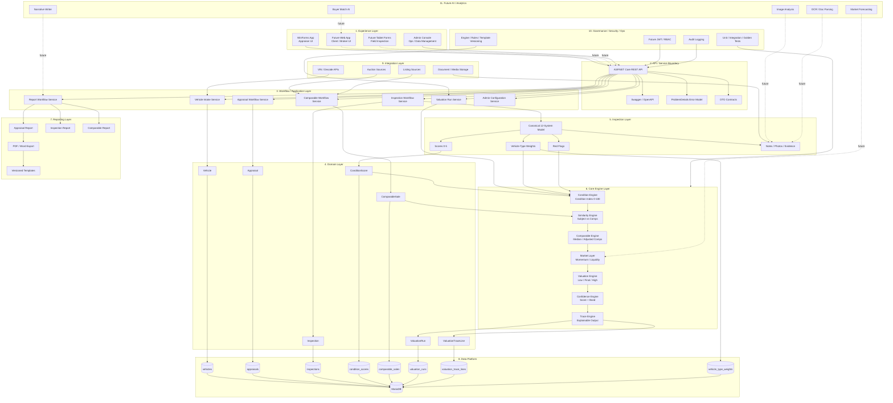

# ONE Classics Nexus
# Platform Architecture

**Document:** Nexus_Platform_Architecture_v1.0  
**Version:** 1.0  
**Status:** Regenerated / Architecture Baseline  
**Prepared By:** Technical Architect, with BA and Tech Lead alignment  
**Target Repository Path:** `/docs/02_Architecture/Solution_Structure/Nexus_Platform_Architecture_v1.0.md`  
**Related Diagram Path:** `/docs/02_Architecture/Architecture_Diagrams/Nexus_Platform_Architecture_v1.0.mmd`  

---

## 1. Purpose

This document defines the comprehensive platform architecture for **ONE Classics Nexus**. It consolidates the locked requirements, design, and implementation guidance into a single system-level architecture view for engineering execution.

The architecture is based on the following locked project principles:

- Inspection-first appraisal workflow
- API-first application access
- Deterministic valuation engine
- Explainable trace output
- Version-controlled engines, rules, reports, and configuration
- MariaDB-backed persistent storage
- WinForms-first user experience with future web expansion

---

## 2. Architecture Scope

This platform architecture covers:

1. Experience Layer
2. API / Service Boundary
3. Workflow / Application Layer
4. Domain Layer
5. Inspection Layer
6. Core Engine Layer
7. Reporting Layer
8. Data Platform
9. Integration Layer
10. Governance, Security, and Operations
11. Future AI / Analytics Expansion

---

## 3. Platform Principles

| Principle | Architecture Decision |
|---|---|
| Inspection-first | Inspection and condition scoring drive valuation and reporting. |
| API-first | WinForms, future web, and external consumers interact through API contracts. |
| Deterministic valuation | Valuation outputs must be reproducible for the same inputs and engine versions. |
| Explainability | Every valuation run must persist trace lines explaining factors, adjustments, and decisions. |
| Source-of-truth schema | Database schema and repositories must remain aligned. |
| Version control | Engine version, ruleset version, report template version, and valuation run versions must be preserved. |
| Testability | Engine math, repository behavior, and API flows must support unit, integration, and golden-run tests. |

---

## 4. High-Level Platform Flow

```text
Client / Appraiser
   ↓
Experience Layer
   ↓
API / Service Boundary
   ↓
Application Workflow Services
   ↓
Domain Model + Rules
   ↓
Inspection + Condition Scores
   ↓
Core Valuation Engine
   ↓
Trace + Valuation Run Persistence
   ↓
Reports + Analytics
```

---

## 5. Logical Platform Architecture



---

## 6. Layer Definitions

### 6.1 Experience Layer

The Experience Layer provides user-facing access to Nexus capabilities.

Current implementation focus:

- **WinForms App** for appraiser workflow, vehicle entry, inspection, comparables, valuation, and reports.
- **Admin functions** for operational management and future configuration control.

Future expansion:

- Web client for customers and brokers.
- Tablet-optimized field inspection interface.
- Brokerage-facing workflows.

### 6.2 API / Service Boundary

The API layer is the only supported access path for UI clients.

Responsibilities:

- Expose RESTful endpoints.
- Publish Swagger/OpenAPI contracts.
- Translate requests into application service calls.
- Return DTOs only; domain entities must not leak through API responses.
- Return standardized `ProblemDetails` error payloads.
- Avoid route conflicts by using unique route patterns.

Primary endpoint groups:

- `/api/vehicles`
- `/api/appraisals`
- `/api/inspections`
- `/api/appraisals/{id}/comparables`
- `/api/appraisals/{id}/valuation/run`
- `/api/appraisals/{id}/valuation/runs`
- `/api/appraisals/{id}/report`

### 6.3 Workflow / Application Layer

The Application Layer coordinates use cases and business workflows.

Core services / handlers:

- Vehicle intake
- Appraisal creation and retrieval
- Inspection creation and score saving
- Comparable capture and retrieval
- Valuation run orchestration
- Report generation orchestration
- Admin configuration governance

Application services own orchestration, validation, and interface contracts, while domain objects own business meaning and invariants.

### 6.4 Domain Layer

The Domain Layer contains the core business concepts.

Primary entities:

- `Vehicle`
- `Appraisal`
- `Inspection`
- `ConditionScore`
- `ComparableSale`
- `ValuationRun`
- `ValuationTraceLine`

Domain rules include:

- Inspection score bounds.
- Required 12-system scoring completeness.
- Vehicle-type weight application.
- Red-flag interpretation.
- Deterministic valuation input requirements.

### 6.5 Inspection Layer

The Inspection Layer is the valuation source of truth.

It captures:

- Canonical 12-system inspection model.
- Score range: `0–5`.
- Vehicle-type-specific weights.
- Red flags.
- Notes, photos, and evidence.

Condition score rules:

```text
system_value = score_0_to_5 × weight
condition_index = Σ(system_value) × 20
```

Architecture rule:

> `condition_scores` is the authoritative section-level score table. Legacy or duplicate scoring tables must not be used as valuation inputs.

### 6.6 Core Engine Layer

The Core Engine Layer executes deterministic valuation logic.

Pipeline:

```text
Condition Engine
→ Similarity Engine
→ Comparable Engine
→ Market Layer
→ Valuation Engine
→ Confidence Engine
→ Trace Engine
```

#### Condition Engine

Inputs:

- 12-system scores
- weights
- red flags

Output:

- normalized condition index from `0–100`

#### Similarity Engine

Inputs:

- subject vehicle
- comparable sales
- weighted attributes

Output:

- similarity score from `0–1`
- ranked comparable set

#### Comparable Engine

Inputs:

- normalized comparable sales
- similarity ranking
- outlier controls

Output:

- comparable price basis
- adjusted comparable set

#### Market Layer

Inputs:

- comparable price movement
- liquidity
- segment behavior

Output:

- market factor
- optional market notes

#### Valuation Engine

Inputs:

- condition index
- comparable price basis
- tier / condition modifiers
- red-flag modifiers
- market factor

Outputs:

- value low
- final value
- value high

#### Confidence Engine

Inputs:

- number of comps
- similarity strength
- inspection completeness
- market depth

Outputs:

- confidence score
- confidence band
- manual review recommendation

#### Trace Engine

Responsibilities:

- Persist every major engine decision.
- Capture factor, amount, message, trace type, and evidence reference.
- Support auditability and deterministic replay.

### 6.7 Reporting Layer

The Reporting Layer converts appraisal, inspection, comparable, valuation, confidence, and trace data into human-readable outputs.

Report outputs:

- Appraisal Report
- Inspection Report
- Comparable Report
- Broker Report / future

Export targets:

- PDF
- Word
- future branded web presentation

Rules:

- Finalized reports should be locked.
- Report templates must be versioned.
- Reports must include valuation explanation and trace summary.

### 6.8 Data Platform

The Data Platform persists all operational and valuation data.

Primary database:

- MariaDB

Primary tables:

| Table | Purpose |
|---|---|
| `vehicles` | Vehicle identity and descriptive attributes |
| `appraisals` | Appraisal lifecycle root |
| `inspections` | Inspection record tied to appraisal |
| `condition_scores` | Authoritative 12-system score table |
| `vehicle_type_weights` | Type-specific system weight configuration |
| `comparable_sales` | Captured and normalized market comparables |
| `valuation_runs` | Immutable valuation results |
| `valuation_trace_lines` | Explainability and audit trace |

Data rules:

- Use GUID / `CHAR(36)` primary keys.
- Keep repository SQL aligned with schema.
- Preserve immutable valuation run history.
- Store engine, ruleset, and rubric versions.

### 6.9 Integration Layer

The Integration Layer supports external data ingestion and outbound data exchange.

Current / planned sources:

- Auction result sources
- Listing marketplaces
- VIN / decode APIs
- Document and media storage

Integration rules:

- External data must be normalized before valuation use.
- Source and evidence references should be retained.
- Manual review should be supported for uncertain or conflicting source data.

### 6.10 Governance, Security, and Operations

Governance responsibilities:

- Admin-only configuration updates.
- Version history preservation.
- Audit logging.
- Deterministic engine governance.
- Test coverage for engine and repository behavior.

Security roadmap:

- JWT authentication.
- Role-based access control.
- Admin-only access to configuration and finalization actions.

Operations targets:

- Save operations under 500ms.
- Valuation execution under 2 seconds.
- Golden run tests for deterministic valuation validation.

### 6.11 Future AI / Analytics Expansion

Future AI modules must remain assistive and must not replace the deterministic valuation engine unless separately governed and versioned.

Potential modules:

- Image analysis for rust, gaps, condition cues.
- OCR / document parsing for titles, receipts, provenance.
- Narrative writer for draft report language.
- Market forecasting.
- Buyer matching.
- Fraud / anomaly detection.

AI governance rule:

> AI may enrich evidence, notes, and workflow productivity, but final valuation logic remains deterministic, traceable, and versioned.

---

## 7. Deployment Architecture

Initial deployment:

```text
WinForms Client
   ↓ HTTPS
ASP.NET Core API
   ↓ Dapper
MariaDB
```

Development environment:

- API: `https://localhost:5001`
- Swagger: `/swagger`
- Database: `one_classics_nexus`
- Test database: `one_classics_nexus_test`

Future deployment expansion:

- Web app client.
- Hosted API.
- Managed database.
- Object storage for photos and documents.
- Background ingestion services for comparables and market analytics.

---

## 8. Architecture Controls

| Risk | Control |
|---|---|
| Schema drift | Lock schema, repository mapping spec, migration scripts |
| API route conflicts | Unique route standards and Swagger validation |
| Non-deterministic valuation | Versioned engine, golden tests, trace lines |
| Incomplete inspection | 12-system validation before valuation |
| Weight imbalance | Enforce total weight = 1.00 per vehicle type |
| Dapper mapping errors | Integration tests and column-by-column repository review |
| Missing explainability | Required valuation trace lines for every valuation run |
| Premature AI dependency | AI kept assistive and outside deterministic valuation path |

---

## 9. Phase Alignment

### Phase 1 — Operational Foundation

- Vehicles
- Appraisals
- Inspections
- Condition scores
- WinForms shell
- Basic API and repository integration

### Phase 2 — Valuation Core

- Comparable sales
- Valuation runs
- Core deterministic engine
- Confidence scoring
- Trace lines
- Golden test validation

### Phase 3 — Platform Expansion

- Reporting lifecycle
- Admin governance
- Brokerage tooling
- Market analytics
- Future web/client portal
- Future AI-assisted modules

---

## 10. Technical Architect Decisions

1. The API is the mandatory boundary between UI and business logic.
2. `condition_scores` is the authoritative inspection score source.
3. Valuation runs must be immutable once persisted.
4. Every valuation must include trace output.
5. Engine, ruleset, rubric, and report template versions must be preserved.
6. WinForms remains the first production UI, with web/tablet as future channels.
7. AI modules are future assistive capabilities, not core valuation authority.
8. Golden run tests are required for valuation engine trust.

---

## 11. Repository Placement

Recommended repo placement:

```text
/docs/02_Architecture/Solution_Structure/Nexus_Platform_Architecture_v1.0.md
/docs/02_Architecture/Architecture_Diagrams/Nexus_Platform_Architecture_v1.0.mmd
```

---

## 12. Final Architecture Summary

ONE Classics Nexus is an inspection-driven, API-centered, deterministic appraisal and valuation platform. The platform is designed to capture structured inspection evidence, normalize condition scoring, compare relevant market data, generate reproducible valuations, persist traceable valuation runs, and produce professional appraisal reports.

The architecture protects the core valuation IP by separating user experience, workflow orchestration, domain rules, deterministic engine execution, persistent storage, reporting, and future AI-assisted modules.

---

END
