# ONE Classics Nexus

## Appraisal and Inspection CRUD Workflow

**Version:** 1.0  
**Scope:** Appraisal and Inspection creation, update, completion, deletion, archival, concurrency, auditing, and downstream dependency controls

```mermaid
flowchart TD
    Start([Appraisal or Inspection action requested])
    Entity{"Which aggregate?"}

    subgraph AppraisalCreate["Appraisal Create"]
        AC1{"Creation source?"}
        AC2[Convert one accepted Appraisal Request]
        AC3[Authorized direct creation exception<br/>with reason and equivalent validation]
        AC4[Validate Client, Vehicle, appraisal type,<br/>effective date, intended use and users, scope,<br/>responsible Appraiser, permissions, and uniqueness]
        AC5{"Create rules pass?"}
        AC6[Create Appraisal with UUID, linked records,<br/>Draft status, sub-statuses, audit fields, and row version 1]
        AC7[Persist conversion-review tasks<br/>or direct-create exception audit]
        AC8[Return validation errors<br/>without partial persistence]
    end

    subgraph AppraisalMaintain["Appraisal Update and Delete"]
        AH{"Appraisal action?"}
        AU1[Load Appraisal and expected row version]
        AU2{"Editable status and authorized fields?"}
        AU3[Apply permitted field and status changes]
        AU4{"Change affects completed inspection,<br/>valuation, or report assumptions?"}
        AU5[Mark dependent outputs stale,<br/>create review tasks, and require rerun or amendment]
        AU6[Increment row version and write audit event]
        AU7[Reject with 403, 409, or 422]
        AD1[Request Appraisal deletion or closure]
        AD2{"Has Inspections, Comparables,<br/>Valuation Runs, Reports, legal hold,<br/>or retained workfile evidence?"}
        AD3[Block physical delete and set<br/>Cancelled, Closed, or Archived as permitted]
        AD4[Authorized soft delete with reason,<br/>actor, UTC timestamp, and audit event]
        AD5{"Administrative purge explicitly allowed<br/>and retention period satisfied?"}
        AD6[Hard-delete unreferenced Draft only<br/>inside one controlled transaction]
        AD7[Retain record and report deletion blocker]
    end

    subgraph InspectionCreate["Inspection Create"]
        IC1[Request new Inspection for Appraisal]
        IC2[Validate active Appraisal, permission,<br/>vehicle type, inspection type, and published template]
        IC3{"Compatible active Inspection already exists<br/>or Appraisal is closed or archived?"}
        IC4[Create Inspection in Draft<br/>with immutable type and template version]
        IC5[Initialize the canonical 12 systems<br/>in fixed order with vehicle-type weights]
        IC6[Validate system numbers 1 through 12,<br/>canonical keys, and total weight of 1.00]
        IC7[Set Appraisal inspection status<br/>to InInspection and write audit event]
        IC8[Reject duplicate, inactive-template,<br/>or lifecycle violation]
    end

    subgraph InspectionMaintain["Inspection Update and Completion"]
        IH{"Inspection action?"}
        IU1[Load Inspection and expected row version]
        IU2{"Status is Draft or InProgress<br/>and actor may edit?"}
        IU3[Update permitted items, notes, media,<br/>scores, red flags, location, and summary]
        IU4[Validate each system score from 0 to 5<br/>and preserve canonical number and key]
        IU5[Recalculate completeness, weighted score,<br/>Condition Index, red-flag summary, and overall score]
        IU6[Increment row version and write audit event]
        IU7[Reject immutable-field, lifecycle,<br/>permission, or concurrency violation]
        CO1[Request Complete Inspection]
        CO2[Validate all required systems and items,<br/>weights, scores, red flags, notes, and completeness]
        CO3{"Completion gate passes?"}
        CO4[Set Complete, persist denormalized summary,<br/>lock ordinary edits, and record completion audit]
        CO5[Set Appraisal inspection status<br/>to Complete or ReadyForValuation]
        CO6[Return rule-specific completion blockers]
        CO7[Authorized reopen or amendment]
        CO8[Record reason and invalidate affected<br/>valuation or report outputs]
    end

    subgraph InspectionDelete["Inspection Delete"]
        ID1[Request Inspection deletion]
        ID2{"Inspection status and dependencies?"}
        ID3[Soft-delete Draft or InProgress Inspection<br/>with reason, actor, timestamp, and row version]
        ID4[Require elevated permission<br/>for completed Inspection]
        ID5{"Linked to finalized Valuation Run,<br/>Report, legal hold, or retained workfile?"}
        ID6[Block deletion and preserve Inspection]
        ID7[Soft-delete completed Inspection,<br/>retain child scores, flags, notes, and media,<br/>then create Appraisal review task]
        ID8[Administrative hard delete only for<br/>unreferenced cleanup explicitly allowed by policy]
    end

    End([Action completed with current state and row version])

    Start --> Entity
    Entity -- Appraisal --> AC1
    Entity -- Inspection --> IH

    AC1 -- Accepted request --> AC2
    AC1 -- Authorized exception --> AC3
    AC2 --> AC4
    AC3 --> AC4
    AC4 --> AC5
    AC5 -- No --> AC8
    AC5 -- Yes --> AC6
    AC6 --> AC7
    AC7 --> AH
    AC8 --> End

    AH -- Update --> AU1
    AH -- Create Inspection --> IC1
    AH -- Delete or close --> AD1
    AU1 --> AU2
    AU2 -- No --> AU7
    AU2 -- Yes --> AU3
    AU3 --> AU4
    AU4 -- Yes --> AU5
    AU4 -- No --> AU6
    AU5 --> AU6
    AU6 --> End
    AU7 --> End

    AD1 --> AD2
    AD2 -- Yes --> AD3
    AD2 -- No --> AD4
    AD3 --> End
    AD4 --> AD5
    AD5 -- No --> AD7
    AD5 -- Yes --> AD6
    AD6 --> End
    AD7 --> End

    IC1 --> IC2
    IC2 --> IC3
    IC3 -- Yes --> IC8
    IC3 -- No --> IC4
    IC4 --> IC5
    IC5 --> IC6
    IC6 --> IC7
    IC7 --> IH
    IC8 --> End

    IH -- Create --> IC1
    IH -- Update --> IU1
    IH -- Complete --> CO1
    IH -- Delete --> ID1
    IH -- Reopen or amend --> CO7
    IU1 --> IU2
    IU2 -- No --> IU7
    IU2 -- Yes --> IU3
    IU3 --> IU4
    IU4 --> IU5
    IU5 --> IU6
    IU6 --> End
    IU7 --> End

    CO1 --> CO2
    CO2 --> CO3
    CO3 -- No --> CO6
    CO3 -- Yes --> CO4
    CO4 --> CO5
    CO5 --> End
    CO6 --> End
    CO7 --> CO8
    CO8 --> IU1

    ID1 --> ID2
    ID2 -- Draft or InProgress,<br/>no finalized dependency --> ID3
    ID2 -- Complete --> ID4
    ID2 -- Cleanup-only candidate --> ID8
    ID3 --> End
    ID4 --> ID5
    ID5 -- Yes --> ID6
    ID5 -- No --> ID7
    ID6 --> End
    ID7 --> End
    ID8 --> End

    classDef terminal fill:#0E2841,color:#ffffff,stroke:#0E2841,stroke-width:2px
    classDef gate fill:#f4efe2,color:#1f2933,stroke:#9a7b35,stroke-width:1px
    classDef mutation fill:#e8f0f6,color:#0E2841,stroke:#0E2841,stroke-width:1px
    classDef destructive fill:#f8e8e8,color:#7f1d1d,stroke:#b91c1c,stroke-width:1px

    class Start,End terminal
    class Entity,AC1,AC5,AH,AU2,AU4,AD2,AD5,IC3,IH,IU2,CO3,ID2,ID5 gate
    class AC6,AC7,AU3,AU5,AU6,IC4,IC5,IC6,IC7,IU3,IU4,IU5,IU6,CO4,CO5,CO7,CO8 mutation
    class AC8,AU7,AD3,AD4,AD6,AD7,IC8,IU7,CO6,ID3,ID4,ID6,ID7,ID8 destructive
```

## Appraisal Action Rules

| Action | Allowed when | Required behavior | Blocked when |
|---|---|---|---|
| Create | Preferred path is conversion of one accepted Appraisal Request. An authorized direct-create exception must satisfy the same problem-identification checks. | Generate UUID, link Client and Vehicle, initialize `status = Draft` and workflow sub-statuses, set `row_version = 1`, and record the actor and UTC timestamp. | Missing required links, duplicate request conversion, unresolved intended-use/user review, insufficient permission, or invalid lifecycle state. |
| Read | Actor has permission to view the Appraisal and related workfile. | Return Appraisal context, status fields, linked records, current row version, and permitted downstream navigation. | Record is unavailable, access is denied, or privacy/tenant rules exclude the actor. |
| Update | Appraisal status permits the requested field or transition and `expectedRowVersion` equals the stored value. | Use explicit field lists, validate transitions, increment `row_version`, and write before/after audit evidence. | Stale row version, immutable linkage, finalized output dependency, invalid transition, or insufficient permission. |
| Delete or close | A business closure, cancellation, archival, or soft-delete is authorized. | Prefer status transition or soft delete. Preserve workfile history, reason, actor, timestamp, and dependent records. | Physical deletion is blocked when Inspections, Comparables, Valuation Runs, Reports, audit evidence, retention obligations, or legal holds exist. |
| Administrative purge | The Appraisal is an unreferenced Draft, policy explicitly permits purge, retention is satisfied, and an administrator approves it. | Purge in one transaction with a durable administrative audit record outside the deleted aggregate. | Any business dependency, converted request link requiring retention, audit/recordkeeping obligation, legal hold, or completed work exists. |

## Inspection Action Rules

| Action | Allowed when | Required behavior | Blocked when |
|---|---|---|---|
| Create | Parent Appraisal is active, actor is authorized, inspection type is valid, and a published template/version applies. | Create Draft Inspection, preserve immutable type/template version, and initialize all 12 canonical systems in fixed order using the Vehicle Type weights. | Parent is closed/archived, template is inactive, incompatible active Inspection exists, vehicle type is unresolved, or weights do not total `1.00`. |
| Read | Actor may view the parent Appraisal. | Return Inspection, sections/items, 12-system scores, red flags, notes, media metadata, completeness, summaries, and current row version. | Parent access is denied or the Inspection is hidden by retention/privacy policy. |
| Update | Status is Draft or InProgress, actor may edit, and row version matches. | Permit item responses, `score_0_to_5`, flags, notes, media URI metadata, location, and summary changes. Recalculate completeness and scores atomically. | Attempt changes immutable type/template/system identity, score is outside `0–5`, system number/key is noncanonical, status is locked, or row version is stale. |
| Complete | All required systems/items are complete, weights total `1.00`, scores are valid, red flags are reviewed, and required notes/evidence exist. | Persist `overall_condition_score`, Condition Index, completeness, red-flag summary, completion actor/time, and update the Appraisal inspection status. | Missing required data, unresolved blockers, invalid weights/scores, or concurrency conflict. |
| Reopen or amend | Qualified actor provides a reason and downstream effects are reviewed. | Preserve completion history, increment version, unlock only permitted fields, and mark affected Valuation Runs or Reports stale/review-required. | Finalized outputs or legal/retention controls prohibit mutation without a formal amendment path. |
| Delete | Draft/InProgress records may be soft-deleted with permission. Completed records require elevated authorization. | Use status-based soft delete by default and retain child scores, red flags, notes, and media metadata. Record reason, actor, timestamp, and row version. | Deletion is blocked when linked to a finalized Valuation Run, Report, legal hold, or retained workfile evidence. |
| Administrative hard delete | Cleanup-only, unreferenced record and explicit policy approval. | Delete children and parent transactionally only when no historical evidence must remain. | Any completed work, finalized dependency, audit requirement, production retention obligation, or legal hold exists. |

## Canonical Inspection Rules

- Every Inspection belongs to exactly one Appraisal.
- `inspection_type` and the selected template version become immutable after creation.
- The 12 canonical systems retain fixed `system_number` values `1–12` and canonical snake-case `system_key` values.
- Each section-level score is stored as `DECIMAL(3,2)` and must remain within `0.00–5.00`.
- Vehicle Type weights must total exactly `1.00` before completion.
- Condition Index is calculated as `SUM(score × weight) × 20`.
- Red flags remain explicit, queryable records and must affect downstream valuation/review behavior according to the active ruleset.
- Media persistence stores URI metadata rather than binary content.
- Completed Inspection deletion is a soft-delete workflow, not ordinary physical deletion.

## Cross-Cutting Controls

1. Every update and delete command includes `expectedRowVersion`; a mismatch returns `409 Conflict` without mutation.
2. Authorization is evaluated before mutation, while business and lifecycle rules are evaluated inside the transaction.
3. Create, update, complete, reopen, delete, close, archive, and purge actions produce auditable actor, UTC timestamp, reason, and before/after evidence.
4. Appraisal status and its intake, inspection, valuation, and report sub-statuses must remain mutually consistent.
5. An Inspection amendment that changes valuation inputs marks later Valuation Runs and Reports stale or review-required rather than silently rewriting immutable outputs.
6. Finalized Valuation Runs and Reports remain immutable; corrections create new versions or runs.
7. API failures use standardized outcomes: `400` malformed request, `403` forbidden, `404` not found, `409` concurrency/uniqueness conflict, and `422` business-rule or lifecycle violation.
