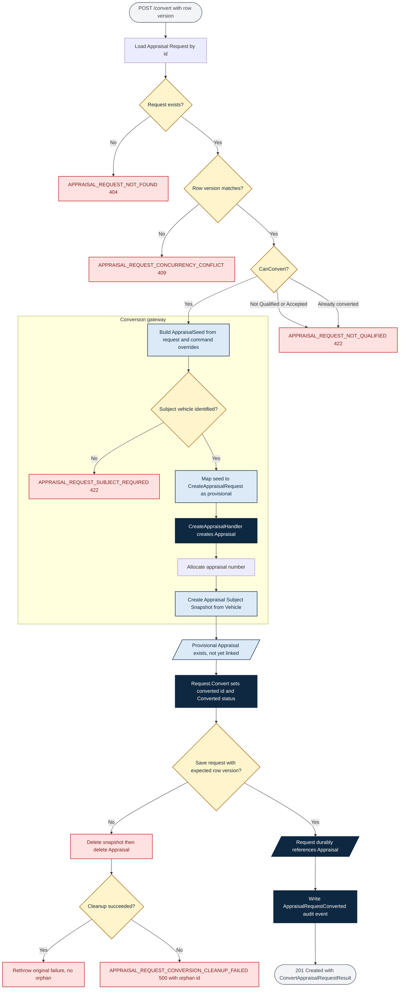
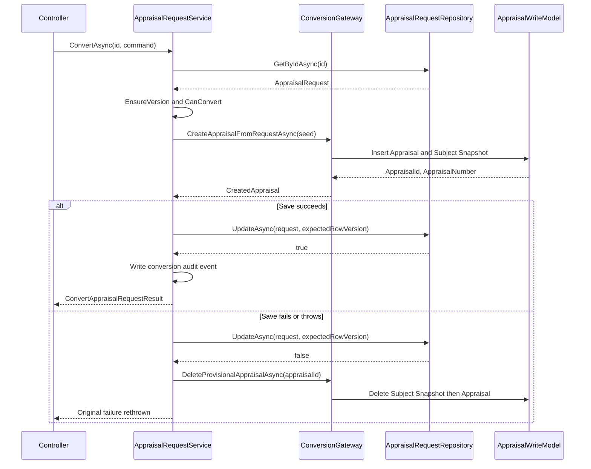

# ONE Classics Nexus

## Appraisal Request to Appraisal Transition Flow

| Document attribute | Value |
|---|---|
| Version | 1.0 |
| Format | Markdown with embedded Mermaid |
| Scope | Conversion boundary only |
| Source aggregate | Appraisal Request |
| Target aggregate | Appraisal |
| Related records | Appraisal Subject Snapshot, Appraisal Request Audit, Vehicle, Client |

## 1. Purpose

This model defines the transition that converts an accepted Appraisal Request into a new Appraisal. It covers the conversion boundary only. Intake, qualification, and disposition are specified in `Appraisal_Request_Workflow_v1.0.md`; post-conversion appraisal production is specified in `Appraisal_Workflow_v1.0.md`.

The governing principle is that conversion **transfers proposed intake facts without approving them**. Every value carried across the boundary arrives in the Appraisal as provisional data that the assigned appraiser must independently establish.

## 2. Participants

| Participant | Responsibility at the boundary |
|---|---|
| `AppraisalRequestsController` | Exposes `POST /api/appraisal-requests/{id}/convert`; translates domain and application faults into `ProblemDetails`. |
| `AppraisalRequestService.ConvertAsync` | Orchestrates the transition, enforces concurrency, and owns compensation on failure. |
| `AppraisalRequest` (domain) | Enforces eligibility and single-conversion invariants via `CanConvert` and `Convert`. |
| `IAppraisalRequestConversionGateway` | Port isolating the request aggregate from the appraisal creation use case. |
| `ExistingAppraisalConversionGateway` | Adapter mapping `AppraisalSeed` onto `CreateAppraisalHandler`; implements rollback. |
| `CreateAppraisalHandler` | Creates the `Appraisal` and its `AppraisalSubjectSnapshot`; allocates the appraisal number. |
| `IAppraisalRequestAuditWriter` | Records the conversion event, including the created appraisal identifier. |

## 3. Transition Flow

## 4. Eligibility Preconditions

Conversion proceeds only when every condition holds:

1. The request exists and the supplied `RowVersion` matches the stored version.
2. `RequestStatus` is `Qualified` or `Accepted`.
3. `ConvertedAppraisalId` is empty, so no prior conversion occurred.
4. A subject vehicle is resolvable from `VehicleIdOverride` or the request's `VehicleId`.

Conditions 2 and 3 are expressed jointly by the domain property `CanConvert` and re-asserted inside `AppraisalRequest.Convert`, so the invariant holds even if a caller bypasses the service.

## 5. Field Transfer Model

`AppraisalSeed` carries intake facts across the boundary. Command overrides take precedence over stored request values, allowing the converting reviewer to correct proposals without amending the frozen request.

| Seed field | Source | Arrives in Appraisal as |
|---|---|---|
| `AppraisalRequestId` | Request identity | `AppraisalRequestId` provenance link |
| `ClientId` | Request client | `ClientId`, provisional |
| `VehicleId` | `VehicleIdOverride` else request `VehicleId` | `VehicleId` plus subject snapshot |
| `AssignedAppraiserId` | Command only | `AssignedAppraiserId`, provisional |
| `ProposedAppraisalType` | `ProposedAppraisalType` else `RequestedAppraisalType` | `AppraisalType`, provisional |
| `ProposedEffectiveDate` | Command else unset | `EffectiveDateUtc`, provisional |
| `ProposedIntendedUse` | Command | Carried for review; not an approved appraisal fact |
| `ProposedValueType` | Command | Carried for review; not an approved appraisal fact |
| `ProposedInspectionScope` | Command | Carried for review; not an approved appraisal fact |
| `IntakeHistory` | `ClientComments` | Workfile context |
| `InternalWorkfileContext` | `InternalNotes` | Workfile context |

### 5.1 Provisional Status Assignment

The created Appraisal is deliberately opened at the earliest lifecycle position. Conversion never signals readiness:

| Appraisal field | Value on conversion | Rationale |
|---|---|---|
| `Status` | `Draft` | Appraisal work has not begun. |
| `IntakeStatus` | `Open` | Intake facts await appraiser confirmation. |
| `InspectionStatus` | `Not Started` | No inspection is authorized by conversion. |
| `ValuationStatus` | `Not Started` | No value definition is approved by conversion. |
| `ReportStatus` | `Not Started` | No reporting obligation is established. |

## 6. Consistency and Compensation

The Appraisal Request and the Appraisal are persisted through separate connection factories, so the two writes cannot share a database transaction. The transition therefore uses an ordered write with compensating cleanup rather than distributed atomicity.

The participant-level view of this sequence, including both failure branches, is maintained as `docs/03_Design/Sequence_Diagrams/Appraisal_Request_To_Appraisal_Transition_Sequence_Diagram_v1.0.mmd`.

### 6.1 Compensation Rules

1. The compensation boundary covers `Convert` and the request save only. It begins after the gateway returns and ends when the request is durably saved.
2. Cleanup deletes the Appraisal Subject Snapshot before the Appraisal so the parent delete is not blocked by its child row.
3. Cleanup executes with a non-cancellable token. If the triggering failure was a cancellation, honoring that token would abandon the orphan it exists to remove.
4. The original failure is rethrown after successful cleanup, preserving its code and HTTP status for the caller.
5. If cleanup itself fails, `APPRAISAL_REQUEST_CONVERSION_CLEANUP_FAILED` is raised with the orphaned appraisal identifier and both underlying exceptions retained for manual reconciliation.
6. Audit writing is intentionally outside the compensation boundary. Once the request references the Appraisal, deleting that Appraisal would produce a dangling reference, which is a worse outcome than a missing audit row.

### 6.2 Residual Risk

Compensation is best-effort, not atomic. A process failure between the appraisal insert and the request save leaves an orphan that no in-process handler can remove. Such an orphan is identifiable as a `Draft` appraisal whose `AppraisalRequestId` references a request that is not in `Converted` status. A reconciliation sweep over that predicate closes the gap; consolidating the two connection factories to permit a single transaction would eliminate it.

## 7. Post-Transition State

| Record | Resulting state |
|---|---|
| Appraisal Request | `RequestStatus` = `Converted`; `ConvertedAppraisalId` and `ConvertedAtUtc` set; `RowVersion` incremented. |
| Appraisal | New `Draft` record carrying provisional intake facts and a back-reference to the request. |
| Appraisal Subject Snapshot | Created from current Vehicle master data for the new Appraisal. |
| Audit trail | `AppraisalRequestConverted` row with prior status, new status, actor, timestamp, and appraisal identifier. |

The converted request becomes immutable to ordinary edits. `EnsureMutable` rejects intake changes and `EnsureNonTerminal` rejects assignment changes, preserving the request as workfile history of what was submitted and accepted.

## 8. Fault Outcomes

| Code | Status | Trigger |
|---|---|---|
| `APPRAISAL_REQUEST_NOT_FOUND` | 404 | No request matches the supplied identifier. |
| `APPRAISAL_REQUEST_CONCURRENCY_CONFLICT` | 409 | Supplied row version is stale at guard time or at save time. |
| `APPRAISAL_REQUEST_NOT_QUALIFIED` | 422 | Status is not `Qualified` or `Accepted`. |
| `APPRAISAL_REQUEST_ALREADY_CONVERTED` | 422 | A conversion already produced an Appraisal for this request. |
| `APPRAISAL_REQUEST_SUBJECT_REQUIRED` | 422 | No subject vehicle is identified on the request or command. |
| `APPRAISAL_REQUEST_CONVERSION_FAILED` | 422 | Conversion yielded an empty appraisal identifier. |
| `APPRAISAL_REQUEST_CONVERSION_CLEANUP_FAILED` | 500 | Conversion failed and the provisional Appraisal could not be removed. |

## 9. Transition Invariants

1. One Appraisal Request converts to at most one Appraisal.
2. Conversion requires a current row version at both the eligibility guard and the save.
3. A subject vehicle must be identified before an Appraisal can be created.
4. Every field transferred by conversion arrives as provisional data requiring independent establishment in the Appraisal.
5. Conversion never sets inspection, valuation, reporting, or assignment readiness to an approved state.
6. A failed request save must not leave a reachable Appraisal, or must surface the orphan identifier explicitly.
7. A durably linked Appraisal is never deleted by a downstream failure.
8. The converted request is preserved as immutable history and is never hard-deleted.
