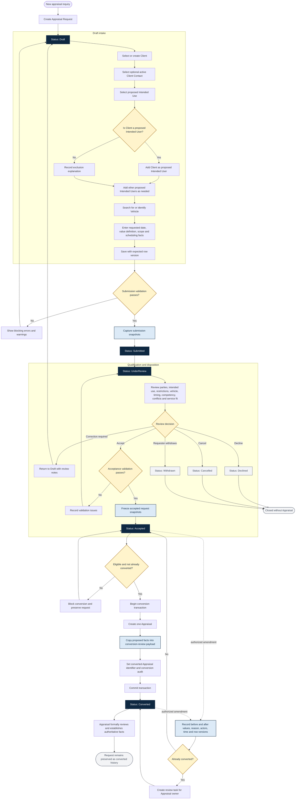

# ONE Classics Nexus

## Appraisal Request Workflow

| Document attribute | Value |
|---|---|
| Version | 1.0 |
| Format | Markdown with embedded Mermaid |
| Primary aggregate | Appraisal Request |
| Related records | Client, Client Contact, Intended Use, Intended Users, Vehicle, Appraisal |

## 1. Purpose

This workflow defines how ONE Classics Nexus creates, validates, reviews, accepts, converts, amends, and closes an Appraisal Request. The Appraisal Request is a pre-appraisal intake aggregate. Its client, intended-use, intended-user, vehicle, value-definition, effective-date, and scope information remains proposed intake data until it is reviewed and established as authoritative data within an Appraisal.

## 2. End-to-End Workflow

## 3. Status and Action Matrix

| Status | Create | Update | Delete or disposition | Permitted transition |
|---|---|---|---|---|
| `Draft` | Create the request and add intake records. | Intake staff may edit incomplete proposed facts using optimistic concurrency. | Do not normally hard-delete. A requester may withdraw; staff may cancel. An authorized purge is limited to an unreferenced Draft when retention policy permits. | `Submitted`, `Cancelled`, or `Withdrawn` |
| `Submitted` | No second request is created for the same submission. | Staff may add review notes; corrections return the request to `Draft`. | No hard delete. Cancel or withdraw with reason and actor. | `UnderReview`, `Draft`, `Cancelled`, or `Withdrawn` |
| `UnderReview` | Not applicable. | Review metadata and disposition facts may be updated. Material intake corrections return to `Draft`. | No hard delete. Record decline, cancellation, or withdrawal. | `Accepted`, `Draft`, `Declined`, `Cancelled`, or `Withdrawn` |
| `Accepted` | Not applicable. | Accepted snapshots are immutable. Changes require an authorized, audited amendment. | No hard delete. Cancellation requires an authorized disposition and retained audit history. | `Converted` or authorized disposition |
| `Converted` | Conversion creates exactly one Appraisal. | Ordinary edits are prohibited. An amendment creates an Appraisal-owner review task and does not rewrite the Appraisal. | No hard delete. Preserve the request as workfile history. | Terminal request state; Appraisal work continues separately. |
| `Declined` | Not applicable. | Disposition metadata only under authorized correction. | Terminal record retained with reason, actor, and timestamp. | None |
| `Cancelled` | Not applicable. | Disposition metadata only under authorized correction. | Terminal record retained with reason, actor, and timestamp. | None |
| `Withdrawn` | Not applicable. | Disposition metadata only under authorized correction. | Terminal record retained with requester, reason, and timestamp. | None |

## 4. Create Rules

1. Create the Appraisal Request in `Draft` with a stable UUID, request number, audit fields, and initial `row_version`.
2. A Draft may be incomplete, but submission requires exactly one active Client.
3. The selected Client Contact is optional. If present, it must be active and belong to the selected Client.
4. The user must explicitly state whether the Client is a proposed Intended User.
5. If the Client is an Intended User, create or update the single intended-user row marked `is_client = true`.
6. If the Client is not an Intended User, require at least one other proposed Intended User and record an explanation.
7. Each proposed Intended User requires a type, display or organization name, and relationship to the Client or request.
8. Select one proposed Intended Use before acceptance or conversion. A definition that requires a custom narrative must include that narrative.
9. Search for an existing Vehicle before creating a new Vehicle. Preliminary request facts must not silently overwrite reusable Vehicle master data.
10. Requested effective date, value definition, scope, and service details are proposals and are not authoritative Appraisal facts.

## 5. Update Rules

- Every update must supply the expected `row_version`. A version mismatch returns `CONCURRENCY-001` and writes nothing.
- Changing the Client in Draft clears an incompatible selected contact and revalidates intended-user source links and intake documents.
- Updating Client or Client Contact master data does not rewrite existing request snapshots.
- Removing the final active proposed Intended User is blocked after the request leaves Draft.
- Changing proposed intended use requires revalidation of effective date, value definition, proposed users, restrictions, scope, and service fit.
- Inactive contacts or reference values remain visible historically but cannot be selected for new intake.
- Accepted or converted snapshot fields cannot be updated through ordinary edit commands.
- A post-acceptance amendment records before and after values, reason, requester, approver, timestamp, status transition, and old and new row versions.
- If the request is already converted, an amendment must create a review task for the Appraisal owner and must not modify authoritative Appraisal data automatically.

## 6. Delete and Closure Rules

- Use lifecycle disposition instead of hard deletion for a submitted or reviewed request.
- `Declined`, `Cancelled`, and `Withdrawn` require a reason, actor or requester, and timestamp.
- A request linked to an Appraisal, audit event, snapshot, legal hold, or retained workfile record must never be hard-deleted.
- Client and Client Contact records referenced by a request are archived or deactivated rather than deleted.
- Proposed Intended User rows are deactivated or historically retained after Draft when removal would affect the record of what was submitted or accepted.
- A privacy deletion request is evaluated against retention and legal obligations. Any approved anonymization remains auditable and must preserve request integrity.

## 7. Validation Gates

### 7.1 Submission Gate

Submission is permitted only when:

- the request has one active Client;
- an optional selected contact is active and belongs to that Client;
- the request has enough identifying and service information for staff review;
- all saved records pass field and entity validation; and
- the supplied row version is current.

Submission captures the Client and selected-contact snapshots used to preserve what was submitted.

### 7.2 Acceptance Gate

Acceptance is permitted only when:

- the Client and selected contact remain valid;
- exactly one proposed Intended Use is selected;
- any required custom-use narrative is complete;
- at least one active proposed Intended User exists;
- no more than one intended-user row represents the Client;
- each proposed user has a type, name, relationship, and reviewed restrictions;
- vehicle identification is sufficient for the requested service;
- competency, conflict, timing, and service-fit reviews are complete; and
- the accepting reviewer, timestamp, and current row version are recorded.

Acceptance freezes the request-level Client, contact, Intended Use, and Intended User snapshots.

### 7.3 Conversion Gate

Conversion is permitted only when:

- the request is `Accepted`;
- the acceptance invariants still pass;
- `converted_appraisal_id` is empty;
- no other Appraisal already references the request;
- the actor is authorized to convert the request; and
- the conversion can create the Appraisal, review payload, link, audit event, and status change in one transaction.

The new Appraisal receives proposed conversion data for review. It must independently establish authoritative client, intended-use, intended-user, vehicle/subject, property-interest, value-definition, effective-date, responsible-appraiser, and scope-of-work facts.

## 8. Stable Validation Outcomes

| Code | Severity | Workflow meaning |
|---|---|---|
| `CIU-001` | Error | Client is required. |
| `CIU-002` | Error | Selected contact does not belong to the request Client or is inactive. |
| `CIU-004` | Error | Proposed Intended Use is required before acceptance or conversion. |
| `CIU-005` | Error | At least one proposed Intended User is required before acceptance or conversion. |
| `CIU-006` | Error | Only one proposed Intended User may represent the Client. |
| `CIU-007` | Error | A custom proposed-use narrative is required. |
| `CIU-008` | Error | Intended-user name or organization and type are required. |
| `CIU-009` | Error | Relationship to the Client is required. |
| `CIU-010` | Error | A selected contact or reference item is inactive or not effective. |
| `CIU-011` | Error | A use restriction conflicts with the request or proposed user. |
| `CIU-012` | Error | The request is already converted or conversion would create a second Appraisal. |
| `CIU-013` | Warning | A proposed Intended User may be a duplicate. |
| `CIU-014` | Warning | The Client is not identified as a proposed Intended User and requires review. |
| `CONCURRENCY-001` | Error | Another user changed the record; refresh before retrying. |

## 9. Transaction and Audit Requirements

The following operations must be atomic:

- setting or changing the request Client;
- selecting the primary Client Contact;
- adding the Client as a proposed Intended User;
- accepting the request and freezing snapshots;
- converting the request into one Appraisal; and
- applying an authorized post-acceptance amendment.

The audit trail records the request identifier, event, actor, timestamp, reason where required, prior and resulting status, affected identifiers, before and after values for material changes, and row-version transition. Conversion additionally records the created Appraisal identifier and the transaction outcome.

## 10. Core Invariants

1. One Appraisal Request references exactly one active Client before submission.
2. A selected Client Contact belongs to that Client and is active.
3. One request carries one proposed Intended Use before acceptance or conversion.
4. One request has at least one active proposed Intended User before acceptance or conversion.
5. At most one proposed Intended User per request is marked as the Client.
6. Accepted and converted snapshots are immutable outside the amendment workflow.
7. One request converts to no more than one Appraisal.
8. Conversion data remains proposed until the Appraisal formally reviews and establishes it.
9. Vehicle intake facts cannot silently overwrite reusable Vehicle master data.
10. Every mutation uses optimistic concurrency and produces an auditable outcome.
