# ONE Classics Nexus

## New Appraisal Workflow

**Version:** 1.0  
**Scope:** Vehicle, Appraisal Request, Client / Intended User, and Appraisal  
**Purpose:** Define the controlled path from a new appraisal need through accepted intake, one-to-one conversion, and assignment-ready Appraisal setup.

```mermaid
flowchart TD
    Start([New appraisal need identified])

    subgraph ClientPhase["1. Client and Intended Users"]
        C1{"Does the client already exist?"}
        C2[Select active Client record]
        C3[Create Client master record]
        C4[Select or create active Client Contact]
        C5{"Is the client a proposed intended user?"}
        C6[Add client as a proposed intended-user snapshot]
        C7[Record that client is not an intended user<br/>and document the explanation]
        C8[Add all additional proposed intended users<br/>with type, relationship, and restrictions]
    end

    subgraph RequestPhase["2. Appraisal Request Intake"]
        R1[Create Appraisal Request in Draft]
        R2[Link Client and selected Client Contact]
        R3[Capture proposed intended use, requested value definition,<br/>effective date, service type, preliminary scope, and subject identifiers]
        R4[Preserve request-owned Client, Contact,<br/>Intended Use, and Intended User snapshots]
    end

    subgraph VehiclePhase["3. Vehicle Identification"]
        V1[Search Vehicle master by VIN, chassis number,<br/>body number, engine number, and descriptive identity]
        V2{"Reliable Vehicle match found?"}
        V3[Link existing Vehicle master record]
        V4[Create new Vehicle master record<br/>after duplicate and identity review]
        V5[Review preliminary request vehicle facts<br/>and capture appraisal-safe subject snapshot]
    end

    subgraph QualificationPhase["4. Request Validation and Qualification"]
        Q1[Validate Client, Contact, proposed Intended Use,<br/>Intended Users, Vehicle identity, restrictions, and row versions]
        Q2{"Blocking issue remains?"}
        Q3[Set NeedsInformation<br/>and return specific validation requirements]
        Q4[Submit Appraisal Request]
        Q5[Set UnderReview and perform conflict,<br/>competency, timing, and service-fit review]
        Q6{"Accept, decline, cancel, or withdraw?"}
        Q7[Set Qualified]
        Q8[Accept request and freeze accepted snapshots]
        Q9([Close without creating an Appraisal])
    end

    subgraph ConversionPhase["5. Controlled Conversion"]
        X1[Begin conversion transaction]
        X2{"Already converted or conversion gate fails?"}
        X3[Block duplicate conversion<br/>or return unresolved validation]
        X4[Create one Appraisal linked to<br/>Appraisal Request, Vehicle, and Client]
        X5[Create review-required conversion payload<br/>from frozen request snapshots]
        X6[Set request status to Converted,<br/>record converted Appraisal ID, and write audit event]
        X7[Commit transaction<br/>and make converted request read-only]
    end

    subgraph AppraisalPhase["6. Authoritative Appraisal Setup"]
        A1[Appraiser reviews converted intake facts]
        A2[Formally establish authoritative Client,<br/>Intended Use, Intended Users, and use restrictions]
        A3[Formally establish Vehicle and property interest,<br/>value definition, effective date, assumptions, and scope]
        A4[Assign responsible Appraiser and Reviewer]
        A5{"Assignment-ready gate passes?"}
        A6[Place Appraisal on hold or request clarification<br/>without rewriting frozen request history]
        A7[Set Appraisal to active Draft<br/>with Intake complete]
        A8([Proceed to Inspection, Comparables,<br/>Valuation, Review, and Report])
    end

    Start --> C1
    C1 -- Yes --> C2
    C1 -- No --> C3
    C2 --> C4
    C3 --> C4
    C4 --> R1
    R1 --> R2
    R2 --> C5
    C5 -- Yes --> C6
    C5 -- No --> C7
    C6 --> C8
    C7 --> C8
    C8 --> R3
    R3 --> V1
    V1 --> V2
    V2 -- Yes --> V3
    V2 -- No --> V4
    V3 --> V5
    V4 --> V5
    V5 --> R4
    R4 --> Q1
    Q1 --> Q2
    Q2 -- Yes --> Q3
    Q3 --> R2
    Q2 -- No --> Q4
    Q4 --> Q5
    Q5 --> Q6
    Q6 -- Accept --> Q7
    Q6 -- Decline, cancel, or withdraw --> Q9
    Q7 --> Q8
    Q8 --> X1
    X1 --> X2
    X2 -- Yes --> X3
    X3 --> Q1
    X2 -- No --> X4
    X4 --> X5
    X5 --> X6
    X6 --> X7
    X7 --> A1
    A1 --> A2
    A2 --> A3
    A3 --> A4
    A4 --> A5
    A5 -- No --> A6
    A6 --> A1
    A5 -- Yes --> A7
    A7 --> A8

    classDef terminal fill:#0E2841,color:#ffffff,stroke:#0E2841,stroke-width:2px
    classDef gate fill:#f4efe2,color:#1f2933,stroke:#9a7b35,stroke-width:1px
    classDef frozen fill:#e8f0f6,color:#0E2841,stroke:#0E2841,stroke-width:1px
    classDef exception fill:#f8e8e8,color:#7f1d1d,stroke:#b91c1c,stroke-width:1px

    class Start,A8 terminal
    class C1,C5,V2,Q2,Q6,X2,A5 gate
    class R4,Q8,X5,X6,X7 frozen
    class Q3,Q9,X3,A6 exception
```

## Workflow Rules

1. **Client and Client Contact are reusable master data.** The Appraisal Request links them and preserves request-owned snapshots for historical truth.
2. **Client and intended user are distinct roles.** Client status never automatically grants intended-user status; the choice must be explicit.
3. **Appraisal Request is the pre-appraisal aggregate.** Requested intended use, intended users, value definition, effective date, scope, and subject facts remain proposed intake data.
4. **Vehicle is reusable master data.** Intake identifiers must be checked for an existing Vehicle before a new master record is created.
5. **Accepted request snapshots are frozen.** Later changes require an authorized, audited amendment and never silently rewrite historical intake.
6. **Conversion is explicit, transactional, and one-to-one.** One Appraisal Request creates at most one Appraisal.
7. **Conversion does not establish authoritative appraisal facts automatically.** It creates a review-required payload for the Appraiser.
8. **The Appraisal is the governing workflow aggregate after conversion.** Assignment readiness requires formal review of the Client, Intended Use, Intended Users, Vehicle, property interest, value definition, effective date, responsible Appraiser, assumptions, and scope.
9. **A converted request is read-only.** A later request amendment creates an Appraisal review task rather than rewriting the linked Appraisal.
10. **Optimistic concurrency and audit history apply throughout.** Every mutable aggregate update must use the expected `row_version` and record the acting user and UTC timestamp.

## Primary Record Outcomes

| Stage | Authoritative record | Result |
|---|---|---|
| Client setup | `clients`, `client_contacts` | Reusable party and contact masters |
| Intake | `appraisal_requests` | Draft or submitted pre-appraisal request |
| Intended-user capture | `appraisal_request_intended_users` | Request-owned proposed-user snapshots |
| Subject identification | `vehicles` plus request/appraisal snapshot | Reusable Vehicle linked without losing point-in-time facts |
| Acceptance | `appraisal_requests` | Frozen accepted snapshots and acceptance audit |
| Conversion | `appraisals` plus conversion-review payload | One linked Appraisal and read-only converted request |
| Assignment readiness | Appraisal problem-identification records | Formally reviewed authoritative appraisal facts |
