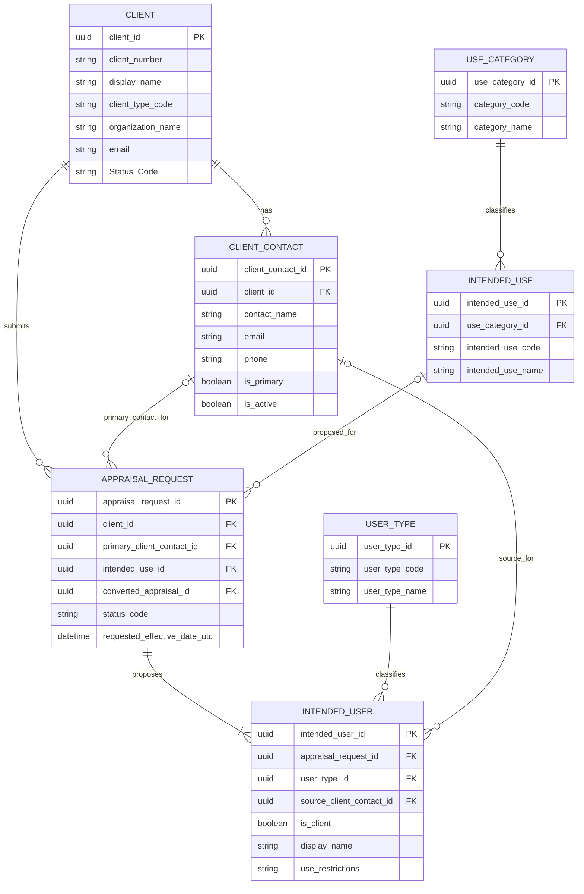

# ONE Classics Nexus

## Client / Intended User Detailed Design Specification

*Appraisal-Request-Centric / USPAP-Aligned Data and Service Design*

| **Document attribute** | **Value**                                                  |
|------------------------|------------------------------------------------------------|
| System                 | ONE_Classics_Nexus                                         |
| Version                | 2.0                                                        |
| Status                 | Locked Implementation Baseline                             |
| Target platform        | .NET 8 / ASP.NET Core / WinForms / MariaDB                 |
| Architecture           | Layered / Clean Architecture                               |
| Primary aggregates     | Client; Appraisal Request                                  |
| Source model           | Client / Intended User Logical Entity Relationship Diagram |
| Prepared date          | September 15, 2026                                         |
| Schema baseline        | clients v2.0 (`docs/04_Data/SQL/Clients/Clients_v2.0.sql`) |

> **Design intent:** Capture the engaging client, the selected client contact, the proposed intended use, and every proposed intended user as explicit, reviewable Appraisal Request facts. On conversion, formally review them before establishing authoritative Appraisal facts.

# Document Control

## Revision History

| **Version** | **Date**   | **Status**  | **Summary**                                                                                                                                                            |
|-------------|------------|-------------|------------------------------------------------------------------------------------------------------------------------------------------------------------------------|
| 1.1         | 2026-09-15 | Recommended | Establishes APPRAISAL_REQUEST as the logical root and adds CLIENT_CONTACT as a first-class entity across the domain, persistence, API, UI, migration, and test design. |

## Approval Roles

| **Role**                          | **Responsibility**                                                              |
|-----------------------------------|---------------------------------------------------------------------------------|
| Product Owner                     | Approves business scope, terminology, and workflow behavior.                    |
| Lead Appraiser / Compliance Owner | Approves appraisal-practice rules, required disclosures, and completion gates.  |
| Solution Architect                | Approves aggregate boundaries, integration contracts, and nonfunctional design. |
| Database Owner                    | Approves schema, migrations, constraints, indexing, retention, and recovery.    |
| QA Owner                          | Approves traceability and acceptance-test coverage.                             |

## Normative Language

“Shall” identifies a required behavior for conformance with this DDS. “Should” identifies a recommended behavior that may be varied only through an explicit design decision. “May” identifies an optional capability.

# Contents

- 1\. Purpose and Scope
- 2\. Source Model and Design Decisions
- 3\. Domain Model
- 4\. Entity and Field Specifications
- 5\. Relationships and Integrity Rules
- 6\. Lifecycle and Business Rules
- 7\. Application Services and Use Cases
- 8\. API Design
- 9\. Persistence Design
- 10\. WinForms UX Requirements
- 11\. Security, Privacy, Audit, and Retention
- 12\. Validation and Error Model
- 13\. Testing and Traceability
- 14\. Deployment and Migration
- 15\. Observability and Operations
- 16\. Acceptance Criteria
- Appendix A. Recommended MariaDB DDL
- Appendix B. C# Contract Skeletons
- Appendix C. Reference Data
- Appendix D. Decision Log

# 1. Purpose and Scope

This DDS defines the recommended production design for identifying and managing the client, client contacts, proposed intended use, and proposed intended users of an Appraisal Request. APPRAISAL_REQUEST is the logical root for this design. The request remains a pre-appraisal intake aggregate: its party and use information becomes proposed conversion data and is not authoritative USPAP problem identification until reviewed and established within the resulting Appraisal.

## 1.1 Objectives

- Identify exactly one engaging client for each appraisal request.
- Support one or more reusable contacts for each client and identify the request’s primary client contact.
- Capture one proposed intended use before the request may be accepted or converted.
- Capture one or more proposed intended users, including the client when the client is proposed as an intended user.
- Distinguish appraisal request participants from Nexus authentication and authorization users.
- Preserve point-in-time appraisal request facts even if a client or contact record later changes.
- Make request-qualification and conversion decisions traceable to proposed intended use and intended-user needs.
- Prevent completion when required identification, review, and consistency checks are unresolved.
- Provide clean Domain, Application, Infrastructure, API, WinForms, and testing boundaries.

## 1.2 In Scope

| **Area**                      | **Included design**                                                                                                                                                                      |
|-------------------------------|------------------------------------------------------------------------------------------------------------------------------------------------------------------------------------------|
| Client                        | Party identity, client type, organization identity, status, concurrency, and audit fields.                                                                                               |
| Client Contact                | Reusable client-owned contacts, roles, communication fields, primary designation, active state, concurrency, and audit fields.                                                           |
| Appraisal Request integration | Required client, selected primary contact, proposed intended use, requested effective date, requested value definition, preliminary scope, status, conversion link, and review metadata. |
| Intended use                  | Controlled definitions, category classification, request-level proposal, custom narrative, and conversion review.                                                                        |
| Intended users                | Request-specific proposed-user snapshots, type classification, client/contact source links, relationship, restrictions, acknowledgement, and conversion review.                          |
| Services                      | Commands, queries, validation, lifecycle gates, API contracts, persistence, and user-interface behavior.                                                                                 |
| Quality                       | Security, privacy, audit, retention, observability, migrations, tests, and acceptance criteria.                                                                                          |

## 1.3 Out of Scope

- The formal Appraisal aggregate, authoritative USPAP problem identification, value-definition catalog, scope-of-work engine, valuation engine, report-generation design, or records-retention policy.
- Legal advice or a substitute for professional appraisal-practice review. The compliance owner shall validate configured terminology and workflow gates against the governing edition of USPAP and applicable jurisdictional requirements.
- Authentication users, employee accounts, roles, and permissions, except where actor identifiers are recorded for audit purposes.
- Client billing, engagement letters, fees, payments, and receivables.

## 1.4 Terms

| **Term**               | **Meaning in this DDS**                                                                                                                                                         |
|------------------------|---------------------------------------------------------------------------------------------------------------------------------------------------------------------------------|
| Client                 | The party that submits or authorizes the appraisal request and may later engage the appraiser if the request is accepted.                                                       |
| Client Contact         | A reusable person associated with a client and eligible to serve as the request’s primary operational contact.                                                                  |
| Proposed intended user | A person or organization recorded during intake as a candidate intended user. It is not an application login and does not become authoritative until reviewed in the Appraisal. |
| Proposed intended use  | The requested or anticipated use captured during intake and subject to formal appraisal review.                                                                                 |
| Appraisal Request      | The pre-appraisal intake aggregate mapped to appraisal_requests. It may be accepted, declined, cancelled, withdrawn, or converted into one formal Appraisal.                    |
| Appraisal              | The formal appraisal workflow that receives reviewed conversion data and establishes authoritative problem-identification facts.                                                |
| Snapshot               | A point-in-time copy of identity and contact facts retained with the appraisal request.                                                                                         |
| Reference data         | Administratively managed codes and descriptions used consistently across appraisal requests.                                                                                    |

# 2. Source Model and Design Decisions

## 2.1 Logical ERD



*Figure 1. Revised logical model using APPRAISAL_REQUEST and first-class CLIENT_CONTACT.*

## 2.2 Logical Relationships Adopted

| **Relationship**                         | **Cardinality**                               | **DDS interpretation**                                                                                           |
|------------------------------------------|-----------------------------------------------|------------------------------------------------------------------------------------------------------------------|
| Client submits Appraisal Request         | Client 1 : Appraisal Request 0..\*            | Every appraisal request has one client; a client may have no appraisal requests or many.                         |
| Client has Client Contact                | Client 1 : Client Contact 0..\*               | A client may have multiple reusable contacts; every contact belongs to exactly one client.                       |
| Appraisal Request selects Client Contact | Appraisal Request 0..\* : Client Contact 0..1 | A request may select one primary contact, and that contact must belong to the selected client.                   |
| Appraisal Request proposes Intended Use  | Appraisal Request \* : Intended Use 1         | Every accepted or converted request identifies one proposed intended-use definition; a definition may be reused. |
| Intended Use classified by Use Category  | Intended Use \* : Use Category 1              | Every intended-use definition belongs to one category.                                                           |
| Appraisal Request has Intended User      | Appraisal Request 1 : Intended User 1..\*     | At least one intended user is required by the Ready-for-Review gate.                                             |
| Intended User has User Type              | Intended User \* : User Type 1                | Each appraisal request-specific intended-user row has one classification.                                        |

## 2.3 Recommended Physical-Model Refinements

| **ID** | **Decision**                                   | **Rationale / implementation**                                                                                                                                          |
|--------|------------------------------------------------|-------------------------------------------------------------------------------------------------------------------------------------------------------------------------|
| D-01   | APPRAISAL_REQUEST is the logical root          | Use the existing AppraisalRequest aggregate and appraisal_requests table. Do not map request fields directly to the formal Appraisal aggregate.                         |
| D-02   | CLIENT_CONTACT is first-class                  | A client owns zero or more reusable contacts. AppraisalRequest selects at most one primary client contact and snapshots it for intake history.                          |
| D-03   | Proposed intended users are snapshots          | Store request-specific identity, organization, contact-source, and restriction fields so later master/contact edits cannot rewrite accepted or converted request facts. |
| D-04   | Client status as intended user is explicit     | The system shall create or require a proposed intended-user row marked is_client = true. Client status alone shall never imply intended-user status.                    |
| D-05   | Reference definitions are controlled           | Use categories, intended-use definitions, and intended-user types as effective-dated reference data; prevent destructive edits after use.                               |
| D-06   | No security-user reuse                         | Do not overload users, roles, or user_roles. “Intended user” is an appraisal-practice concept, not an authenticated principal.                                          |
| D-07   | Conversion requires formal review              | Request-level intended use and intended users are proposals. Conversion copies them for explicit review; it does not silently establish Appraisal facts.                |
| D-08   | Optimistic concurrency is numeric              | Use BIGINT UNSIGNED row_version incremented atomically. MariaDB does not provide SQL Server rowversion semantics.                                                       |
| D-09   | Accepted and converted snapshots are immutable | Corrections require an authorized request amendment with audit history; converted Appraisal records follow their own controls.                                          |

# 3. Domain Model

## 3.1 Aggregate Boundaries

| **Aggregate**     | **Owns**                                                                                                                                                                 | **Does not own**                                                                                                |
|-------------------|--------------------------------------------------------------------------------------------------------------------------------------------------------------------------|-----------------------------------------------------------------------------------------------------------------|
| Client            | Client identity, client type, zero-or-more Client Contacts, status, concurrency, audit metadata.                                                                         | Request snapshots, proposed intended use/users, appraisal conclusions.                                          |
| Appraisal Request | Client and primary-contact references/snapshots, proposed intended use/users, requested effective date/value definition, preliminary scope, status, and conversion link. | Client/contact master lifecycle, formal Appraisal problem identification, global reference-data administration. |
| Reference Data    | Use categories, intended-use definitions, intended-user types, effective dates, active state.                                                                            | Appraisal Request-specific facts or client data.                                                                |

## 3.2 Recommended Conceptual Model

```text
ClientAggregate
Client
ClientContacts [0..*]

AppraisalRequestAggregate
AppraisalRequest
ClientSnapshot
ClientContactSnapshot [0..1]
ProposedIntendedUseSnapshot
ProposedIntendedUsers [1..*]

ReferenceData
UseCategory
IntendedUseDefinition
IntendedUserType
```

## 3.3 Domain Invariants

| **Rule**    | **Invariant**                                                                                                                         |
|-------------|---------------------------------------------------------------------------------------------------------------------------------------|
| CIU-INV-001 | An appraisal request shall reference exactly one active client before it may be submitted.                                            |
| CIU-INV-002 | A selected primary client contact shall belong to the appraisal request’s client and shall be active.                                 |
| CIU-INV-003 | At most one active Client Contact per client may be designated as the default primary contact.                                        |
| CIU-INV-004 | An appraisal request shall have exactly one proposed intended use before it may be accepted or converted.                             |
| CIU-INV-005 | An appraisal request shall have at least one active proposed intended user before it may be accepted or converted.                    |
| CIU-INV-006 | Only one proposed intended-user row per appraisal request may be marked is_client = true.                                             |
| CIU-INV-007 | When the client is a proposed intended user, the client shall be represented explicitly and marked is_client = true.                  |
| CIU-INV-008 | Every proposed intended user shall have a type, display or organization name, and a documented relationship to the client or request. |
| CIU-INV-009 | An intended-use definition shall belong to exactly one use category.                                                                  |
| CIU-INV-010 | Inactive reference data and contacts may remain historically but shall not be newly selected.                                         |
| CIU-INV-011 | Accepted and converted request snapshots shall not be modified in place outside an amendment workflow.                                |
| CIU-INV-012 | Every update shall match the expected row_version or fail with a concurrency conflict.                                                |
| CIU-INV-013 | Removal of the final proposed intended user shall be blocked after the request leaves Draft.                                          |
| CIU-INV-014 | Conversion shall create no more than one Appraisal and shall require review of all proposed party/use facts.                          |

## 3.4 Identity and Snapshot Strategy

Client and Client Contact master data support reuse across appraisal requests. At submission or acceptance, the request shall snapshot the client identity and selected primary contact. Each proposed intended-user row is already request-owned and may retain source_client_id and source_client_contact_id for traceability. At conversion, Nexus copies these facts into a conversion-review payload; the Appraisal must explicitly review and establish its own authoritative client, intended use, and intended users.

> **Non-negotiable historical rule:** Accepted or converted Appraisal Request snapshots must not change when referenced master data changes.

# 4. Entity and Field Specifications

The following field sets are the recommended physical baseline. Identifier types use CHAR(36) UUID text for compatibility with the current Nexus/Dapper style. A later binary-UUID optimization may be introduced only through a solution-wide decision and migration.

## 4.1 clients

Schema version: **2.0 (LOCKED)**. Authoritative DDL lives in
`docs/04_Data/SQL/Clients/Clients_v2.0.sql`; the migration path from earlier
revisions is `docs/04_Data/SQL/Clients/Update_Clients_To_v2.0.sql`.

| **Field**                | **MariaDB type** | **Null** | **Rules / meaning**                                          |
|--------------------------|------------------|----------|--------------------------------------------------------------|
| client_id                | CHAR(36)         | No       | Primary key; canonical lower-case UUID string.               |
| client_number            | VARCHAR(30)      | No       | Human-readable unique identifier, e.g., CL-000123.           |
| client_type_code         | VARCHAR(30)      | No       | Client type; surfaced in the Client List Type column.        |
| first_name               | VARCHAR(100)     | Yes      | Person given name; null for organization-only records.       |
| last_name                | VARCHAR(100)     | Yes      | Person family name; null for organization-only records.      |
| middle_name              | VARCHAR(100)     | Yes      | Person middle name.                                          |
| display_name             | VARCHAR(200)     | No       | Primary UI and report display value; Client List search target. |
| address_line1            | VARCHAR(200)     | Yes      | Mailing/street address.                                      |
| address_line2            | VARCHAR(200)     | Yes      | Unit, suite, care-of, or additional delivery detail.         |
| city                     | VARCHAR(100)     | Yes      | Locality.                                                    |
| state_region             | VARCHAR(100)     | Yes      | State, province, or region; not limited to US abbreviations. |
| postal_code              | VARCHAR(30)      | Yes      | Postal code; stored as text.                                 |
| email                    | VARCHAR(254)     | No       | Client List search target; stored as entered.                |
| phone                    | VARCHAR(40)      | No       | Primary telephone number in display format.                  |
| preferred_contact_method | VARCHAR(20)      | Yes      | Email, Phone, or Mail.                                       |
| notes                    | TEXT             | Yes      | Free-form internal notes.                                    |
| row_version              | BIGINT UNSIGNED  | No       | Starts at 1; incremented on each update.                     |
| created_at_utc           | DATETIME(6)      | No       | UTC creation timestamp.                                      |
| created_by_user_id       | CHAR(36)         | No       | Authenticated actor identifier.                              |
| updated_at_utc           | DATETIME(6)      | No       | UTC last-update timestamp.                                   |
| updated_by_user_id       | CHAR(36)         | No       | Authenticated actor identifier.                              |
| organization_name        | VARCHAR(200)     | Yes      | Legal or commonly used organization name.                    |
| organization_type        | VARCHAR(100)     | Yes      | Organization classification.                                 |
| Status_Code              | VARCHAR(20)      | No       | Active, Inactive, Archived. Defaults to Active. Stored in mixed case and displayed verbatim. |

**Changes from v1.1**

- Added `Status_Code`, backing the Client List status filter, the Active-by-default view, and the sortable Status column.
- Added `first_name`, `last_name`, `middle_name`, `phone`, `preferred_contact_method`, `notes`, and `organization_type`.
- Removed `country_code`: no longer part of the locked schema.
- Removed the uppercase `status_code` vocabulary (`ACTIVE`/`INACTIVE`/`ARCHIVED`) in favour of mixed-case values that match the UI directly, so no case-mapping layer is required.
- `email` and `phone` are now `NOT NULL`.

## 4.2 client_contacts

| **Field**                               | **MariaDB type**      | **Null** | **Rules / meaning**                                                 |
|-----------------------------------------|-----------------------|----------|---------------------------------------------------------------------|
| client_contact_id                       | CHAR(36)              | No       | Primary key; canonical lower-case UUID string.                      |
| client_id                               | CHAR(36)              | No       | FK to clients; immutable ownership after the contact is referenced. |
| contact_name                            | VARCHAR(200)          | No       | Person display name.                                                |
| title                                   | VARCHAR(120)          | Yes      | Professional title or position.                                     |
| contact_role                            | VARCHAR(100)          | Yes      | Relationship or operational role for the client.                    |
| email                                   | VARCHAR(254)          | Yes      | Normalized for comparison; original casing may be retained.         |
| phone                                   | VARCHAR(40)           | Yes      | Primary telephone number in display format.                         |
| alternate_phone                         | VARCHAR(40)           | Yes      | Optional secondary telephone number.                                |
| preferred_contact_method                | VARCHAR(20)           | Yes      | EMAIL, PHONE, SMS, MAIL, or OTHER.                                  |
| address_line1 / address_line2           | VARCHAR(200)          | Yes      | Contact-specific mailing address when different from the client.    |
| city / state_region                     | VARCHAR(100)          | Yes      | Contact-specific locality and state/province/region.                |
| postal_code / country_code              | VARCHAR(30) / CHAR(2) | Yes      | Contact-specific postal and country codes.                          |
| is_primary                              | BOOLEAN               | No       | Default contact for the client; at most one active primary contact. |
| is_active                               | BOOLEAN               | No       | Inactive contacts remain historical but cannot be newly selected.   |
| notes                                   | TEXT                  | Yes      | Operational contact notes; exclude appraisal conclusions.           |
| row_version                             | BIGINT UNSIGNED       | No       | Optimistic concurrency token.                                       |
| created_at_utc / updated_at_utc         | DATETIME(6)           | No       | UTC audit timestamps.                                               |
| created_by_user_id / updated_by_user_id | CHAR(36)              | No       | Authenticated actors.                                               |

## 4.3 appraisal_requests — Client / Contact / Proposed Use Extension

| **Field**                                | **MariaDB type** | **Null** | **Rules / meaning**                                                                         |
|------------------------------------------|------------------|----------|---------------------------------------------------------------------------------------------|
| client_id                                | CHAR(36)         | Yes\*    | FK to clients; required by the submission gate.                                             |
| primary_client_contact_id                | CHAR(36)         | Yes      | FK to client_contacts; selected contact must belong to client_id and be active.             |
| intended_use_id                          | CHAR(36)         | Yes\*    | FK to intended_uses; proposed use required before acceptance/conversion.                    |
| requested_effective_date_utc             | DATETIME(6)      | Yes      | Client-requested effective date/time; not authoritative until established in the Appraisal. |
| requested_effective_date_precision       | VARCHAR(20)      | Yes      | DATE_ONLY or DATE_TIME.                                                                     |
| requested_effective_date_time_zone       | VARCHAR(64)      | Yes      | Time-zone identifier used to interpret the requested value.                                 |
| requested_value_definition_id            | CHAR(36)         | Yes      | Preliminary FK or requested value-definition reference; requires conversion review.         |
| requested_scope_summary                  | TEXT             | Yes      | Preliminary client-requested scope; not the approved Appraisal scope of work.               |
| converted_appraisal_id                   | CHAR(36)         | Yes      | Unique FK to appraisals; one request may create no more than one Appraisal.                 |
| client_snapshot_json                     | LONGTEXT         | Yes      | Immutable request snapshot captured at submission/acceptance.                               |
| client_contact_snapshot_json             | LONGTEXT         | Yes      | Immutable selected-contact snapshot captured at submission/acceptance.                      |
| intended_use_name_snapshot               | VARCHAR(200)     | Yes      | Proposed-use name copied at submission/acceptance.                                          |
| intended_use_description_snapshot        | TEXT             | Yes      | Proposed-use description copied at submission/acceptance.                                   |
| intended_use_category_snapshot           | VARCHAR(100)     | Yes      | Proposed-use category copied at submission/acceptance.                                      |
| party_identification_reviewed_at_utc     | DATETIME(6)      | Yes      | When the client/use/user identification was reviewed.                                       |
| party_identification_reviewed_by_user_id | CHAR(36)         | Yes      | Reviewer actor.                                                                             |

## 4.4 use_categories

| **Field**                       | **MariaDB type** | **Null** | **Rules / meaning**                                                         |
|---------------------------------|------------------|----------|-----------------------------------------------------------------------------|
| use_category_id                 | CHAR(36)         | No       | Primary key.                                                                |
| category_code                   | VARCHAR(50)      | No       | Stable unique machine code.                                                 |
| use_category_name               | VARCHAR(100)     | No       | Unique human-readable name.                                                 |
| description                     | TEXT             | Yes      | Administrative explanation; not a substitute for appraisal request wording. |
| sort_order                      | INT              | No       | Positive display order.                                                     |
| is_active                       | BOOLEAN          | No       | Selectable when true.                                                       |
| effective_from_utc              | DATETIME(6)      | No       | Start of selectable period.                                                 |
| effective_to_utc                | DATETIME(6)      | Yes      | Optional end of selectable period.                                          |
| row_version                     | BIGINT UNSIGNED  | No       | Optimistic concurrency token.                                               |
| created_at_utc / updated_at_utc | DATETIME(6)      | No       | UTC audit timestamps.                                                       |

## 4.5 intended_uses

| **Field**                             | **MariaDB type** | **Null** | **Rules / meaning**                                             |
|---------------------------------------|------------------|----------|-----------------------------------------------------------------|
| intended_use_id                       | CHAR(36)         | No       | Primary key.                                                    |
| use_category_id                       | CHAR(36)         | No       | FK to use_categories.                                           |
| intended_use_code                     | VARCHAR(50)      | No       | Stable unique machine code.                                     |
| intended_use_name                     | VARCHAR(200)     | No       | Concise selection/display name.                                 |
| description                           | TEXT             | No       | Definition presented to the appraiser for review.               |
| default_restrictions                  | TEXT             | Yes      | Default restriction text proposed for appraisal request review. |
| requires_custom_narrative             | BOOLEAN          | No       | When true, appraisal request-specific description is mandatory. |
| is_active                             | BOOLEAN          | No       | Selectable when true and effective.                             |
| effective_from_utc / effective_to_utc | DATETIME(6)      | No/Yes   | Effective-dating range.                                         |
| row_version                           | BIGINT UNSIGNED  | No       | Optimistic concurrency token.                                   |
| created_at_utc / updated_at_utc       | DATETIME(6)      | No       | UTC audit timestamps.                                           |

## 4.6 intended_user_types

| **Field**                       | **MariaDB type** | **Null** | **Rules / meaning**                          |
|---------------------------------|------------------|----------|----------------------------------------------|
| user_type_id                    | CHAR(36)         | No       | Primary key.                                 |
| user_type_code                  | VARCHAR(50)      | No       | Stable unique code; not an application role. |
| user_type_name                  | VARCHAR(100)     | No       | Display name.                                |
| description                     | TEXT             | Yes      | Classification guidance.                     |
| sort_order                      | INT              | No       | Positive display order.                      |
| is_active                       | BOOLEAN          | No       | Selectable when true.                        |
| row_version                     | BIGINT UNSIGNED  | No       | Optimistic concurrency token.                |
| created_at_utc / updated_at_utc | DATETIME(6)      | No       | UTC audit timestamps.                        |

## 4.7 appraisal_request_intended_users

| **Field**                               | **MariaDB type** | **Null** | **Rules / meaning**                                                                       |
|-----------------------------------------|------------------|----------|-------------------------------------------------------------------------------------------|
| intended_user_id                        | CHAR(36)         | No       | Primary key.                                                                              |
| appraisal_request_id                    | CHAR(36)         | No       | FK to appraisal_requests; appraisal request owner.                                        |
| user_type_id                            | CHAR(36)         | No       | FK to intended_user_types.                                                                |
| source_client_id                        | CHAR(36)         | Yes      | Optional source master client/party for traceability.                                     |
| source_client_contact_id                | CHAR(36)         | Yes      | Optional FK to client_contacts; if supplied, contact must belong to source_client_id.     |
| is_client                               | BOOLEAN          | No       | True only for the intended-user record representing the engaging client.                  |
| display_name                            | VARCHAR(200)     | No       | Person or organization display name. May be organization name when no person is named.    |
| organization_name                       | VARCHAR(200)     | Yes      | Organization represented by the intended user.                                            |
| relationship_to_client                  | VARCHAR(200)     | No       | Plain-language relationship; “Client” when is_client is true.                             |
| address_line1 / address_line2           | VARCHAR(200)     | Yes      | Appraisal Request snapshot address.                                                       |
| city                                    | VARCHAR(100)     | Yes      | Appraisal Request snapshot locality.                                                      |
| state_region                            | VARCHAR(100)     | Yes      | Appraisal Request snapshot state/province/region.                                         |
| postal_code                             | VARCHAR(30)      | Yes      | Appraisal Request snapshot postal code.                                                   |
| country_code                            | CHAR(2)          | Yes      | ISO 3166-1 alpha-2 when known.                                                            |
| email                                   | VARCHAR(254)     | Yes      | Appraisal Request snapshot email.                                                         |
| phone                                   | VARCHAR(40)      | Yes      | Appraisal Request snapshot telephone number.                                              |
| use_restrictions                        | TEXT             | Yes      | User-specific restrictions, authorized reliance, distribution, or scope limitations.      |
| acknowledged_at_utc                     | DATETIME(6)      | Yes      | Optional acknowledgement timestamp; not required by the source ERD.                       |
| sort_order                              | INT              | No       | Stable report/UI display order.                                                           |
| is_active                               | BOOLEAN          | No       | Allows draft removal without deleting history; accepted/converted rows remain historical. |
| row_version                             | BIGINT UNSIGNED  | No       | Optimistic concurrency token.                                                             |
| created_at_utc / updated_at_utc         | DATETIME(6)      | No       | UTC audit timestamps.                                                                     |
| created_by_user_id / updated_by_user_id | CHAR(36)         | No       | Authenticated actors.                                                                     |

## 4.8 Master Data and Snapshot Boundary

CLIENT and CLIENT_CONTACT are reusable master records. APPRAISAL_REQUEST stores their identifiers for navigation and immutable snapshots for historical truth. A request must never depend on a live Client Contact join when displaying what was submitted or accepted. On conversion, request snapshots are copied into a review payload; the resulting Appraisal establishes separate authoritative facts.

# 5. Relationships and Integrity Rules

| **Parent**          | **Child FK**                                              | **Delete behavior**                                                                   | **Update behavior**                                                       |
|---------------------|-----------------------------------------------------------|---------------------------------------------------------------------------------------|---------------------------------------------------------------------------|
| clients             | appraisal_requests.client_id                              | RESTRICT when referenced; archive client instead.                                     | Client master edits do not update snapshots.                              |
| clients             | client_contacts.client_id                                 | RESTRICT for referenced contacts; deactivate contact instead.                         | Client ownership is immutable once a contact is referenced.               |
| client_contacts     | appraisal_requests.primary_client_contact_id              | RESTRICT when referenced.                                                             | Contact edits do not update request snapshots.                            |
| client_contacts     | appraisal_request_intended_users.source_client_contact_id | RESTRICT when referenced.                                                             | Source link remains; intended-user snapshot is unchanged.                 |
| use_categories      | intended_uses.use_category_id                             | RESTRICT when definitions exist.                                                      | Category name changes do not update accepted request snapshots.           |
| intended_uses       | appraisal_requests.intended_use_id                        | RESTRICT when referenced.                                                             | Definition edits require versioning; accepted snapshots remain unchanged. |
| appraisal_requests  | appraisal_request_intended_users.appraisal_request_id     | CASCADE only for never-submitted draft hard deletion; otherwise use status/amendment. | Child rows updated through aggregate service.                             |
| appraisals          | appraisal_requests.converted_appraisal_id                 | RESTRICT when linked.                                                                 | Conversion link is immutable outside an authorized reversal process.      |
| intended_user_types | appraisal_request_intended_users.user_type_id             | RESTRICT when referenced.                                                             | Type display edits do not rewrite historical reports.                     |

## 5.1 Unique Constraints

- clients.client_number shall be unique.
- client_contacts shall use a generated nullable primary_marker keyed by client_id so at most one active contact per client is marked is_primary.
- appraisal_requests.converted_appraisal_id shall be unique when non-null, enforcing one request to at most one Appraisal.
- use_categories.category_code and use_category_name shall each be unique among non-archived rows.
- intended_uses.intended_use_code shall be unique.
- intended_user_types.user_type_code shall be unique.
- A generated nullable column client_marker = CASE WHEN is_client THEN appraisal_request_id ELSE NULL END shall be unique, enforcing at most one client-marked proposed intended user per request.
- Within one request, normalized display_name + organization_name + user_type_id should be duplicate-checked by the application; exact database uniqueness is not required because legitimate role distinctions may exist.

## 5.2 Required Consistency Checks

| **Check**                                                                                                                                | **Result when violated**                                          |
|------------------------------------------------------------------------------------------------------------------------------------------|-------------------------------------------------------------------|
| Selected primary_client_contact_id belongs to appraisal_requests.client_id and is active.                                                | Block save or client/contact transition.                          |
| A source_client_contact_id belongs to source_client_id.                                                                                  | Block intended-user save.                                         |
| is_client = true implies relationship_to_client = “Client”.                                                                              | 422 validation error before persistence.                          |
| The client-marked proposed intended user is traceable to appraisal_requests.client_id unless an accepted snapshot-only exception exists. | Block acceptance/conversion; require review resolution.           |
| Selected proposed intended use is active on the request review date.                                                                     | Block new selection; existing historical selection remains valid. |
| Every active intended user has nonblank display_name and user_type_id.                                                                   | Block save for missing identity/type.                             |
| Effective-to date is later than effective-from date.                                                                                     | Block reference-data save.                                        |
| Request restrictions do not conflict with a proposed intended user.                                                                      | Block acceptance or conversion; flag conflict.                    |

# 6. Lifecycle and Business Rules

## 6.1 Appraisal Request Identification States

| **State**             | **Allowed behavior**                                                                              | **Exit gate**                                         |
|-----------------------|---------------------------------------------------------------------------------------------------|-------------------------------------------------------|
| Draft                 | Client, contact, proposed intended use, and proposed intended users may be incomplete and edited. | None.                                                 |
| Submitted             | Requester has submitted intake data; staff may return it for correction.                          | Client selected; submission validation passes.        |
| UnderReview           | Staff qualifies the request, proposed use/users, timing, conflicts, and service fit.              | Acceptance or disposition decision recorded.          |
| Accepted              | Accepted request snapshots are fixed. Changes require an authorized request amendment.            | Reviewer, acceptance time, and row version recorded.  |
| Converted             | Read-only request linked to one Appraisal. Formal Appraisal review remains authoritative.         | converted_appraisal_id and conversion audit recorded. |
| Declined              | Request closed without creating an Appraisal.                                                     | Decline reason and actor recorded.                    |
| Cancelled / Withdrawn | Request closed by ONE Classics or requester.                                                      | Reason, actor/requester, and timestamp recorded.      |

## 6.2 Client Rules

- A client may exist without an appraisal request.
- A client with appraisal requests shall not be hard-deleted.
- An inactive or archived client shall not be selectable for a new appraisal request but may remain linked historically.
- Changing the client after acceptance is a material request change and shall require an authorized amendment with reason and audit record.
- Every Client Contact belongs to one client. A referenced contact is deactivated rather than deleted.
- Selecting a request contact does not make that person a proposed intended user or authorize delivery of a future report.
- Changing a selected contact after acceptance changes the request snapshot only through an authorized amendment.

## 6.3 Intended-Use Rules

- Proposed intended use shall be expressed as a use, not merely as a report format or value type.
- Selecting OTHER or a definition marked requires_custom_narrative shall require an appraisal request-specific narrative.
- Proposed intended use shall be reconsidered when the requested effective date, value definition, intended users, or preliminary scope changes.
- The accepted request snapshot is authoritative only for the request; the Appraisal must formally establish intended use during conversion review.
- One request carries one proposed intended use. Distinct anticipated uses should be separated or explicitly resolved during qualification.

## 6.4 Intended-User Rules

- The user shall explicitly indicate whether the client is a proposed intended user.
- If yes, Nexus shall offer “Add client as proposed intended user” and create a reviewable request snapshot.
- If no, Nexus shall require at least one additional intended user and a brief explanation when the client is excluded from intended-user status.
- Adding a recipient to an email, attachment, or report distribution list shall not automatically make that recipient an intended user.
- Likewise, an intended user is not automatically a permitted electronic recipient; distribution authorization may be narrower and belongs to the reporting/distribution design.
- Proposed restrictions shall be visible during qualification and conversion review.

## 6.5 Amendment Rules

After acceptance, a change to client, selected contact, proposed intended use, or proposed intended users shall record the old and new values, reason, requester, approving actor, timestamp, status transition, and row versions. If already converted, the request amendment shall not rewrite the Appraisal; it shall create a review task for the Appraisal owner.

# 7. Application Services and Use Cases

## 7.1 Commands

| **Command**                     | **Primary behavior**                                                                     |
|---------------------------------|------------------------------------------------------------------------------------------|
| CreateClient                    | Validate and create reusable client master record.                                       |
| UpdateClient                    | Apply expected-row-version update; preserve appraisal request snapshots.                 |
| ArchiveClient                   | Set archived status after dependency check.                                              |
| CreateClientContact             | Create a reusable contact owned by one client and enforce primary-contact rules.         |
| UpdateClientContact             | Apply expected-version update without rewriting request snapshots.                       |
| DeactivateClientContact         | Deactivate a contact after dependency checks; preserve historical references.            |
| SetAppraisalRequestClient       | Link one client, clear an incompatible selected contact, and refresh the draft snapshot. |
| SetPrimaryClientContact         | Select an active contact owned by the request client and stage its snapshot.             |
| SetProposedIntendedUse          | Select a proposed definition, apply custom narrative rules, and stage its snapshot.      |
| AddProposedIntendedUser         | Add a request-specific proposed-user snapshot and validate classification/source links.  |
| AddClientAsProposedIntendedUser | Create/update the single client-marked proposed intended user.                           |
| UpdateIntendedUser              | Apply expected-version update within aggregate rules.                                    |
| RemoveIntendedUser              | Deactivate draft row; block removal if it violates lifecycle gate.                       |
| SubmitAppraisalRequest          | Capture request snapshots, run submission rules, and move to Submitted.                  |
| AcceptAppraisalRequest          | Run acceptance invariants and freeze accepted request snapshots.                         |
| ConvertAppraisalRequest         | Create one Appraisal plus a review-required conversion payload.                          |
| AmendPartyIdentification        | Audit post-acceptance changes and notify the Appraisal owner if converted.               |

## 7.2 Queries

| **Query**                              | **Result**                                                                                                 |
|----------------------------------------|------------------------------------------------------------------------------------------------------------|
| SearchClients                          | Paged active/inactive client summary by number, name, or organization.                                     |
| GetClient                              | Master record, active contacts, row version, status, and request-count summary.                            |
| ListClientContacts                     | Active and historical contacts for one client, ordered primary-first.                                      |
| GetAppraisalRequestPartyIdentification | Client/contact links and snapshots, proposed use/users, validation state, status, and conversion metadata. |
| ListIntendedUseOptions                 | Effective active uses grouped by category.                                                                 |
| ListIntendedUserTypes                  | Active user types in configured order.                                                                     |
| ValidatePartyIdentification            | Structured blocking errors and warnings without mutation.                                                  |

## 7.3 Transaction Boundaries

SetAppraisalRequestClient, SetPrimaryClientContact, AddClientAsProposedIntendedUser, acceptance, conversion, and amendment operations shall execute in one database transaction. Conversion shall atomically create the Appraisal, write the conversion-review payload, set converted_appraisal_id, and emit the audit event.

## 7.4 Domain Events

| **Event**                             | **Consumers / effects**                                                              |
|---------------------------------------|--------------------------------------------------------------------------------------|
| ClientContactChanged                  | Update client-facing views only; preserve existing request snapshots.                |
| AppraisalRequestClientChanged         | Clear incompatible selected contact; revalidate proposed users and intake documents. |
| AppraisalRequestPrimaryContactChanged | Refresh draft contact snapshot and communication routing.                            |
| AppraisalRequestProposedUseChanged    | Revalidate qualification, service fit, timing, and conversion review.                |
| AppraisalRequestProposedUserChanged   | Revalidate restrictions and conversion readiness.                                    |
| AppraisalRequestAccepted              | Freeze accepted request snapshots.                                                   |
| AppraisalRequestConverted             | Create Appraisal review tasks for all proposed party/use facts.                      |
| AppraisalRequestAmended               | Preserve before/after audit and notify a linked Appraisal without rewriting it.      |

# 8. API Design

## 8.1 Resource Endpoints

| **Method** | **Route**                                                  | **Purpose**                                                            |
|------------|------------------------------------------------------------|------------------------------------------------------------------------|
| POST       | /api/clients                                               | Create a client.                                                       |
| GET        | /api/clients/{clientId}                                    | Get client detail.                                                     |
| GET        | /api/clients?query=&status=&page=                          | Search clients.                                                        |
| PUT        | /api/clients/{clientId}                                    | Update client using expected row version.                              |
| POST       | /api/clients/{clientId}/archive                            | Archive client after dependency checks.                                |
| GET        | /api/clients/{clientId}/contacts                           | List client contacts.                                                  |
| POST       | /api/clients/{clientId}/contacts                           | Create a client contact.                                               |
| PUT        | /api/clients/{clientId}/contacts/{contactId}               | Update a client contact using expected row version.                    |
| POST       | /api/clients/{clientId}/contacts/{contactId}/deactivate    | Deactivate a contact while preserving history.                         |
| GET        | /api/reference/intended-uses                               | List active/effective intended-use options grouped by category.        |
| GET        | /api/reference/intended-user-types                         | List intended-user types.                                              |
| GET        | /api/appraisal-requests/{id}/party-identification          | Read the full party-identification workspace.                          |
| PUT        | /api/appraisal-requests/{id}/client                        | Set/change engaging client.                                            |
| PUT        | /api/appraisal-requests/{id}/primary-contact               | Select or clear the request’s primary client contact.                  |
| PUT        | /api/appraisal-requests/{id}/intended-use                  | Set proposed intended use and custom narrative.                        |
| POST       | /api/appraisal-requests/{id}/intended-users                | Add proposed intended user.                                            |
| POST       | /api/appraisal-requests/{id}/intended-users/client         | Add/update client as proposed intended user.                           |
| PUT        | /api/appraisal-requests/{id}/intended-users/{userId}       | Update intended-user snapshot.                                         |
| DELETE     | /api/appraisal-requests/{id}/intended-users/{userId}       | Deactivate removable draft user.                                       |
| POST       | /api/appraisal-requests/{id}/party-identification/validate | Return warnings and blockers.                                          |
| POST       | /api/appraisal-requests/{id}/submit                        | Capture submitted snapshots and move to Submitted.                     |
| POST       | /api/appraisal-requests/{id}/accept                        | Accept and freeze request snapshots.                                   |
| POST       | /api/appraisal-requests/{id}/convert                       | Create one linked Appraisal with a review-required conversion payload. |
| POST       | /api/appraisal-requests/{id}/party-identification/amend    | Start/apply authorized amendment.                                      |

## 8.2 Contract Conventions

- UUIDs are serialized as canonical strings.
- Timestamps use ISO 8601 UTC with Z. The API also returns effectiveDatePrecision and effectiveDateTimeZone.
- Every mutable response includes rowVersion. Every update request includes expectedRowVersion.
- Reference responses include code, name, description, active/effective metadata, and version where relevant.
- Validation responses contain stable rule codes, severity, field path, and human-readable message.
- Nullable strings are normalized: whitespace-only input becomes null except fields explicitly required.

## 8.3 Example Appraisal Request Response

```json
{
"appraisalRequestId": "7b3b6d8c-2d61-4d62-bf9e-ff3c68fbf10a",
"client": {
"clientId": "...",
"clientNumber": "CL-000123",
"displayName": "Kent G. Klingler",
"rowVersion": 4
},
"primaryClientContact": {
"clientContactId": "...",
"contactName": "Jordan Example",
"email": "jordan@example.com",
"rowVersion": 2
},
"proposedIntendedUse": {
"intendedUseId": "...",
"code": "INSURANCE_PLACEMENT",
"name": "Insurance placement or renewal",
"customNarrative": null
},
"proposedIntendedUsers": [
{
"intendedUserId": "...",
"isClient": true,
"userTypeCode": "CLIENT",
"displayName": "Kent G. Klingler",
"relationshipToClient": "Client",
"useRestrictions": null,
"rowVersion": 2
}
],
"review": {
"state": "UnderReview",
"blockingIssueCount": 0,
"warningCount": 1
},
"convertedAppraisalId": null,
"rowVersion": 11
}
```

## 8.4 HTTP Status and Error Mapping

| **Status** | **Use**                                                                                                           |
|------------|-------------------------------------------------------------------------------------------------------------------|
| 200 / 201  | Successful query/update or creation.                                                                              |
| 400        | Malformed contract, invalid UUID, or invalid JSON.                                                                |
| 404        | Client, client contact, appraisal request, reference item, proposed intended user, or linked Appraisal not found. |
| 409        | Optimistic-concurrency conflict or unique-key conflict.                                                           |
| 422        | Business-rule violation, lifecycle gate failure, or inconsistent restrictions.                                    |
| 403        | Actor lacks permission for client/contact, acceptance, conversion, amendment, or reference-data action.           |

# 9. Persistence Design

## 9.1 Repository Interfaces

```csharp
IClientRepository
GetAsync(ClientId, cancellationToken)
SearchAsync(ClientSearchCriteria, cancellationToken)
InsertAsync(Client, cancellationToken)
UpdateAsync(Client, expectedRowVersion, cancellationToken)

IClientContactRepository
ListByClientAsync(ClientId, cancellationToken)
InsertAsync(ClientContact, cancellationToken)
UpdateAsync(ClientContact, expectedRowVersion, cancellationToken)
DeactivateAsync(ClientContactId, expectedRowVersion, cancellationToken)

IAppraisalRequestPartyRepository
GetAsync(AppraisalRequestId, cancellationToken)
SetClientAsync(...)
SetPrimaryClientContactAsync(...)
SetProposedIntendedUseAsync(...)
Add/Update/DeactivateProposedIntendedUserAsync(...)
AcceptAsync(...)
ConvertAsync(...)

IPartyReferenceDataRepository
ListIntendedUsesAsync(asOfUtc, cancellationToken)
ListIntendedUserTypesAsync(asOfUtc, cancellationToken)
```

## 9.2 Indexing

| **Table**                        | **Index**                                                                  | **Purpose**                                                   |
|----------------------------------|----------------------------------------------------------------------------|---------------------------------------------------------------|
| clients                          | UNIQUE(client_number)                                                      | Direct lookup and stable display identifier.                  |
| clients                          | INDEX(display_name), INDEX(organization_name)                              | Client search.                                                |
| client_contacts                  | INDEX(client_id, is_active, is_primary)                                    | Client contact list and primary selection.                    |
| client_contacts                  | UNIQUE(primary_marker)                                                     | At most one active primary contact per client.                |
| client_contacts                  | INDEX(email), INDEX(phone)                                                 | Contact lookup and duplicate warning.                         |
| appraisal_requests               | INDEX(client_id), INDEX(primary_client_contact_id), INDEX(intended_use_id) | Client/contact history and proposed-use analysis.             |
| appraisal_requests               | UNIQUE(converted_appraisal_id)                                             | One request to at most one Appraisal.                         |
| use_categories                   | UNIQUE(category_code), INDEX(is_active, sort_order)                        | Reference lookup and UI ordering.                             |
| intended_uses                    | UNIQUE(intended_use_code), INDEX(use_category_id, is_active)               | Category lists and selection.                                 |
| intended_user_types              | UNIQUE(user_type_code), INDEX(is_active, sort_order)                       | Reference selection.                                          |
| appraisal_request_intended_users | INDEX(appraisal_request_id, is_active, sort_order)                         | Workspace/report loading.                                     |
| appraisal_request_intended_users | UNIQUE(client_marker)                                                      | At most one client-marked proposed intended user per request. |

## 9.3 Query and Update Patterns

Repositories shall use parameterized SQL and explicit column lists. Request reads should load the request header, selected client/contact, proposed intended-use definition, and proposed intended-user rows without N+1 queries. Updates shall be conditional on row_version and test affected-row count.

```sql
UPDATE appraisal_request_intended_users
SET display_name = @DisplayName,
organization_name = @OrganizationName,
relationship_to_client = @RelationshipToClient,
use_restrictions = @UseRestrictions,
row_version = row_version + 1,
updated_at_utc = UTC_TIMESTAMP(6),
updated_by_user_id = @ActorId
WHERE intended_user_id = @IntendedUserId
AND appraisal_request_id = @AppraisalRequestId
AND row_version = @ExpectedRowVersion;
```

If the affected-row count is zero, the repository shall distinguish not-found from concurrency conflict through a targeted existence query or a standardized repository result.

## 9.4 Reference-Data Versioning

Once referenced, a category, intended-use definition, or user type should be retired rather than overwritten or deleted. Material wording changes should create a new code/version or new effective-dated row. Appraisal Request snapshots ensure reports remain stable, but versioned reference data improves auditability and analytics.

# 10. WinForms UX Requirements

The Client / Intended User workspace shall follow the existing Nexus shell and locked primary color \#0E2841. The UI shall present appraisal-practice concepts in plain language and make incomplete identification visible without treating draft incompleteness as a system failure.

## 10.1 Recommended Workspace Layout

| **Region**                   | **Content**                                                                                                                |
|------------------------------|----------------------------------------------------------------------------------------------------------------------------|
| Appraisal Request header     | Request number, subject summary, request status, requested effective date, validation badge, Save/Validate/Submit actions. |
| Client card                  | Client search/select, summary, “Open client,” “Change client,” and snapshot status.                                        |
| Client Contact card          | Primary-contact selector filtered to the client, contact details, “Add contact,” “Edit contact,” and snapshot status.      |
| Proposed Intended Use card   | Category-grouped selector, definition preview, custom narrative, and conversion-review notice.                             |
| Proposed Intended Users grid | Client flag, source contact, type, name, organization, relationship, restrictions, active state, and row actions.          |
| Guidance panel               | Short field-level help distinguishing client, intended user, recipient, and system user.                                   |
| Validation panel             | Blocking issues and warnings with navigation to the affected field.                                                        |

## 10.2 Required Interactions

- Selecting a client shall load only that client’s active contacts and propose its default primary contact when one exists.
- Changing the client shall clear any incompatible selected contact and show the effect on client-sourced proposed intended users.
- Add contact shall create a first-class CLIENT_CONTACT record rather than writing contact fields onto the request.
- Selecting a client shall prompt: “Is the client also a proposed intended user?” with Add, Not now, and No choices.
- Add client as proposed intended user shall copy client identity into a reviewable request row.
- The proposed intended-use definition and the conversion-review notice shall be visible before confirmation.
- OTHER/custom intended use shall expand a required narrative field.
- Removing the last intended user shall be prevented outside Draft, with a rule-specific message.
- A concurrency conflict shall offer reload and compare; it shall not overwrite newer data.
- Accepted, converted, declined, cancelled, and withdrawn data shall render according to status permissions; amendments use a separate action.

## 10.3 Accessibility

- Logical tab order shall follow Client → Client Contact → Proposed Intended Use → Proposed Intended Users → Validation → Actions.
- Labels shall be programmatically associated with controls; color shall not be the only indicator of state.
- Errors shall be announced through ErrorProvider text and summarized in the validation panel.
- Grid operations shall be keyboard accessible. Tooltips shall supplement, not replace, visible labels.
- Minimum target size and contrast shall follow the Nexus design system; dark navy headings use high-contrast white text.

# 11. Security, Privacy, Audit, and Retention

## 11.1 Authorization

| **Capability**                                 | **Recommended permission**                                              |
|------------------------------------------------|-------------------------------------------------------------------------|
| View client and appraisal request parties      | appraisal_request.read or client.read within authorized business scope. |
| Create/update client and contacts              | client.manage.                                                          |
| Set client/contact/proposed use/users in Draft | appraisal_request.edit.                                                 |
| Submit request                                 | appraisal_request.submit.                                               |
| Accept request                                 | appraisal_request.accept; qualified intake/appraiser role.              |
| Convert request                                | appraisal_request.convert plus appraisal.create.                        |
| Amend accepted identification                  | appraisal_request.amend plus reason and elevated audit.                 |
| Manage reference data                          | reference_data.manage; administrative role.                             |

## 11.2 Data Protection

- Client and intended-user contact information is personal/confidential business data. Access shall be least-privilege and scoped to appraisal requests or authorized client-management functions.
- TLS shall protect API traffic. Database backups and production storage shall use platform-approved encryption controls.
- Logs shall not emit full addresses, email bodies, use-restriction narratives, or entire request/response payloads.
- Search results shall return only fields needed for disambiguation. Sensitive notes are excluded from list endpoints.
- Exports and reports shall follow separate distribution authorization; intended-user status alone is not a blanket permission to disclose every stored field.

## 11.3 Audit Events

| **Event**                                    | **Minimum captured data**                                                                   |
|----------------------------------------------|---------------------------------------------------------------------------------------------|
| Client created/updated/archived              | Actor, timestamp, entity ID, changed fields, previous/new row versions.                     |
| Client Contact created/updated/deactivated   | Client/contact IDs, actor, timestamp, primary-state change, changed fields, versions.       |
| Appraisal Request client set/changed         | Request ID, old/new client IDs, reason after acceptance, actor, timestamp.                  |
| Primary client contact set/changed           | Request ID, old/new contact IDs and snapshots, actor, timestamp.                            |
| Proposed intended use set/changed            | Old/new definition IDs and snapshots, custom narrative change indicator, actor.             |
| Proposed intended user added/updated/removed | User row ID, request ID, source contact, client flag, type, changed fields, actor.          |
| Request submitted/accepted/converted/amended | Rule summary, snapshots, reason, actors, linked Appraisal ID, and conversion-review result. |

## 11.4 Retention and Deletion

Appraisal Request identification records, snapshots, and amendments shall follow the retention policy applicable to the appraisal workfile. Referenced client records shall be archived, not hard-deleted, while retention or legal-hold obligations exist. A privacy deletion request shall be evaluated against recordkeeping and legal obligations; approved redaction/anonymization must remain auditable and must not destroy appraisal request integrity.

# 12. Validation and Error Model

## 12.1 Validation Levels

| **Level**    | **Examples**                                                                                  | **Behavior**                                              |
|--------------|-----------------------------------------------------------------------------------------------|-----------------------------------------------------------|
| Field        | Required display name, valid email syntax, maximum length.                                    | Immediate UI/API validation; 422 on command.              |
| Entity       | Contact requires name and at least one usable communication method; effective range valid.    | Reject save.                                              |
| Aggregate    | Selected contact belongs to client; one primary contact; proposed use/users complete at gate. | Reject transition; may allow incomplete Draft.            |
| Cross-domain | Conversion target is unique and all proposed facts receive formal Appraisal review.           | Block acceptance/conversion; surface explicit dependency. |
| Concurrency  | Expected row version differs from stored version.                                             | 409 with current version metadata; no lost update.        |

## 12.2 Stable Validation Codes

| **Code**        | **Severity** | **Message intent**                                                               |
|-----------------|--------------|----------------------------------------------------------------------------------|
| CIU-001         | ERROR        | Client is required.                                                              |
| CIU-002         | ERROR        | Selected client contact does not belong to the request client or is inactive.    |
| CIU-003         | ERROR        | Only one active primary contact is allowed per client.                           |
| CIU-004         | ERROR        | Proposed intended use is required before acceptance or conversion.               |
| CIU-005         | ERROR        | At least one proposed intended user is required before acceptance or conversion. |
| CIU-006         | ERROR        | Only one proposed intended user may represent the client.                        |
| CIU-007         | ERROR        | Custom proposed-use narrative is required.                                       |
| CIU-008         | ERROR        | Proposed intended-user name/organization and type are required.                  |
| CIU-009         | ERROR        | Relationship to client is required.                                              |
| CIU-010         | ERROR        | Selected reference item or contact is inactive or not effective.                 |
| CIU-011         | ERROR        | Use restriction conflicts with the request or proposed user.                     |
| CIU-012         | ERROR        | Request is already converted or conversion would create a second Appraisal.      |
| CIU-013         | WARNING      | Possible duplicate proposed intended user.                                       |
| CIU-014         | WARNING      | Client is not identified as a proposed intended user; review is required.        |
| CONCURRENCY-001 | ERROR        | The record was changed by another user.                                          |

## 12.3 Error Contract

```json
{
"type": "https://nexus/errors/validation",
"title": "Appraisal request party identification is incomplete",
"status": 422,
"traceId": "00-...",
"errors": [
{
"code": "CIU-005",
"severity": "error",
"field": "proposedIntendedUsers",
"message": "Identify at least one proposed intended user before acceptance or conversion."
}
]
}
```

# 13. Testing and Traceability

## 13.1 Unit Tests

| **Test**  | **Scenario**                                    | **Expected result**                                                       |
|-----------|-------------------------------------------------|---------------------------------------------------------------------------|
| CIU-U-001 | Create valid person client.                     | Client created with row_version 1 and normalized fields.                  |
| CIU-U-002 | Create client contact and mark it primary.      | Contact created; any former primary is cleared atomically.                |
| CIU-U-003 | Submit appraisal request with no client.        | CIU-001 blocker.                                                          |
| CIU-U-004 | Select a contact belonging to another client.   | CIU-002 blocker.                                                          |
| CIU-U-005 | Accept request with no proposed intended use.   | CIU-004 blocker.                                                          |
| CIU-U-006 | Accept request with no proposed intended users. | CIU-005 blocker.                                                          |
| CIU-U-007 | Add client as proposed intended user twice.     | Existing client-marked row updated or duplicate rejected; never two rows. |
| CIU-U-008 | Select custom proposed use without narrative.   | CIU-007 blocker.                                                          |
| CIU-U-009 | Select inactive contact or use for new request. | CIU-010 failure.                                                          |
| CIU-U-010 | Update with stale row version.                  | Concurrency conflict; no overwrite.                                       |
| CIU-U-011 | Change client/contact master after acceptance.  | Accepted request snapshots remain unchanged.                              |
| CIU-U-012 | Convert request twice.                          | Second conversion blocked by CIU-012 and unique constraint.               |
| CIU-U-013 | Convert accepted request.                       | One Appraisal and review-required payload created atomically.             |

## 13.2 Integration Tests

- Foreign-key and restrict-delete behavior for clients, contacts, requests, Appraisals, and reference tables.
- Atomic primary-contact switch and generated primary_marker uniqueness under concurrency.
- Atomic SetAppraisalRequestClient + SetPrimaryClientContact + proposed-user validation.
- Generated client_marker and converted_appraisal_id unique constraints under concurrent requests.
- Conditional row-version updates return exactly one affected row.
- Reference effective-date queries include only active/effective options.
- Accepted snapshots remain byte-for-byte stable after Client, Client Contact, or reference edits.
- Conversion rollback leaves no partial Appraisal, conversion link, payload, or audit event.

## 13.3 API and UI Tests

- Contract serialization for timestamps, UUIDs, nulls, and row versions.
- Problem-details mapping for 400, 403, 404, 409, and 422.
- Keyboard-only completion of the workspace.
- Validation summary focuses the correct field/grid row.
- Client change clears an incompatible contact and identifies affected proposed users.
- Contact creation/edit/selection is keyboard accessible and client-scoped.
- Accepted and converted states are read-only for ordinary editors; amendment and conversion actions are permission-controlled.

## 13.4 Requirement Traceability

| **Source** | **Requirement**                              | **DDS realization**                                                                            |
|------------|----------------------------------------------|------------------------------------------------------------------------------------------------|
| ERD-R1     | Identify the client and request contact.     | CIU-INV-001–003; sections 4.1–4.3 and 6.2; tests U-002–U-004.                                  |
| ERD-R2     | Capture proposed intended users.             | CIU-INV-005–008; section 6.4; tests U-006–U-007.                                               |
| ERD-R3     | Capture proposed intended use.               | CIU-INV-004 and 009; section 6.3; tests U-005, U-008, U-009.                                   |
| ERD-R4     | Capture requested value definition and date. | requested_value_definition_id and requested_effective_date fields; conversion review required. |
| ERD-R5     | Understand client and intended-user needs.   | relationship_to_client, restrictions, intended-use narrative, validation and UX guidance.      |
| ERD-R6     | Determine appropriate scope of work.         | Scope dependency events and invalidation on party/use amendment.                               |
| ERD-R7     | Establish authoritative Appraisal facts.     | One-to-one conversion, immutable request snapshots, and mandatory Appraisal review payload.    |

# 14. Deployment and Migration

## 14.1 Migration Sequence

1.  Reconcile or create client_contacts, use_categories, intended_uses, intended_user_types, and appraisal_request_intended_users.
2.  Seed reference data using stable UUIDs/codes; validate no duplicate codes.
3.  Add primary_client_contact_id, proposed-use, requested-date/value/scope, conversion-link, snapshot, and review columns to appraisal_requests.
4.  Migrate legacy client contact fields into client_contacts only where identity and ownership are reliable; report duplicates and ambiguous primary contacts.
5.  Backfill client links from authoritative existing appraisal/request data where confidence is sufficient; produce an exception report for ambiguous rows.
6.  Backfill intended use only from explicit authoritative data. Do not infer intended use from appraisal type, report name, or client type.
7.  Create proposed intended-user snapshots only where identity is explicit. Do not silently assume the client or selected contact is an intended user.
8.  Deploy API/UI with Draft-compatible nullable columns and validation warnings.
9.  Run remediation workflow for active appraisal requests.
10. Enable submission, acceptance, and conversion gates after remediation.
11. Add or validate restrictive foreign keys and production indexes.

## 14.2 Backfill Classification

| **Classification** | **Treatment**                                                                               |
|--------------------|---------------------------------------------------------------------------------------------|
| Confirmed          | Source contains explicit client/intended-user/intended-use fact; migrate and record source. |
| Probable           | Candidate can be proposed in UI but requires staff confirmation before acceptance.          |
| Unknown            | Leave null/incomplete; create remediation task. Never invent a compliance fact.             |
| Conflicting        | Retain source evidence, flag conflict, require compliance review.                           |

## 14.3 Rollback

Before gate activation, application rollback may leave new nullable columns/tables in place. Data migrations shall be forward-only in production; corrective migrations shall supersede failed migrations. Never drop migrated party-identification data as an application rollback step. Backups and migration reports shall be retained according to database change policy.

# 15. Observability and Operations

| **Signal**       | **Recommended measure**                                                                                                        |
|------------------|--------------------------------------------------------------------------------------------------------------------------------|
| Completeness     | Percentage of active requests with client, valid selected contact when required, proposed use, and at least one proposed user. |
| Contact quality  | Clients with no active contact, multiple primary candidates, inactive selected contacts, and duplicate-contact warnings.       |
| Review quality   | Validation failures by stable code; warnings unresolved at submission.                                                         |
| Concurrency      | 409 conflicts by endpoint and form.                                                                                            |
| Reference health | Appraisal Requests using inactive definitions; definitions nearing effective-to date.                                          |
| Conversion       | Acceptance-to-conversion time, conversion failures, duplicate-conversion attempts, and unresolved Appraisal review tasks.      |
| Amendments       | Post-acceptance client/contact/use/user amendments by reason and stage.                                                        |
| Performance      | P50/P95 API latency for client search and workspace load; SQL query count.                                                     |
| Security         | Denied sensitive actions, unusual client searches, export/distribution events.                                                 |

Metrics and logs shall use entity IDs, stable codes, status, duration, and result counts. They shall not include full contact details or narrative restrictions. Trace IDs shall connect UI/API failures to structured server logs and audit records.

# 16. Acceptance Criteria

| **ID** | **Criterion**                                                                                                                                                |
|--------|--------------------------------------------------------------------------------------------------------------------------------------------------------------|
| AC-01  | A user can create, search, view, update, and archive a client subject to authorization and concurrency rules.                                                |
| AC-02  | A client owns zero or more Client Contacts, with at most one active primary contact.                                                                         |
| AC-03  | A request may select one active contact belonging to its client and preserves a contact snapshot.                                                            |
| AC-04  | Each accepted or converted request has exactly one client, one proposed intended use, and one-or-more proposed intended users.                               |
| AC-05  | The client’s proposed intended-user status is explicit and limited to one client-marked row.                                                                 |
| AC-06  | Client, contact, proposed-use, and proposed-user request snapshots do not change when master/reference data changes.                                         |
| AC-07  | Inactive reference items cannot be newly selected but remain readable historically.                                                                          |
| AC-08  | All writes are parameterized, transactional where required, and protected by optimistic concurrency.                                                         |
| AC-09  | Acceptance captures reviewer and time and blocks on unresolved invariant violations.                                                                         |
| AC-10  | Conversion creates at most one Appraisal and requires formal review of all proposed facts.                                                                   |
| AC-11  | The API returns stable validation codes and standard HTTP outcomes.                                                                                          |
| AC-12  | The WinForms workspace is keyboard operable, visually consistent with Nexus, and exposes clear field-level guidance.                                         |
| AC-13  | Automated unit/integration/API tests cover the invariant, snapshot, concurrency, and lifecycle cases in section 13.                                          |
| AC-14  | Migration reports contact identity/primary conflicts and confirmed/probable/unknown/conflicting proposed party/use facts without inventing compliance facts. |

# Appendix A. Recommended MariaDB DDL

The following is a design baseline, not a substitute for reconciling exact existing Nexus column types, constraint names, and migration tooling. Existing client_contacts, appraisal_requests, appraisals, users, and clients definitions shall be inspected before execution.

```sql
CREATE TABLE client_contacts (
client_contact_id CHAR(36) NOT NULL,
client_id CHAR(36) NOT NULL,
contact_name VARCHAR(200) NOT NULL,
title VARCHAR(120) NULL,
contact_role VARCHAR(100) NULL,
email VARCHAR(254) NULL,
phone VARCHAR(40) NULL,
alternate_phone VARCHAR(40) NULL,
preferred_contact_method VARCHAR(20) NULL,
address_line1 VARCHAR(200) NULL,
address_line2 VARCHAR(200) NULL,
city VARCHAR(100) NULL,
state_region VARCHAR(100) NULL,
postal_code VARCHAR(30) NULL,
country_code CHAR(2) NULL,
is_primary BOOLEAN NOT NULL DEFAULT FALSE,
is_active BOOLEAN NOT NULL DEFAULT TRUE,
primary_marker CHAR(36) GENERATED ALWAYS AS
(CASE WHEN is_active = TRUE AND is_primary = TRUE THEN client_id ELSE NULL END) STORED,
notes TEXT NULL,
row_version BIGINT UNSIGNED NOT NULL DEFAULT 1,
created_at_utc DATETIME(6) NOT NULL DEFAULT UTC_TIMESTAMP(6),
created_by_user_id CHAR(36) NOT NULL,
updated_at_utc DATETIME(6) NOT NULL DEFAULT UTC_TIMESTAMP(6),
updated_by_user_id CHAR(36) NOT NULL,
PRIMARY KEY (client_contact_id),
UNIQUE KEY uq_client_contacts_one_primary (primary_marker),
KEY idx_client_contacts_client (client_id, is_active, is_primary),
KEY idx_client_contacts_email (email),
CONSTRAINT fk_client_contacts_client FOREIGN KEY (client_id)
REFERENCES clients (client_id)
) ENGINE=InnoDB DEFAULT CHARSET=utf8mb4 COLLATE=utf8mb4_unicode_ci;

CREATE TABLE use_categories (
use_category_id CHAR(36) NOT NULL,
category_code VARCHAR(50) NOT NULL,
use_category_name VARCHAR(100) NOT NULL,
description TEXT NULL,
sort_order INT NOT NULL DEFAULT 0,
is_active BOOLEAN NOT NULL DEFAULT TRUE,
effective_from_utc DATETIME(6) NOT NULL,
effective_to_utc DATETIME(6) NULL,
row_version BIGINT UNSIGNED NOT NULL DEFAULT 1,
created_at_utc DATETIME(6) NOT NULL DEFAULT UTC_TIMESTAMP(6),
updated_at_utc DATETIME(6) NOT NULL DEFAULT UTC_TIMESTAMP(6),
PRIMARY KEY (use_category_id),
UNIQUE KEY uq_use_categories_code (category_code),
UNIQUE KEY uq_use_categories_name (use_category_name),
KEY idx_use_categories_active_sort (is_active, sort_order),
CONSTRAINT ck_use_categories_dates CHECK
(effective_to_utc IS NULL OR effective_to_utc > effective_from_utc)
) ENGINE=InnoDB DEFAULT CHARSET=utf8mb4 COLLATE=utf8mb4_unicode_ci;

CREATE TABLE intended_uses (
intended_use_id CHAR(36) NOT NULL,
use_category_id CHAR(36) NOT NULL,
intended_use_code VARCHAR(50) NOT NULL,
intended_use_name VARCHAR(200) NOT NULL,
description TEXT NOT NULL,
default_restrictions TEXT NULL,
requires_custom_narrative BOOLEAN NOT NULL DEFAULT FALSE,
is_active BOOLEAN NOT NULL DEFAULT TRUE,
effective_from_utc DATETIME(6) NOT NULL,
effective_to_utc DATETIME(6) NULL,
row_version BIGINT UNSIGNED NOT NULL DEFAULT 1,
created_at_utc DATETIME(6) NOT NULL DEFAULT UTC_TIMESTAMP(6),
updated_at_utc DATETIME(6) NOT NULL DEFAULT UTC_TIMESTAMP(6),
PRIMARY KEY (intended_use_id),
UNIQUE KEY uq_intended_uses_code (intended_use_code),
KEY idx_intended_uses_category_active
(use_category_id, is_active, effective_from_utc),
CONSTRAINT fk_intended_uses_category FOREIGN KEY (use_category_id)
REFERENCES use_categories (use_category_id),
CONSTRAINT ck_intended_uses_dates CHECK
(effective_to_utc IS NULL OR effective_to_utc > effective_from_utc)
) ENGINE=InnoDB DEFAULT CHARSET=utf8mb4 COLLATE=utf8mb4_unicode_ci;

CREATE TABLE intended_user_types (
user_type_id CHAR(36) NOT NULL,
user_type_code VARCHAR(50) NOT NULL,
user_type_name VARCHAR(100) NOT NULL,
description TEXT NULL,
sort_order INT NOT NULL DEFAULT 0,
is_active BOOLEAN NOT NULL DEFAULT TRUE,
row_version BIGINT UNSIGNED NOT NULL DEFAULT 1,
created_at_utc DATETIME(6) NOT NULL DEFAULT UTC_TIMESTAMP(6),
updated_at_utc DATETIME(6) NOT NULL DEFAULT UTC_TIMESTAMP(6),
PRIMARY KEY (user_type_id),
UNIQUE KEY uq_intended_user_types_code (user_type_code),
KEY idx_intended_user_types_active_sort (is_active, sort_order)
) ENGINE=InnoDB DEFAULT CHARSET=utf8mb4 COLLATE=utf8mb4_unicode_ci;

CREATE TABLE appraisal_request_intended_users (
intended_user_id CHAR(36) NOT NULL,
appraisal_request_id CHAR(36) NOT NULL,
user_type_id CHAR(36) NOT NULL,
source_client_id CHAR(36) NULL,
source_client_contact_id CHAR(36) NULL,
is_client BOOLEAN NOT NULL DEFAULT FALSE,
client_marker CHAR(36) GENERATED ALWAYS AS
(CASE WHEN is_client = TRUE THEN appraisal_request_id ELSE NULL END) STORED,
display_name VARCHAR(200) NOT NULL,
organization_name VARCHAR(200) NULL,
relationship_to_client VARCHAR(200) NOT NULL,
address_line1 VARCHAR(200) NULL,
address_line2 VARCHAR(200) NULL,
city VARCHAR(100) NULL,
state_region VARCHAR(100) NULL,
postal_code VARCHAR(30) NULL,
country_code CHAR(2) NULL,
email VARCHAR(254) NULL,
phone VARCHAR(40) NULL,
use_restrictions TEXT NULL,
acknowledged_at_utc DATETIME(6) NULL,
sort_order INT NOT NULL DEFAULT 0,
is_active BOOLEAN NOT NULL DEFAULT TRUE,
row_version BIGINT UNSIGNED NOT NULL DEFAULT 1,
created_at_utc DATETIME(6) NOT NULL DEFAULT UTC_TIMESTAMP(6),
created_by_user_id CHAR(36) NOT NULL,
updated_at_utc DATETIME(6) NOT NULL DEFAULT UTC_TIMESTAMP(6),
updated_by_user_id CHAR(36) NOT NULL,
PRIMARY KEY (intended_user_id),
UNIQUE KEY uq_appraisal_request_one_client_intended_user (client_marker),
KEY idx_appraisal_request_intended_users_order
(appraisal_request_id, is_active, sort_order),
KEY idx_appraisal_request_intended_users_type (user_type_id),
CONSTRAINT fk_appraisal_request_intended_users_request
FOREIGN KEY (appraisal_request_id) REFERENCES appraisal_requests (appraisal_request_id),
CONSTRAINT fk_appraisal_request_intended_users_type
FOREIGN KEY (user_type_id) REFERENCES intended_user_types (user_type_id),
CONSTRAINT fk_appraisal_request_intended_users_source_client
FOREIGN KEY (source_client_id) REFERENCES clients (client_id),
CONSTRAINT fk_appraisal_request_intended_users_source_contact
FOREIGN KEY (source_client_contact_id) REFERENCES client_contacts (client_contact_id)
) ENGINE=InnoDB DEFAULT CHARSET=utf8mb4 COLLATE=utf8mb4_unicode_ci;
```

## A.1 Appraisal Request Extension Migration

```sql
ALTER TABLE appraisal_requests
ADD COLUMN client_id CHAR(36) NULL,
ADD COLUMN primary_client_contact_id CHAR(36) NULL,
ADD COLUMN intended_use_id CHAR(36) NULL,
ADD COLUMN requested_effective_date_utc DATETIME(6) NULL,
ADD COLUMN requested_effective_date_precision VARCHAR(20) NULL,
ADD COLUMN requested_effective_date_time_zone VARCHAR(64) NULL,
ADD COLUMN requested_value_definition_id CHAR(36) NULL,
ADD COLUMN requested_scope_summary TEXT NULL,
ADD COLUMN converted_appraisal_id CHAR(36) NULL,
ADD COLUMN client_snapshot_json LONGTEXT NULL,
ADD COLUMN client_contact_snapshot_json LONGTEXT NULL,
ADD COLUMN intended_use_name_snapshot VARCHAR(200) NULL,
ADD COLUMN intended_use_description_snapshot TEXT NULL,
ADD COLUMN intended_use_category_snapshot VARCHAR(100) NULL,
ADD COLUMN party_identification_reviewed_at_utc DATETIME(6) NULL,
ADD COLUMN party_identification_reviewed_by_user_id CHAR(36) NULL,
ADD KEY idx_appraisal_requests_client (client_id),
ADD KEY idx_appraisal_requests_contact (primary_client_contact_id),
ADD KEY idx_appraisal_requests_intended_use (intended_use_id),
ADD UNIQUE KEY uq_appraisal_requests_converted_appraisal (converted_appraisal_id),
ADD CONSTRAINT fk_appraisal_requests_client FOREIGN KEY (client_id) REFERENCES clients (client_id),
ADD CONSTRAINT fk_appraisal_requests_contact FOREIGN KEY (primary_client_contact_id) REFERENCES client_contacts (client_contact_id),
ADD CONSTRAINT fk_appraisal_requests_intended_use FOREIGN KEY (intended_use_id) REFERENCES intended_uses (intended_use_id),
ADD CONSTRAINT fk_appraisal_requests_converted_appraisal FOREIGN KEY (converted_appraisal_id) REFERENCES appraisals (appraisal_id);
```

> **Reconciliation required:** If `client_contacts` or `appraisal_requests` already contains any proposed column or equivalent relationship, alter only what is missing. Match existing identifier and actor foreign-key types exactly.

# Appendix B. C# Contract Skeletons

```csharp
public sealed record ClientContactSnapshot(
Guid ClientContactId,
string ContactName,
string? Title,
string? ContactRole,
string? Email,
string? Phone,
PostalAddress? Address,
ulong RowVersion);

public sealed record ProposedIntendedUserSnapshot(
Guid IntendedUserId,
Guid UserTypeId,
bool IsClient,
string DisplayName,
string? OrganizationName,
string RelationshipToClient,
PostalAddress? Address,
string? Email,
string? Phone,
string? UseRestrictions,
int SortOrder,
ulong RowVersion);

public sealed record PartyIdentificationSnapshot(
Guid AppraisalRequestId,
Guid ClientId,
ClientSnapshot Client,
Guid? PrimaryClientContactId,
ClientContactSnapshot? PrimaryClientContact,
Guid IntendedUseId,
IntendedUseSnapshot ProposedIntendedUse,
IReadOnlyList<ProposedIntendedUserSnapshot> ProposedIntendedUsers,
DateTimeOffset? ReviewedAt,
Guid? ReviewedByUserId,
Guid? ConvertedAppraisalId,
ulong AppraisalRequestRowVersion);
```

## B.1 Service Port

```csharp
public interface IAppraisalRequestPartyService
{
Task<PartyIdentificationResponse?> GetAsync(
Guid appraisalRequestId, CancellationToken cancellationToken);

Task<PartyIdentificationResponse> SetClientAsync(
Guid appraisalRequestId, SetAppraisalRequestClientRequest request,
Guid actorId, CancellationToken cancellationToken);

Task<PartyIdentificationResponse> SetPrimaryClientContactAsync(
Guid appraisalRequestId, SetPrimaryClientContactRequest request,
Guid actorId, CancellationToken cancellationToken);

Task<PartyIdentificationResponse> SetProposedIntendedUseAsync(
Guid appraisalRequestId, SetIntendedUseRequest request,
Guid actorId, CancellationToken cancellationToken);

Task<IntendedUserResponse> AddProposedIntendedUserAsync(
Guid appraisalRequestId, CreateIntendedUserRequest request,
Guid actorId, CancellationToken cancellationToken);

Task<ValidationSummary> ValidateAsync(
Guid appraisalRequestId, CancellationToken cancellationToken);

Task<PartyIdentificationResponse> ConvertAsync(
Guid appraisalRequestId, ConvertAppraisalRequest request,
Guid actorId, CancellationToken cancellationToken);
}
```

## B.2 Update Request

```csharp
public sealed record UpdateIntendedUserRequest(
Guid UserTypeId,
bool IsClient,
string DisplayName,
string? OrganizationName,
string RelationshipToClient,
AddressRequest? Address,
string? Email,
string? Phone,
string? UseRestrictions,
int SortOrder,
ulong ExpectedRowVersion);
```

# Appendix C. Recommended Reference Data

Reference data shall be reviewed and approved by the compliance owner before production use. Labels below are implementation starters, not a closed legal taxonomy.

## C.1 Use Categories and Intended Uses

| **Category code** | **Intended-use examples**                                                                          |
|-------------------|----------------------------------------------------------------------------------------------------|
| INSURANCE         | Insurance placement, renewal, coverage review, claim support when appropriately scoped.            |
| ESTATE_TRUST      | Estate planning, estate administration, trust planning or administration.                          |
| TAX               | Charitable contribution, gift tax, estate tax, or other tax-related use when appropriately scoped. |
| TRANSACTION       | Purchase, sale, exchange, or negotiation decision support.                                         |
| FINANCING         | Collateral, lending, financial reporting, or asset-management decision support.                    |
| LEGAL_DISPUTE     | Litigation, dissolution, damage, loss, or dispute support.                                         |
| PERSONAL_PLANNING | Collection management, succession planning, or owner information.                                  |
| OTHER             | Custom narrative required.                                                                         |

## C.2 Intended-User Types

| **Code**          | **Name**                       | **Guidance**                                                                            |
|-------------------|--------------------------------|-----------------------------------------------------------------------------------------|
| CLIENT            | Client                         | The engaging party when explicitly identified as an intended user.                      |
| ADDITIONAL_PERSON | Additional individual          | A specifically identified person other than the client.                                 |
| ORGANIZATION      | Organization                   | A specifically identified company, nonprofit, trust, estate, or institution.            |
| INSURER           | Insurer / agent                | A specifically identified insurance carrier, underwriter, or authorized representative. |
| LENDER            | Lender / financial institution | A specifically identified financial institution.                                        |
| LEGAL_COUNSEL     | Legal counsel                  | Specifically identified counsel or firm.                                                |
| GOVERNMENT_AGENCY | Government agency              | A specifically identified tax, court, regulatory, or other agency.                      |
| FIDUCIARY         | Executor / trustee / fiduciary | A specifically identified person or organization acting in a fiduciary capacity.        |
| OTHER             | Other                          | Requires plain-language classification and relationship.                                |

# Appendix D. Decision Log and Open Integration Items

| **Item**                       | **Recommended disposition**                                                                                                                                         |
|--------------------------------|---------------------------------------------------------------------------------------------------------------------------------------------------------------------|
| Appraisal Request table naming | APPRAISAL_REQUEST maps to existing appraisal_requests and is distinct from the formal Appraisal aggregate.                                                          |
| Client Contact ownership       | CLIENT_CONTACT is first-class and client-owned. Reconcile the existing client_contacts table rather than duplicating it.                                            |
| Snapshot storage               | Prefer normalized snapshot columns/tables for queryable fields; JSON is acceptable for an immutable supplemental payload, not the only searchable model.            |
| Client as intended user        | Explicit row, never implicit. UI helper copies and requires review.                                                                                                 |
| One-or-more intended users     | Enforce at domain/application lifecycle gates; database ensures at most one client-marked row but cannot alone guarantee at least one child.                        |
| Request statuses               | Use the appraisal-request status catalog for Draft, Submitted, UnderReview, Accepted, Converted, Declined, Cancelled, and Withdrawn. Do not reuse appraisal_status. |
| Value definition               | Retain the diagram’s FK but defer detailed design to the Value Definition / Appraisal Request DDS.                                                                  |
| Requested effective date       | Store requested date/time plus precision and source time zone; require the Appraisal to establish its own effective date.                                           |
| Reference wording              | Compliance owner approves production seed descriptions and effective dating.                                                                                        |
| Client privacy and retention   | Reconcile with the system-wide workfile retention, legal hold, and privacy policies before go-live.                                                                 |

# Implementation Recommendation

Adopt this model as the Client / Intended User implementation baseline, with five non-negotiable controls: first-class client contacts; explicit client status as a proposed intended user; request-owned snapshots; acceptance/conversion gates for proposed use/users; and formal Appraisal review after conversion. These controls preserve the meaning of the logical ERD while making it safe for a production appraisal workflow.
