# ONE Classics Nexus — Appraisal Sequence Diagram

```mermaid
sequenceDiagram
    autonumber

    actor Client as User / Appraiser
    participant UI as WinForms/Web UI
    participant API as AppraisalsController
    participant VehAPI as VehiclesController
    participant AppSvc as AppraisalService
    participant VehSvc as VehicleService
    participant CreateHandler as CreateAppraisalHandler
    participant UpdateHandler as UpdateAppraisalHandler
    participant QuerySvc as IAppraisalQueryService
    participant AppRepo as AppraisalRepository
    participant VehRepo as VehicleRepository
    participant InspRepo as InspectionRepository
    participant ValRepo as ValuationRunRepository
    participant DB as MariaDB one_classics_nexus

    Note over Client,DB: Appraisal is the workflow parent linking Vehicle, Inspection, Comparables, Valuation, and Report.

    rect rgb(245,245,255)
        Note over Client,DB: 1) Select or create subject vehicle

        Client->>UI: Start new appraisal
        UI->>VehAPI: GET /api/vehicles?q={vin/make/model}
        VehAPI->>VehSvc: SearchVehicles(query)
        VehSvc->>VehRepo: SearchAsync(query)
        VehRepo->>DB: SELECT vehicle_id, vin, year, make, model, trim FROM vehicles WHERE ...
        DB-->>VehRepo: vehicle results
        VehRepo-->>VehSvc: VehicleResponse[]
        VehSvc-->>VehAPI: PagedVehicleResponse
        VehAPI-->>UI: 200 OK + vehicle candidates

        alt Existing vehicle selected
            Client->>UI: Select existing vehicle
        else New vehicle needed
            Client->>UI: Enter subject vehicle details
            UI->>VehAPI: POST /api/vehicles
            VehAPI->>VehSvc: CreateVehicle(request)
            VehSvc->>VehRepo: CreateAsync(vehicle)
            VehRepo->>DB: INSERT INTO vehicles (vehicle_id, vin, year, make, model, trim, ...)
            DB-->>VehRepo: vehicle_id
            VehRepo-->>VehSvc: Vehicle persisted
            VehSvc-->>VehAPI: VehicleResponse
            VehAPI-->>UI: 201 Created + vehicle
        end
    end

    rect rgb(245,255,245)
        Note over Client,DB: 2) Create appraisal record

        Client->>UI: Enter appraisal intake details
        UI->>API: POST /api/appraisals
        Note over UI,API: Request: vehicleId, status, requestedBy, assignedTo, notes

        API->>AppSvc: CreateAppraisal(request)
        AppSvc->>CreateHandler: Handle(CreateAppraisalCommand)
        CreateHandler->>VehRepo: Validate vehicle exists
        VehRepo->>DB: SELECT vehicle_id FROM vehicles WHERE vehicle_id = ? AND is_deleted = FALSE
        DB-->>VehRepo: vehicle row
        VehRepo-->>CreateHandler: vehicle valid

        CreateHandler->>AppRepo: CreateAsync(appraisal)
        AppRepo->>DB: INSERT INTO appraisals (appraisal_id, vehicle_id, status, requested_by, assigned_to, notes, row_version, created_at_utc)
        DB-->>AppRepo: appraisal_id, row_version
        AppRepo-->>CreateHandler: Appraisal persisted
        CreateHandler-->>AppSvc: AppraisalResponse
        AppSvc-->>API: AppraisalResponse
        API-->>UI: 201 Created + appraisal
        UI-->>Client: Display appraisal workspace
    end

    rect rgb(255,250,240)
        Note over Client,DB: 3) Retrieve appraisal detail

        Client->>UI: Open appraisal
        UI->>API: GET /api/appraisals/{appraisalId}
        API->>QuerySvc: GetAppraisalById(appraisalId)

        par Load appraisal
            QuerySvc->>AppRepo: GetByIdAsync(appraisalId)
            AppRepo->>DB: SELECT appraisal_id, vehicle_id, status, requested_by, assigned_to, notes, row_version FROM appraisals WHERE appraisal_id = ?
            DB-->>AppRepo: appraisal row
            AppRepo-->>QuerySvc: Appraisal
        and Load subject vehicle
            QuerySvc->>VehRepo: GetByAppraisalIdAsync(appraisalId)
            VehRepo->>DB: SELECT v.* FROM vehicles v JOIN appraisals a ON a.vehicle_id = v.vehicle_id WHERE a.appraisal_id = ?
            DB-->>VehRepo: vehicle row
            VehRepo-->>QuerySvc: VehicleResponse
        and Load latest inspection
            QuerySvc->>InspRepo: GetLatestByAppraisalIdAsync(appraisalId)
            InspRepo->>DB: SELECT * FROM inspections WHERE appraisal_id = ? AND is_deleted = FALSE ORDER BY created_at_utc DESC LIMIT 1
            DB-->>InspRepo: latest inspection or null
            InspRepo-->>QuerySvc: InspectionResponse
        and Load latest valuation
            QuerySvc->>ValRepo: GetLatestByAppraisalIdAsync(appraisalId)
            ValRepo->>DB: SELECT * FROM valuation_runs WHERE appraisal_id = ? ORDER BY created_at_utc DESC LIMIT 1
            DB-->>ValRepo: latest valuation or null
            ValRepo-->>QuerySvc: ValuationRunSummaryResponse
        end

        QuerySvc-->>API: AppraisalDetailResponse
        API-->>UI: 200 OK + appraisal detail
        UI-->>Client: Render appraisal dashboard/detail
    end

    rect rgb(245,250,255)
        Note over Client,DB: 4) Update appraisal workflow status/details

        Client->>UI: Update status, assignment, or notes
        UI->>API: PUT /api/appraisals/{appraisalId}
        Note over UI,API: Request includes rowVersion for optimistic concurrency

        API->>AppSvc: UpdateAppraisal(request)
        AppSvc->>UpdateHandler: Handle(UpdateAppraisalCommand)
        UpdateHandler->>AppRepo: UpdateAsync(appraisal, rowVersion)
        AppRepo->>DB: UPDATE appraisals SET status=?, assigned_to=?, notes=?, row_version=row_version+1, updated_at_utc=? WHERE appraisal_id=? AND row_version=?

        alt Update success
            DB-->>AppRepo: rows affected = 1
            AppRepo->>DB: INSERT INTO appraisal_status_history (history_id, appraisal_id, from_status, to_status, changed_by, changed_at_utc, notes)
            DB-->>AppRepo: history saved
            AppRepo-->>UpdateHandler: Appraisal updated
            UpdateHandler-->>AppSvc: AppraisalResponse
            AppSvc-->>API: AppraisalResponse
            API-->>UI: 200 OK + updated appraisal
            UI-->>Client: Refresh appraisal header/status
        else Row version conflict
            DB-->>AppRepo: rows affected = 0
            AppRepo-->>UpdateHandler: concurrency conflict
            UpdateHandler-->>API: Conflict
            API-->>UI: 409 Conflict application/problem+json
            UI-->>Client: Show refresh/retry message
        end
    end

    rect rgb(250,245,255)
        Note over Client,DB: 5) Appraisal coordinates downstream workflows

        Client->>UI: Start inspection from appraisal
        UI->>API: Navigate using appraisalId
        API-->>UI: Appraisal context retained

        Note over UI,DB: Downstream operations attach to appraisalId:
        UI->>DB: inspections.appraisal_id
        UI->>DB: comparable_sales.appraisal_id
        UI->>DB: valuation_runs.appraisal_id
        UI->>DB: appraisal_reports.appraisal_id
    end

    rect rgb(255,240,240)
        Note over Client,DB: 6) Error handling

        alt Invalid appraisalId format
            UI->>API: GET /api/appraisals/{badId}
            API-->>UI: 400 Bad Request application/problem+json
            UI-->>Client: Display validation message
        else Appraisal not found
            UI->>API: GET /api/appraisals/{appraisalId}
            API->>QuerySvc: GetAppraisalById(appraisalId)
            QuerySvc->>AppRepo: GetByIdAsync(appraisalId)
            AppRepo->>DB: SELECT ... WHERE appraisal_id = ?
            DB-->>AppRepo: no rows
            AppRepo-->>QuerySvc: null
            QuerySvc-->>API: NotFound
            API-->>UI: 404 Not Found application/problem+json
            UI-->>Client: Display not-found message
        else Server/database error
            AppRepo-->>API: exception
            API-->>UI: 500 Server Error application/problem+json
            UI-->>Client: Display support/error message
        end
    end
```



## Implementation Notes

- `AppraisalsController` owns appraisal create, retrieve, and update contracts.
- `appraisals` is the parent workflow table for inspection, comparables, valuation, and reporting.
- `row_version` supports optimistic concurrency for appraisal updates.
- Status history should be captured in `appraisal_status_history`.
- All errors should return `application/problem+json`.

## Primary API Contracts

```http
POST /api/appraisals
GET  /api/appraisals
GET  /api/appraisals/{appraisalId}
PUT  /api/appraisals/{appraisalId}
```

## Primary Database Tables

```text
vehicles
appraisals
appraisal_status_history
inspections
valuation_runs
appraisal_reports
```
