# ONE Classics Nexus — Inspection + Condition Scores Sequence Diagram

```mermaid
sequenceDiagram
    autonumber

    actor Client as User / Appraiser
    participant UI as WinForms/Web UI
    participant API as InspectionsController
    participant AppSvc as InspectionService
    participant CreateHandler as CreateInspectionHandler
    participant SaveHandler as SaveInspectionHandler
    participant QuerySvc as InspectionQueryService
    participant AppRepo as AppraisalRepository
    participant InspRepo as InspectionRepository
    participant WeightRepo as SystemWeightRepository
    participant TemplateRepo as InspectionTemplateRepository
    participant DB as MariaDB one_classics_nexus

    Note over Client,DB: Inspection + Condition Scores are the source of truth for condition scoring and AVM valuation input.

    rect rgb(245,245,255)
        Note over Client,DB: 1) Start inspection from appraisal workspace

        Client->>UI: Start inspection for appraisal
        UI->>API: POST /api/inspections
        Note over UI,API: Request: appraisalId, vehicleType, status, notes

        API->>AppSvc: CreateInspection(request)
        AppSvc->>CreateHandler: Handle(CreateInspectionCommand)

        CreateHandler->>AppRepo: Validate appraisal exists
        AppRepo->>DB: SELECT appraisal_id FROM appraisals WHERE appraisal_id = ?
        DB-->>AppRepo: appraisal row
        AppRepo-->>CreateHandler: appraisal valid

        CreateHandler->>TemplateRepo: GetActiveTemplate(vehicleType)
        TemplateRepo->>DB: SELECT * FROM inspection_templates WHERE vehicle_type = ? AND is_active = TRUE
        DB-->>TemplateRepo: active template
        TemplateRepo-->>CreateHandler: templateId

        CreateHandler->>InspRepo: CreateAsync(inspection)
        InspRepo->>DB: INSERT INTO inspections (inspection_id, appraisal_id, template_id, vehicle_type, status, notes, created_at_utc)
        DB-->>InspRepo: inspection_id
        InspRepo-->>CreateHandler: inspection persisted
        CreateHandler-->>AppSvc: InspectionResponse
        AppSvc-->>API: InspectionResponse
        API-->>UI: 201 Created + inspection
        UI-->>Client: Open 12-system inspection screen
    end

    rect rgb(255,250,240)
        Note over Client,DB: 2) Load inspection template, system weights, and existing scores

        UI->>API: GET /api/inspections/{inspectionId}
        API->>QuerySvc: GetInspectionDetail(inspectionId)

        par Load inspection parent
            QuerySvc->>InspRepo: GetByIdAsync(inspectionId)
            InspRepo->>DB: SELECT inspection_id, appraisal_id, template_id, vehicle_type, status, notes FROM inspections WHERE inspection_id = ? AND is_deleted = FALSE
            DB-->>InspRepo: inspection row
            InspRepo-->>QuerySvc: Inspection
        and Load template items
            QuerySvc->>TemplateRepo: ListItemsByInspectionId(inspectionId)
            TemplateRepo->>DB: SELECT iti.* FROM inspection_template_items iti JOIN inspections i ON i.template_id = iti.template_id WHERE i.inspection_id = ? ORDER BY iti.system_number, iti.display_order
            DB-->>TemplateRepo: template items
            TemplateRepo-->>QuerySvc: template item list
        and Load active weights
            QuerySvc->>WeightRepo: GetActiveWeights(vehicleType)
            WeightRepo->>DB: SELECT system_number, system_code, system_key, weight FROM system_weights WHERE vehicle_type = ? AND is_active = TRUE ORDER BY system_number
            DB-->>WeightRepo: 12 system weights
            WeightRepo-->>QuerySvc: weight profile
        and Load saved condition scores
            QuerySvc->>InspRepo: GetScoresAsync(inspectionId)
            InspRepo->>DB: SELECT condition_score_id, inspection_id, appraisal_id, system_number, system_code, system_key, score_0_to_5, weight, weighted_value, is_red_flag, notes FROM condition_scores WHERE inspection_id = ? ORDER BY system_number
            DB-->>InspRepo: existing scores or empty set
            InspRepo-->>QuerySvc: score list
        end

        QuerySvc->>QuerySvc: Merge template + weights + existing scores
        QuerySvc-->>API: InspectionDetailResponse
        API-->>UI: 200 OK + inspection detail
        UI-->>Client: Render BODY_EXT through ROAD_FUNC scoring sections
    end

    rect rgb(245,255,245)
        Note over Client,DB: 3) Capture and validate condition scores

        loop For each canonical 12-system section
            Client->>UI: Enter score 0-5, notes, red flag
            UI->>UI: Client-side validation: score between 0 and 5
            UI->>UI: Verify systemNumber, systemCode, systemKey, weight are present
        end

        Client->>UI: Save inspection scores
        UI->>API: PUT /api/inspections/{inspectionId}/scores
        Note over UI,API: Body: scores[] with systemNumber, systemCode, systemKey, score0To5, weight, isRedFlag, notes

        API->>AppSvc: SaveInspectionScores(request)
        AppSvc->>SaveHandler: Handle(SaveInspectionCommand)

        SaveHandler->>InspRepo: Validate inspection exists
        InspRepo->>DB: SELECT inspection_id, appraisal_id, vehicle_type FROM inspections WHERE inspection_id = ? AND is_deleted = FALSE
        DB-->>InspRepo: inspection row
        InspRepo-->>SaveHandler: inspection context

        SaveHandler->>SaveHandler: Validate score_0_to_5 between 0 and 5
        SaveHandler->>SaveHandler: Validate canonical system_number 1-12
        SaveHandler->>SaveHandler: Validate required system_code/system_key
        SaveHandler->>SaveHandler: Validate no duplicate system_number
        SaveHandler->>SaveHandler: Validate 12-system completeness when marking Complete

        alt Validation fails
            SaveHandler-->>AppSvc: Validation failure
            AppSvc-->>API: ProblemDetails
            API-->>UI: 400 Bad Request application/problem+json
            UI-->>Client: Highlight invalid system score
        else Validation succeeds
            SaveHandler->>WeightRepo: Validate active weight profile totals 1.00
            WeightRepo->>DB: SELECT SUM(weight) FROM system_weights WHERE vehicle_type = ? AND is_active = TRUE
            DB-->>WeightRepo: weight total
            WeightRepo-->>SaveHandler: weight total valid

            SaveHandler->>InspRepo: UpsertScoresAsync(inspectionId, scores)

            loop Each ConditionScoreItem
                alt Existing condition score row
                    InspRepo->>DB: UPDATE condition_scores SET score_0_to_5=?, weight=?, is_red_flag=?, notes=?, updated_at_utc=? WHERE inspection_id=? AND system_number=?
                    DB-->>InspRepo: rows affected = 1
                else New condition score row
                    InspRepo->>DB: INSERT INTO condition_scores (condition_score_id, inspection_id, appraisal_id, system_number, system_code, system_key, score_0_to_5, weight, is_red_flag, notes, created_at_utc)
                    DB-->>InspRepo: condition_score_id
                end
            end

            InspRepo-->>SaveHandler: saved score rows
            SaveHandler->>SaveHandler: Calculate scoreCompleteness
            SaveHandler-->>AppSvc: InspectionScoresResponse
            AppSvc-->>API: InspectionScoresResponse
            API-->>UI: 200 OK + saved scores
            UI-->>Client: Show saved state, completeness, red flag indicators
        end
    end

    rect rgb(245,250,255)
        Note over Client,DB: 4) Red flag persistence and review behavior

        alt Any score isRedFlag = true
            SaveHandler->>InspRepo: Persist score red flag state
            InspRepo->>DB: UPDATE condition_scores SET is_red_flag = TRUE WHERE inspection_id = ? AND system_number = ?
            DB-->>InspRepo: red flag saved

            SaveHandler->>InspRepo: Optional detailed red flag row
            InspRepo->>DB: INSERT INTO inspection_red_flags (inspection_red_flag_id, inspection_id, condition_score_id, system_number, system_code, system_key, severity, description, modifier, notes, created_at_utc)
            DB-->>InspRepo: inspection_red_flag_id
        else No red flags
            SaveHandler->>SaveHandler: Continue normal save
        end

        Note over UI,DB: Red flags remain visible to valuation, confidence, report generation, and reviewer workflow.
    end

    rect rgb(255,255,240)
        Note over Client,DB: 5) Mark inspection complete / ready for valuation

        Client->>UI: Mark inspection Complete
        UI->>API: PUT /api/inspections/{inspectionId}
        Note over UI,API: Request: status = Complete

        API->>AppSvc: UpdateInspection(request)
        AppSvc->>InspRepo: Validate 12 required scores exist
        InspRepo->>DB: SELECT COUNT(*) FROM condition_scores WHERE inspection_id = ?
        DB-->>InspRepo: scored system count

        alt Fewer than 12 required scores
            InspRepo-->>AppSvc: incomplete inspection
            AppSvc-->>API: ProblemDetails
            API-->>UI: 409 Conflict application/problem+json
            UI-->>Client: Display incomplete systems
        else All required scores exist
            AppSvc->>InspRepo: UpdateStatus(Complete)
            InspRepo->>DB: UPDATE inspections SET status='Complete', updated_at_utc=? WHERE inspection_id=?
            DB-->>InspRepo: rows affected = 1
            InspRepo-->>AppSvc: InspectionResponse
            AppSvc-->>API: InspectionResponse
            API-->>UI: 200 OK
            UI-->>Client: Inspection ready for valuation
        end
    end

    rect rgb(250,245,255)
        Note over Client,DB: 6) Retrieve saved inspection + scoring summary

        Client->>UI: Reopen inspection
        UI->>API: GET /api/inspections/{inspectionId}
        API->>QuerySvc: GetInspectionDetail(inspectionId)
        QuerySvc->>InspRepo: GetInspectionWithScores(inspectionId)
        InspRepo->>DB: SELECT i.*, cs.* FROM inspections i LEFT JOIN condition_scores cs ON cs.inspection_id = i.inspection_id WHERE i.inspection_id = ? ORDER BY cs.system_number
        DB-->>InspRepo: inspection + condition_scores
        InspRepo-->>QuerySvc: hydrated inspection detail
        QuerySvc-->>API: InspectionDetailResponse
        API-->>UI: 200 OK
        UI-->>Client: Display persisted scores, weighted values, notes, red flags
    end

    rect rgb(255,240,240)
        Note over Client,DB: 7) Error handling

        alt Invalid inspectionId format
            UI->>API: GET /api/inspections/{badId}
            API-->>UI: 400 Bad Request application/problem+json
            UI-->>Client: Show validation error
        else Inspection not found
            UI->>API: GET /api/inspections/{inspectionId}
            API->>QuerySvc: GetInspectionDetail(inspectionId)
            QuerySvc->>InspRepo: GetByIdAsync(inspectionId)
            InspRepo->>DB: SELECT ... WHERE inspection_id = ?
            DB-->>InspRepo: no rows
            InspRepo-->>QuerySvc: null
            QuerySvc-->>API: NotFound
            API-->>UI: 404 Not Found application/problem+json
            UI-->>Client: Show not-found message
        else Schema or repository error
            InspRepo-->>API: exception
            API-->>UI: 500 Server Error application/problem+json
            UI-->>Client: Show support/error message
        end
    end
```



## Implementation Notes

- `condition_scores` is the authoritative inspection scoring table.
- `score0To5` in API contracts maps to `score_0_to_5` in MariaDB.
- Every score must be between `0` and `5`.
- Required systems are fixed as the canonical 12-system Nexus model.
- Active system weights must total `1.00`.
- Red flags must not be hidden inside notes only; they must remain queryable through `condition_scores.is_red_flag` and, when needed, `inspection_red_flags`.
- The inspection response should support valuation readiness by exposing scores, weights, weighted values, notes, and red-flag status.

## Primary API Contracts

```http
POST   /api/inspections
GET    /api/inspections/{inspectionId}
PUT    /api/inspections/{inspectionId}
DELETE /api/inspections/{inspectionId}
PUT    /api/inspections/{inspectionId}/scores
```

## Primary Database Tables

```text
appraisals
inspections
condition_scores
inspection_templates
inspection_template_items
system_weights
red_flag_rules
inspection_red_flags
```
