# ONE Classics Nexus — Valuation Engine Pipeline Sequence Diagram

```mermaid
sequenceDiagram
    autonumber

    actor User as Appraiser / Reviewer
    participant UI as WinForms/Web UI
    participant API as ValuationRunsController / AppraisalsController
    participant ValSvc as ValuationService / RunValuationHandler
    participant AppRepo as AppraisalRepository
    participant VehRepo as VehicleRepository
    participant InspRepo as InspectionRepository
    participant CompRepo as ComparableRepository
    participant WeightRepo as SystemWeightRepository
    participant RFRepo as RedFlagRuleRepository
    participant CondEngine as DefaultConditionEngine
    participant TierEngine as DefaultTierEngine
    participant CompEngine as DefaultComparableEngine
    participant RedFlagEngine as DefaultRedFlagEngine
    participant ConfEngine as DefaultConfidenceEngine
    participant CoreValEngine as DefaultValuationEngine
    participant TraceEngine as DefaultTraceEngine
    participant ValRepo as ValuationRunRepository
    participant DB as MariaDB one_classics_nexus

    Note over User,DB: Core AVM pipeline: Inspection Scores + Weights + Comparables + Red Flags -> Deterministic Valuation Result + Trace Lines

    rect rgb(245,245,255)
        Note over User,DB: 1) User initiates valuation run

        User->>UI: Click Run Valuation
        UI->>API: POST /api/appraisals/{appraisalId}/valuation/run
        Note over UI,API: Optional body: engineVersion, rubricVersion, rulesetVersion, forceRecompute

        API->>ValSvc: RunValuation(appraisalId, request)
        ValSvc->>ValSvc: Initialize immutable valuation run context
        ValSvc->>ValSvc: Set engine/rubric/ruleset versions
    end

    rect rgb(245,255,245)
        Note over User,DB: 2) Load valuation input aggregate

        par Load appraisal
            ValSvc->>AppRepo: GetByIdAsync(appraisalId)
            AppRepo->>DB: SELECT appraisal_id, vehicle_id, status FROM appraisals WHERE appraisal_id = ?
            DB-->>AppRepo: appraisal row
            AppRepo-->>ValSvc: Appraisal
        and Load subject vehicle
            ValSvc->>VehRepo: GetByAppraisalIdAsync(appraisalId)
            VehRepo->>DB: SELECT v.* FROM vehicles v JOIN appraisals a ON a.vehicle_id = v.vehicle_id WHERE a.appraisal_id = ?
            DB-->>VehRepo: subject vehicle row
            VehRepo-->>ValSvc: Vehicle
        and Load latest completed inspection
            ValSvc->>InspRepo: GetLatestCompleteByAppraisalIdAsync(appraisalId)
            InspRepo->>DB: SELECT * FROM inspections WHERE appraisal_id = ? AND status = 'Complete' AND is_deleted = FALSE ORDER BY created_at_utc DESC LIMIT 1
            DB-->>InspRepo: inspection row
            InspRepo-->>ValSvc: Inspection
        and Load condition scores
            ValSvc->>InspRepo: GetScoresByAppraisalIdAsync(appraisalId)
            InspRepo->>DB: SELECT condition_score_id, inspection_id, appraisal_id, system_number, system_code, system_key, score_0_to_5, weight, weighted_value, is_red_flag, notes FROM condition_scores WHERE appraisal_id = ? ORDER BY system_number
            DB-->>InspRepo: condition score rows
            InspRepo-->>ValSvc: ConditionScore[]
        and Load comparables
            ValSvc->>CompRepo: ListByAppraisalIdAsync(appraisalId)
            CompRepo->>DB: SELECT * FROM comparable_sales WHERE appraisal_id = ? AND is_deleted = FALSE
            DB-->>CompRepo: comparable sale rows
            CompRepo-->>ValSvc: ComparableSale[]
        and Load active weight profile
            ValSvc->>WeightRepo: GetActiveWeights(vehicleType)
            WeightRepo->>DB: SELECT system_number, system_code, system_key, weight FROM system_weights WHERE vehicle_type = ? AND is_active = TRUE ORDER BY system_number
            DB-->>WeightRepo: active system weights
            WeightRepo-->>ValSvc: SystemWeight[]
        and Load red flag rules
            ValSvc->>RFRepo: GetActiveRules(vehicleType)
            RFRepo->>DB: SELECT * FROM red_flag_rules WHERE (vehicle_type = ? OR vehicle_type IS NULL) AND is_active = TRUE
            DB-->>RFRepo: red flag rules
            RFRepo-->>ValSvc: RedFlagRule[]
        end

        ValSvc->>ValSvc: Build ValuationInput
    end

    rect rgb(255,250,240)
        Note over User,DB: 3) Pre-validation and blocking edge cases

        ValSvc->>ValSvc: Validate appraisal exists
        ValSvc->>ValSvc: Validate inspection exists and is complete
        ValSvc->>ValSvc: Validate 12 canonical condition scores
        ValSvc->>ValSvc: Validate all scores are 0-5
        ValSvc->>ValSvc: Validate active weights total 1.00
        ValSvc->>ValSvc: Validate comparable count and median inputs

        alt Missing or incomplete inspection
            ValSvc->>TraceEngine: Build trace for INCOMPLETE_INSPECTION
            TraceEngine-->>ValSvc: TraceLines
            ValSvc->>ValRepo: SaveAsync(status=INCOMPLETE_INSPECTION, traceLines)
            ValRepo->>DB: INSERT INTO valuation_runs (status, appraisal_id, inspection_id, engine_version, rubric_version, ruleset_version, created_at_utc)
            ValRepo->>DB: INSERT INTO valuation_trace_lines (...)
            ValRepo-->>ValSvc: saved incomplete run
            ValSvc-->>API: ValuationRunDetailResponse
            API-->>UI: 200 OK + INCOMPLETE_INSPECTION
            UI-->>User: Show incomplete inspection message
        else Invalid weights
            ValSvc->>TraceEngine: Build trace for INVALID_WEIGHT_PROFILE
            TraceEngine-->>ValSvc: TraceLines
            ValSvc->>ValRepo: SaveAsync(status=INVALID_WEIGHT_PROFILE, traceLines)
            ValRepo->>DB: INSERT INTO valuation_runs (...)
            ValRepo->>DB: INSERT INTO valuation_trace_lines (...)
            ValSvc-->>API: ValuationRunDetailResponse
            API-->>UI: 200 OK + INVALID_WEIGHT_PROFILE
            UI-->>User: Show weight profile error
        else No comparable data
            ValSvc->>TraceEngine: Build trace for INSUFFICIENT_COMPARABLES
            TraceEngine-->>ValSvc: TraceLines
            ValSvc->>ValRepo: SaveAsync(status=INSUFFICIENT_COMPARABLES, traceLines)
            ValRepo->>DB: INSERT INTO valuation_runs (...)
            ValRepo->>DB: INSERT INTO valuation_trace_lines (...)
            ValSvc-->>API: ValuationRunDetailResponse
            API-->>UI: 200 OK + INSUFFICIENT_COMPARABLES
            UI-->>User: Show insufficient comparables message
        else Inputs valid
            ValSvc->>ValSvc: Continue deterministic AVM pipeline
        end
    end

    rect rgb(245,250,255)
        Note over User,DB: 4) Condition Engine

        ValSvc->>CondEngine: CalculateConditionIndex(conditionScores, weights)
        CondEngine->>CondEngine: system_weighted_value = score_0_to_5 × system_weight
        CondEngine->>CondEngine: total_weighted_value = SUM(system_weighted_value)
        CondEngine->>CondEngine: condition_index = total_weighted_value × 20
        CondEngine-->>ValSvc: ConditionResult(conditionIndex, totalWeightedValue, scoreCompleteness)

        Note right of CondEngine: Output example: condition_index 0-100
    end

    rect rgb(245,255,250)
        Note over User,DB: 5) Tier Engine

        ValSvc->>TierEngine: DetermineTier(conditionIndex)
        TierEngine->>TierEngine: T1 >= 90
        TierEngine->>TierEngine: T2 >= 80
        TierEngine->>TierEngine: T3 >= 70
        TierEngine->>TierEngine: T4 >= 60
        TierEngine->>TierEngine: T5 >= 50
        TierEngine->>TierEngine: T6 >= 30
        TierEngine->>TierEngine: T7 < 30
        TierEngine->>TierEngine: Assign tier multiplier
        TierEngine-->>ValSvc: TierResult(conditionTier, tierMultiplier)
    end

    rect rgb(255,245,245)
        Note over User,DB: 6) Comparable Engine

        ValSvc->>CompEngine: AnalyzeComparables(subjectVehicle, comparableSales)
        CompEngine->>CompEngine: Calculate low comparable value
        CompEngine->>CompEngine: Calculate high comparable value
        CompEngine->>CompEngine: Calculate median comparable value
        CompEngine->>CompEngine: Count comparable records
        CompEngine->>CompEngine: Optionally calculate similarity / adjusted values
        CompEngine-->>ValSvc: ComparableResult(medianComparableValue, comparableCount, compLinks)

        loop Each comparable used
            ValSvc->>ValRepo: Stage comparable link
            Note over ValSvc,ValRepo: valuation_comparable_links records will persist after valuation_run_id exists
        end
    end

    rect rgb(250,245,255)
        Note over User,DB: 7) Red Flag Engine

        ValSvc->>RedFlagEngine: CalculateRedFlagModifier(conditionScores, redFlagRules)
        RedFlagEngine->>RedFlagEngine: Identify active red flags
        RedFlagEngine->>RedFlagEngine: Match system/rule severity modifiers
        RedFlagEngine->>RedFlagEngine: red_flag_modifier_total = MIN(applicable modifiers)
        RedFlagEngine->>RedFlagEngine: If critical red flag exists, cap tier at T6 unless override
        RedFlagEngine-->>ValSvc: RedFlagResult(redFlagModifier, hasCriticalFlag, reviewMessages)

        alt Critical red flag exists and tier above T6
            ValSvc->>ValSvc: Set status candidate NEEDS_REVIEW
            ValSvc->>ValSvc: Apply tier cap / reviewer override requirement
        else No critical red flag
            ValSvc->>ValSvc: Continue
        end
    end

    rect rgb(255,255,240)
        Note over User,DB: 8) Confidence Engine

        ValSvc->>ConfEngine: CalculateConfidence(comparableCount, similarityQuality, inspectionCompleteness, documentationReliability)
        ConfEngine->>ConfEngine: comparable_count_quality × 0.35
        ConfEngine->>ConfEngine: comparable_similarity_quality × 0.30
        ConfEngine->>ConfEngine: inspection_completeness × 0.20
        ConfEngine->>ConfEngine: documentation_reliability × 0.15
        ConfEngine->>ConfEngine: confidence_score = weighted sum
        ConfEngine->>ConfEngine: Determine confidence modifier
        ConfEngine-->>ValSvc: ConfidenceResult(confidenceScore, confidenceModifier, confidenceLevel)

        alt Inspection completeness < 80 percent
            ValSvc->>ValSvc: Cap confidence score at 0.69
        else Inspection completeness acceptable
            ValSvc->>ValSvc: Use calculated confidence
        end
    end

    rect rgb(245,245,255)
        Note over User,DB: 9) Final Valuation Engine

        ValSvc->>CoreValEngine: CalculateFinalValue(medianComparableValue, tierMultiplier, redFlagModifier, confidenceModifier)
        CoreValEngine->>CoreValEngine: final_value = median × tier_multiplier × red_flag_modifier × confidence_modifier
        CoreValEngine->>CoreValEngine: reported_final_value = round to nearest 100
        CoreValEngine->>CoreValEngine: value_low = final × 0.90 or 0.85
        CoreValEngine->>CoreValEngine: value_high = final × 1.10 or 1.15
        CoreValEngine-->>ValSvc: ValuationResult(finalValue, valueLow, valueHigh)

        ValSvc->>ValSvc: Determine final valuation status
        alt Any review condition exists
            ValSvc->>ValSvc: status = NEEDS_REVIEW
        else All calculations successful
            ValSvc->>ValSvc: status = SUCCESS
        end
    end

    rect rgb(245,255,245)
        Note over User,DB: 10) Trace Engine

        ValSvc->>TraceEngine: BuildTrace(input, conditionResult, tierResult, comparableResult, redFlagResult, confidenceResult, valuationResult)
        TraceEngine->>TraceEngine: Add BASE_MEDIAN trace
        TraceEngine->>TraceEngine: Add CONDITION_SCORE trace
        TraceEngine->>TraceEngine: Add CONDITION_TIER trace
        TraceEngine->>TraceEngine: Add TIER_MULTIPLIER trace
        TraceEngine->>TraceEngine: Add RED_FLAG_MODIFIER trace
        TraceEngine->>TraceEngine: Add CONFIDENCE_SCORE trace
        TraceEngine->>TraceEngine: Add CONFIDENCE_MODIFIER trace
        TraceEngine->>TraceEngine: Add FINAL_VALUE trace
        TraceEngine->>TraceEngine: Add VALUE_RANGE trace
        TraceEngine-->>ValSvc: ValuationTraceLine[]
    end

    rect rgb(240,255,255)
        Note over User,DB: 11) Persist immutable valuation run

        ValSvc->>ValRepo: SaveAsync(valuationRun, traceLines, comparableLinks)
        ValRepo->>DB: INSERT INTO valuation_runs (valuation_run_id, appraisal_id, inspection_id, engine_version, rubric_version, ruleset_version, condition_score, condition_tier, tier_multiplier, median_comparable_value, red_flag_modifier, confidence_score, confidence_modifier, final_value, value_low, value_high, status, created_at_utc)
        DB-->>ValRepo: valuation_run_id

        loop Each comparable contribution
            ValRepo->>DB: INSERT INTO valuation_comparable_links (valuation_comparable_link_id, valuation_run_id, comparable_id, similarity_score, adjusted_value, adjustment_notes, created_at_utc)
            DB-->>ValRepo: link saved
        end

        loop Each trace line
            ValRepo->>DB: INSERT INTO valuation_trace_lines (trace_id, valuation_run_id, sort_order, type, trace_key, amount, factor, message, evidence_ref, created_at_utc)
            DB-->>ValRepo: trace saved
        end

        ValRepo-->>ValSvc: persisted ValuationRunDetail
        ValSvc-->>API: ValuationRunDetailResponse
        API-->>UI: 200 OK + final value, range, confidence, trace
        UI-->>User: Display valuation result and trace explanation
    end

    rect rgb(255,240,240)
        Note over User,DB: 12) Unexpected error handling

        alt Repository or engine exception
            ValSvc->>TraceEngine: Build error trace
            TraceEngine-->>ValSvc: Error trace line
            ValSvc->>ValRepo: SaveAsync(status=ERROR, traceLines)
            ValRepo->>DB: INSERT INTO valuation_runs (... status='ERROR' ...)
            ValRepo->>DB: INSERT INTO valuation_trace_lines (...)
            ValSvc-->>API: ValuationRunDetailResponse or ProblemDetails
            API-->>UI: application/problem+json or ERROR result
            UI-->>User: Display error and support details
        end
    end
```



## Implementation Notes

- The valuation run is immutable. Corrections require a new `valuation_runs` row.
- The AVM pipeline is deterministic: the same inputs must produce the same outputs.
- `condition_scores` provides the authoritative 12-system inspection input.
- `system_weights` must total `1.00` for the selected vehicle type.
- Comparable data must provide a valid median comparable anchor.
- Trace lines are mandatory for auditability and must be returned in valuation detail responses.
- Red flags apply after tiering and must influence review status, confidence, and trace output.
- Valuation status should support:
  - `SUCCESS`
  - `INCOMPLETE_INSPECTION`
  - `INSUFFICIENT_COMPARABLES`
  - `INVALID_INPUT`
  - `INVALID_WEIGHT_PROFILE`
  - `INVALID_COMPARABLE_DATA`
  - `NEEDS_REVIEW`
  - `ERROR`

## Primary API Contracts

```http
POST /api/appraisals/{appraisalId}/valuation/run
GET  /api/appraisals/{appraisalId}/valuation/runs
GET  /api/valuation/runs/{valuationRunId}
```

## Primary Database Tables

```text
appraisals
vehicles
inspections
condition_scores
system_weights
red_flag_rules
inspection_red_flags
comparable_sales
valuation_runs
valuation_comparable_links
valuation_trace_lines
```

## Required Trace Keys

```text
BASE_MEDIAN
CONDITION_SCORE
CONDITION_TIER
TIER_MULTIPLIER
RED_FLAG_MODIFIER
CONFIDENCE_SCORE
CONFIDENCE_MODIFIER
FINAL_VALUE
VALUE_RANGE
```
