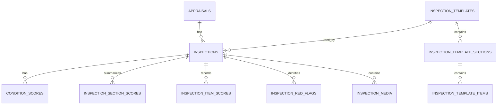

# ONE Classics Nexus
## 04_Data_Inspections

**Document Name:** Nexus_04_Data_Inspections_v1.1.md  
**Version:** 1.1  
**Status:** Draft for Engineering Review  
**Prepared For:** DBA, Technical Architect, Tech Lead, QA, API Engineering  
**System:** ONE_Classics_Nexus  
**Target Repo Location:** `/docs/04_Data/04_Data_Inspections/`  

---

# 1. Purpose

The `04_Data_Inspections` package defines the inspection data model for ONE Classics Nexus. It aligns the inspection database layer, API contracts, WinForms inspection workflow, condition scoring engine, and QA test coverage around a single inspection-first source of truth.

The inspection module is responsible for:

1. Creating and managing appraisal-linked inspection records.
2. Capturing 12-system vehicle condition scores.
3. Capturing red flags, notes, media, section/item detail, and inspection completion status.
4. Providing normalized condition inputs to the valuation engine.
5. Supporting auditability, repeatability, and deterministic valuation runs.

---

# 2. Source Alignment

This document consolidates:

1. Master Design Specification inspection rules.
2. Locked Nexus 12-system inspection scoring model.
3. Phase 3 expanded inspection schema concepts.
4. Existing API route conventions.
5. QA test plan requirements for inspection CRUD, scoring, red flags, and deletion.

---

# 3. Inspection Data Design Principles

| Principle | Requirement |
|---|---|
| Inspection-first | Inspection data is the primary valuation input for vehicle condition. |
| Appraisal-linked | Every inspection must belong to one appraisal. |
| Structured scoring | Condition scoring must use the canonical 12-system model. |
| Deterministic weights | Weights must be versioned or sourced from lookup tables. |
| Red-flag aware | Red flags must be persisted and available to valuation and review workflows. |
| Auditable | Created, updated, inspected, and reviewer metadata must be retained. |
| API-first | WinForms and future UI clients must use API contracts only. |
| Schema-controlled | Repository SQL and database schema must remain aligned. |

---

# 4. Data Scope

## 4.1 In Scope

The inspection data package includes:

- Inspection record creation.
- Inspection record retrieval.
- Inspection record update.
- Inspection record deletion.
- Inspection status tracking.
- Inspection type tracking.
- Inspection template reference.
- 12-system condition scoring.
- Inspection section scoring.
- Inspection item scoring.
- Inspection red flags.
- Inspection media metadata.
- Inspection notes.
- Inspection completion tracking.
- Condition index source data.
- API validation rules.
- Repository persistence rules.
- QA test data and assertions.

## 4.2 Out of Scope

The following are not owned by this data package:

- Final valuation calculation.
- Comparable sale adjustment calculation.
- Report rendering.
- User authentication and authorization design.
- Client portal workflow.
- External photo/file storage implementation.

---

# 5. Core Entity Relationship Model



---

# 6. Canonical 12-System Inspection Model

The following mapping is locked for ONE Classics Nexus and must not be renumbered.

| System # | System Name | system_key |
|---:|---|---|
| 1 | Body & Exterior | body_exterior |
| 2 | Frame & Structure | frame_structure |
| 3 | Engine / Powertrain | powertrain |
| 4 | Transmission & Driveline | transmission_driveline |
| 5 | Suspension & Steering | suspension_steering |
| 6 | Braking System | braking_system |
| 7 | Electrical System | electrical_system |
| 8 | Interior | interior |
| 9 | Wheels & Tires | wheels_tires |
| 10 | Trim, Glass & Details | trim_glass_details |
| 11 | Documentation & Provenance | documentation_provenance |
| 12 | Road Test & Functional | road_test_functional |

---

# 7. Vehicle-Type Weight Sets

(unchanged — retained from v1.0)

---

# 8. Scoring Rules

(unchanged — retained from v1.0 except for DB storage note below)

## 8.1 Score Range

Each condition score must be stored as a decimal value from `0.00` through `5.00` at the application/API layer.

## 8.2 Condition Index Formula

Condition Index = SUM(score_0_to_5 * weight) * 20

The resulting condition index is normalized to a 0-100 scale.

## 8.3 Required Validation

The application and API must reject:

- Scores less than 0.
- Scores greater than 5.
- Duplicate `system_number` or `subsystem_key` rows for the same inspection (see schema mapping below).
- Missing `inspection_id`.
- Missing `system_number`/`subsystem_key`.
- Missing `weight`.
- Weight values outside the configured weight set.

Note: the storage representation in the current implementation stores `score` in the `condition_scores` table as a scaled numeric value (application `Score0To5` is multiplied by 2 before insert and divided by 2 on read). Repositories and integration tests must account for this mapping when asserting DB values.

---

# 9. Inspection Lifecycle

(unchanged — retained from v1.0)

---

# 10. Core Tables

## 10.1 inspections

The `inspections` table is the parent record for all inspection data.

| Column | Type | Required | Description |
|---|---|---:|---|
| inspection_id | CHAR(36) | Yes | Primary GUID. |
| appraisal_id | CHAR(36) | Yes | Parent appraisal. |
| inspection_template_id | CHAR(36) | Yes | Template used for inspection. |
| inspected_by_user_id | CHAR(36) | No | Inspector user. |
| inspection_type | VARCHAR(30) | Yes | Standard, Custom, or VintageClassic. |
| status | VARCHAR(30) | Yes | Lifecycle status. |
| inspection_location | VARCHAR(255) | No | Physical inspection location. |
| inspected_on_utc | DATETIME(6) | No | Actual inspection timestamp. |
| summary_notes | TEXT | No | Overall inspection summary. |
| created_at_utc | DATETIME(6) | Yes | Created timestamp. |
| updated_at_utc | DATETIME(6) | Yes | Updated timestamp. |
| completion_percentage | DECIMAL(5,2) | No | Completion percentage for inspection workflow. |
| overall_condition_score | DECIMAL(5,2) | No | Optional persisted condition index or score summary. |
| has_red_flags | TINYINT(1) / BOOLEAN | Yes | True when one or more inspection red flags exist. |
| row_version | BIGINT | Yes | Optimistic concurrency value. |

Indexes typically include `idx_inspections_appraisal`, `idx_inspections_template`, `idx_inspections_user`, `idx_inspections_status` and FK constraints to `appraisals`, `inspection_templates`, and `users`.

## 10.2 condition_scores

The `condition_scores` table stores canonical condition input rows. Implementation in `InspectionRepository` uses the following column mapping and a scaled storage representation for `score`:

| Column (DB) | Type | Required | Notes / Application mapping |
|---|---|---:|---|
| condition_score_id | CHAR(36) | Yes | Primary GUID. |
| appraisal_id | CHAR(36) | Yes | Parent appraisal (stored as CHAR(36)). |
| inspection_id | CHAR(36) | Yes | Parent inspection. |
| subsystem_key | VARCHAR(50) | Yes | Canonical system key (matches `system_key` concept). |
| score | DECIMAL(...) | Yes | Stored scaled value (application `score_0_to_5` multiplied by 2 for storage). Repositories map to `Score0To5` by dividing by 2. |
| weight | DECIMAL(9,6) | Yes | Vehicle-type-specific system weight. |
| is_red_flag | TINYINT(1) | Yes | True if the system has a red flag. |
| notes | TEXT | No | Inspector notes. |
| created_at | DATETIME / DATETIME(6) | Yes | Created timestamp (implementation uses UTC_TIMESTAMP()). |
| updated_at | DATETIME / DATETIME(6) | No | Updated timestamp (may be NULL). |

Required Unique Constraint (implementation expectation):

```sql
UNIQUE KEY ux_condition_scores_inspection_subsystem (inspection_id, subsystem_key)
```

Notes:
- The current repository implementation inserts and reads `condition_scores` inside transactional flows in `InspectionRepository`.
- Tests should assert the application-layer `Score0To5` after repository mapping rather than raw DB `score` where possible.

---

# 11. Expanded Phase 3 Inspection Tables (aligned to SQL schema files)

## 11.1 inspection_templates

(Structure retained; see `docs/04_Data/Schema/CREATE_inspection_template.sql` for authoritative DDL.)

## 11.2 inspection_template_sections

The SQL schema defines the following columns for `inspection_template_sections`:

| Column | Type | Required | Description |
|---|---|---:|---|
| inspection_template_section_id | CHAR(36) | Yes | Primary GUID. |
| inspection_template_id | CHAR(36) | Yes | Parent template. |
| system_number | INT | Yes | Canonical system number (1-12). |
| system_key | VARCHAR(50) | Yes | Canonical system key string. |
| section_name | VARCHAR(150) | Yes | Human-readable section name. |
| description | TEXT | No | Section description. |
| weight | DECIMAL(9,6) | Yes | Default section weight. |
| sort_order | INT | Yes | Presentation order. |
| created_at_utc | DATETIME(6) | Yes | Created timestamp. |
| updated_at_utc | DATETIME(6) | No | Updated timestamp. |
| is_required | TINYINT(1) | Yes | Template-level required flag. |

Indexes: `uq_template_sections_template_system` (inspection_template_id, system_number), `idx_template_sections_template`, `idx_template_sections_system_key`.

## 11.3 inspection_template_items

Aligned to `CREATE_inspection_template_items.sql` with these columns:

| Column | Type | Required | Description |
|---|---|---:|---|
| inspection_template_item_id | CHAR(36) | Yes | Primary GUID. |
| inspection_template_section_id | CHAR(36) | Yes | Parent template section. |
| item_key | VARCHAR(80) | Yes | Item identifier key. |
| display_name | VARCHAR(200) | Yes | Label shown to inspectors. |
| help_text | TEXT | No | Inline help for the item. |
| response_type | VARCHAR(30) | Yes | Response type (boolean, numeric, text, rating, etc.). |
| default_weight | DECIMAL(9,6) | No | Default item weight (optional). |
| allows_red_flag | TINYINT(1) | Yes | Whether item may generate a red flag. |
| is_required | TINYINT(1) | Yes | Whether an item response is required. |
| sort_order | INT | Yes | Presentation order. |
| created_at_utc | DATETIME(6) | Yes | Created timestamp. |

Unique/indexes: `uq_template_items_section_key` (inspection_template_section_id, item_key), `idx_template_items_section`.

## 11.4 inspection_item_scores

DDL aligned to `CREATE_inspection_item_scores.sql` and contains the following fields:

| Column | Type | Required | Description |
|---|---|---:|---|
| inspection_item_score_id | CHAR(36) | Yes | Primary GUID. |
| inspection_id | CHAR(36) | Yes | Parent inspection. |
| appraisal_id | CHAR(36) | Yes | Parent appraisal. |
| inspection_template_section_id | CHAR(36) | Yes | Parent section. |
| inspection_template_item_id | CHAR(36) | Yes | Template item GUID. |
| system_number | INT | Yes | Canonical system number. |
| item_key | VARCHAR(80) | Yes | Item key. |
| score_0_to_5 | DECIMAL(4,2) | No | Item-level score (0.00-5.00). |
| boolean_response | TINYINT(1) | No | Boolean responses (0/1). |
| numeric_response | DECIMAL(18,4) | No | Numeric responses. |
| text_response | TEXT | No | Free-text response. |
| is_red_flag | TINYINT(1) | Yes | Item-level red flag indicator (default 0). |
| evidence_note | TEXT | No | Evidence or explanation text. |
| created_at_utc | DATETIME(6) | Yes | Created timestamp. |
| updated_at_utc | DATETIME(6) | Yes | Updated timestamp. |

Indexes: `idx_item_scores_appraisal`, `idx_item_scores_inspection`, `idx_item_scores_section`, `idx_item_scores_item`.

Foreign keys reference `appraisals`, `inspections`, `inspection_template_items`, and `inspection_template_sections`.

## 11.5 inspection_section_scores

DDL aligned to `CREATE_inspection_section_scores.sql` and contains:

| Column | Type | Required | Description |
|---|---|---:|---|
| inspection_section_score_id | CHAR(36) | Yes | Primary GUID. |
| inspection_id | CHAR(36) | Yes | Parent inspection. |
| appraisal_id | CHAR(36) | Yes | Parent appraisal. |
| inspection_template_section_id | CHAR(36) | Yes | Parent template section. |
| system_number | INT | Yes | Canonical system number. |
| system_key | VARCHAR(50) | Yes | Canonical system key. |
| score_0_to_5 | DECIMAL(4,2) | Yes | Section-level score. |
| normalized_score_0_to_100 | DECIMAL(6,2) | No | Optional normalized score. |
| weight | DECIMAL(9,6) | Yes | Section weight. |
| weighted_score | DECIMAL(12,6) | No | Computed weighted score. |
| red_flag_count | INT | Yes | Count of red-flagged items for the section. |
| notes | TEXT | No | Section notes. |
| created_at_utc | DATETIME(6) | Yes | Created timestamp. |
| updated_at_utc | DATETIME(6) | Yes | Updated timestamp. |

Unique/indexes: `uq_section_scores_inspection_system` (inspection_id, system_number), `idx_section_scores_appraisal`, `idx_section_scores_inspection`, `idx_section_scores_section`.

## 11.6 inspection_media

A table for inspection-related media metadata (aligned to `CREATE_inspection_media.sql`):

| Column | Type | Required | Description |
|---|---|---:|---|
| inspection_media_id | CHAR(36) | Yes | Primary GUID. |
| inspection_id | CHAR(36) | Yes | Parent inspection. |
| appraisal_id | CHAR(36) | Yes | Parent appraisal. |
| inspection_template_section_id | CHAR(36) | No | Optional template section association. |
| inspection_template_item_id | CHAR(36) | No | Optional template item association. |
| media_type | VARCHAR(20) | Yes | `photo`, `video`, `document`, etc. |
| storage_provider | VARCHAR(50) | Yes | Storage provider identifier. |
| storage_path | VARCHAR(500) | No | Provider-specific path. |
| file_name | VARCHAR(255) | Yes | Original file name. |
| file_extension | VARCHAR(20) | No | File extension. |
| mime_type | VARCHAR(100) | No | MIME type. |
| caption | VARCHAR(255) | No | Caption or alt text. |
| content_hash | VARCHAR(128) | No | Hash for deduplication. |
| sort_order | INT | Yes | Display ordering. |
| created_at_utc | DATETIME(6) | Yes | Created timestamp. |
| system_number | INT | No | Canonical system number (if applicable). |
| system_key | VARCHAR(50) | No | Canonical system key (if applicable). |
| content_type | VARCHAR(100) | No | Content classification. |
| captured_at_utc | DATETIME | No | Capture timestamp from device. |
| updated_at_utc | DATETIME | No | Updated timestamp. |

Indexes: `idx_inspection_media_appraisal`, `idx_inspection_media_inspection`, `idx_inspection_media_section`, `idx_inspection_media_item`.

## 11.7 inspection_red_flags

Aligned to `CREATE_inspection_red_flags.sql`:

| Column | Type | Required | Description |
|---|---|---:|---|
| inspection_red_flag_id | CHAR(36) | Yes | Primary GUID. |
| inspection_id | CHAR(36) | Yes | Parent inspection. |
| appraisal_id | CHAR(36) | Yes | Parent appraisal. |
| inspection_template_section_id | CHAR(36) | No | Template section associated. |
| inspection_template_item_id | CHAR(36) | No | Template item associated. |
| system_number | INT | No | Canonical system number. |
| red_flag_code | VARCHAR(50) | No | Optional code for the red flag. |
| title | VARCHAR(150) | Yes | Short title of the red flag. |
| description | TEXT | No | Detailed description. |
| severity | VARCHAR(30) | Yes | Severity level (High/Medium/Low). |
| penalty_factor | DECIMAL(8,4) | No | Penalty factor applied to scoring/valuation. |
| requires_manual_review | TINYINT(1) | Yes | Whether manual review is required. |
| created_at_utc | DATETIME(6) | Yes | Created timestamp. |
| system_key | (note: SQL shows `system_key` as INT in DDL) | No | DDL shows `system_key` as `int(11)` — verify intended type (string key vs numeric id). |
| is_resolved | TINYINT(1) | Yes | Resolution indicator. |
| resolved_by_user_id | CHAR(36) | No | User who resolved the flag. |
| resolved_at_utc | DATETIME | No | Resolution timestamp. |

Indexes: `idx_red_flags_appraisal`, `idx_red_flags_inspection`, `idx_red_flags_section`, `idx_red_flags_item`, `idx_red_flags_severity`.

Foreign keys reference `appraisals`, `inspections`, `inspection_template_items`, and `inspection_template_sections`.

Notes: the `system_key` column in the supplied DDL for `inspection_red_flags` is typed as `int(11)` — this is inconsistent with canonical textual `system_key` elsewhere. Confirm and reconcile with DB/DAO expectations.

---

# 12. Validation and QA Checklist (schema-aligned)

- Verify `condition_scores` storage mapping (application `0-5` → DB `score` scaled) across repository tests.
- Assert exactly 12 canonical `subsystem_key` rows per inspection when saving canonical scores via API and repository.
- Confirm unique constraints/indexes match repository insert/update SQL (e.g., `uq_section_scores_inspection_system`).
- Validate foreign key references before inserts in service layer to avoid FK failures in integration tests.
- Verify `inspection_media` fields align with storage provider integration tests (path, hash, mime type).
- Confirm `inspection_red_flags.system_key` intended type and fix schema or code to match.

---

Document last aligned to DDL files in `docs/04_Data/Schema/` and repository implementations in `ONE_Classics_Nexus.Infrastructure`.
