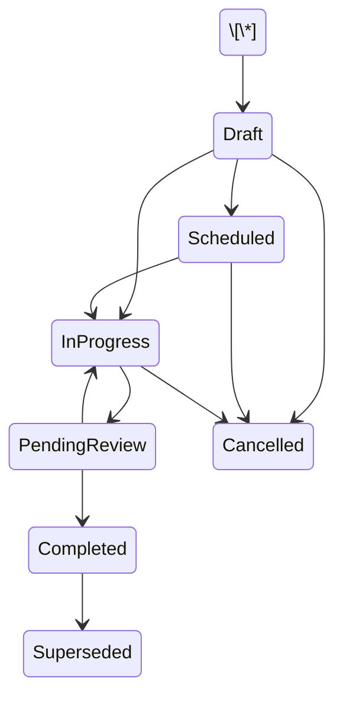

# ONE Classics Nexus

## 04\_Data\_Inspections

**Document Name:** Nexus\_04\_Data\_Inspections\_v1.0.md  
**Version:** 1.0  
**Status:** Draft for Engineering Review  
**Prepared For:** DBA, Technical Architect, Tech Lead, QA, API Engineering  
**System:** ONE\_Classics\_Nexus  
**Target Repo Location:** `/docs/04\\\_Data/04\\\_Data\\\_Inspections/`

\---

# 1\. Purpose

The `04\\\_Data\\\_Inspections` package defines the inspection data model for ONE Classics Nexus. It aligns the inspection database layer, API contracts, WinForms inspection workflow, condition scoring engine, and QA test coverage around a single inspection-first source of truth.

The inspection module is responsible for:

1. Creating and managing appraisal-linked inspection records.
2. Capturing 12-system vehicle condition scores.
3. Capturing red flags, notes, media, section/item detail, and inspection completion status.
4. Providing normalized condition inputs to the valuation engine.
5. Supporting auditability, repeatability, and deterministic valuation runs.

\---

# 2\. Source Alignment

This document consolidates:

1. Master Design Specification inspection rules.
2. Locked Nexus 12-system inspection scoring model.
3. Phase 3 expanded inspection schema concepts.
4. Existing API route conventions.
5. QA test plan requirements for inspection CRUD, scoring, red flags, and deletion.

\---

# 3\. Inspection Data Design Principles

|Principle|Requirement|
|-|-|
|Inspection-first|Inspection data is the primary valuation input for vehicle condition.|
|Appraisal-linked|Every inspection must belong to one appraisal.|
|Structured scoring|Condition scoring must use the canonical 12-system model.|
|Deterministic weights|Weights must be versioned or sourced from lookup tables.|
|Red-flag aware|Red flags must be persisted and available to valuation and review workflows.|
|Auditable|Created, updated, inspected, and reviewer metadata must be retained.|
|API-first|WinForms and future UI clients must use API contracts only.|
|Schema-controlled|Repository SQL and database schema must remain aligned.|

\---

# 4\. Data Scope

## 4.1 In Scope

The inspection data package includes:

* Inspection record creation.
* Inspection record retrieval.
* Inspection record update.
* Inspection record deletion.
* Inspection status tracking.
* Inspection type tracking.
* Inspection template reference.
* 12-system condition scoring.
* Inspection section scoring.
* Inspection item scoring.
* Inspection red flags.
* Inspection media metadata.
* Inspection notes.
* Inspection completion tracking.
* Condition index source data.
* API validation rules.
* Repository persistence rules.
* QA test data and assertions.

## 4.2 Out of Scope

The following are not owned by this data package:

* Final valuation calculation.
* Comparable sale adjustment calculation.
* Report rendering.
* User authentication and authorization design.
* Client portal workflow.
* External photo/file storage implementation.

\---

# 5\. Core Entity Relationship Model

```mermaid
erDiagram
    APPRAISALS ||--o{ INSPECTIONS : has
    INSPECTIONS ||--o{ CONDITION\\\_SCORES : has
    INSPECTIONS ||--o{ INSPECTION\\\_SECTION\\\_SCORES : summarizes
    INSPECTIONS ||--o{ INSPECTION\\\_ITEM\\\_SCORES : records
    INSPECTIONS ||--o{ INSPECTION\\\_RED\\\_FLAGS : identifies
    INSPECTIONS ||--o{ INSPECTION\\\_MEDIA : contains
    INSPECTION\\\_TEMPLATES ||--o{ INSPECTIONS : used\\\_by
    INSPECTION\\\_TEMPLATES ||--o{ INSPECTION\\\_TEMPLATE\\\_SECTIONS : contains
    INSPECTION\\\_TEMPLATE\\\_SECTIONS ||--o{ INSPECTION\\\_TEMPLATE\\\_ITEMS : contains
```

\---

# 6\. Canonical 12-System Inspection Model

The following mapping is locked for ONE Classics Nexus and must not be renumbered.

|System #|System Name|system\_key|
|-:|-|-|
|1|Body \& Exterior|body\_exterior|
|2|Frame \& Structure|frame\_structure|
|3|Engine / Powertrain|powertrain|
|4|Transmission \& Driveline|transmission\_driveline|
|5|Suspension \& Steering|suspension\_steering|
|6|Braking System|braking\_system|
|7|Electrical System|electrical\_system|
|8|Interior|interior|
|9|Wheels \& Tires|wheels\_tires|
|10|Trim, Glass \& Details|trim\_glass\_details|
|11|Documentation \& Provenance|documentation\_provenance|
|12|Road Test \& Functional|road\_test\_functional|

\---

# 7\. Vehicle-Type Weight Sets

## 7.1 Standard Vehicle Weights

|System #|system\_key|Weight|
|-:|-|-:|
|1|body\_exterior|0.06|
|2|frame\_structure|0.10|
|3|powertrain|0.18|
|4|transmission\_driveline|0.14|
|5|suspension\_steering|0.10|
|6|braking\_system|0.10|
|7|electrical\_system|0.10|
|8|interior|0.04|
|9|wheels\_tires|0.06|
|10|trim\_glass\_details|0.02|
|11|documentation\_provenance|0.04|
|12|road\_test\_functional|0.06|

## 7.2 Custom Vehicle Weights

|System #|system\_key|Weight|
|-:|-|-:|
|1|body\_exterior|0.15|
|2|frame\_structure|0.12|
|3|powertrain|0.16|
|4|transmission\_driveline|0.10|
|5|suspension\_steering|0.08|
|6|braking\_system|0.06|
|7|electrical\_system|0.08|
|8|interior|0.08|
|9|wheels\_tires|0.05|
|10|trim\_glass\_details|0.05|
|11|documentation\_provenance|0.03|
|12|road\_test\_functional|0.04|

## 7.3 Vintage/Classic Vehicle Weights

|System #|system\_key|Weight|
|-:|-|-:|
|1|body\_exterior|0.12|
|2|frame\_structure|0.09|
|3|powertrain|0.13|
|4|transmission\_driveline|0.08|
|5|suspension\_steering|0.06|
|6|braking\_system|0.05|
|7|electrical\_system|0.05|
|8|interior|0.09|
|9|wheels\_tires|0.04|
|10|trim\_glass\_details|0.08|
|11|documentation\_provenance|0.12|
|12|road\_test\_functional|0.09|

\---

# 8\. Scoring Rules

## 8.1 Score Range

Each condition score must be stored as a decimal value from `0.00` through `5.00`.

|Score|Meaning|
|-:|-|
|0.00|Not inspected / unusable / failed|
|1.00|Poor|
|2.00|Fair|
|3.00|Good driver-quality condition|
|4.00|Very good|
|5.00|Excellent / concours-level condition|

Half-point increments are allowed when supported by the UI and API validation rules.

## 8.2 Condition Index Formula

```text
Condition Index = SUM(score\\\_0\\\_to\\\_5 \\\* weight) \\\* 20
```

The resulting condition index is normalized to a 0-100 scale.

## 8.3 Required Validation

The application and API must reject:

* Scores less than 0.
* Scores greater than 5.
* Duplicate `system\\\_number` rows for the same inspection.
* Missing `inspection\\\_id`.
* Missing `system\\\_number`.
* Missing `system\\\_key`.
* Missing `weight`.
* Weight values outside the configured weight set.

\---

# 9\. Inspection Lifecycle

## 9.1 Recommended Inspection Status Values

|Status|Description|
|-|-|
|Draft|Inspection exists but has not started.|
|Scheduled|Inspection is scheduled but not yet in progress.|
|InProgress|Inspection scoring or media capture has started.|
|PendingReview|Inspection is complete and awaiting review.|
|Completed|Inspection has been finalized.|
|Cancelled|Inspection was cancelled before completion.|
|Superseded|Inspection was replaced by a newer inspection.|

## 9.2 Valid Status Transitions



\---

# 10\. Core Tables

## 10.1 inspections

The `inspections` table is the parent record for all inspection data.

|Column|Type|Required|Description|
|-|-|-:|-|
|inspection\_id|CHAR(36)|Yes|Primary GUID.|
|appraisal\_id|CHAR(36)|Yes|Parent appraisal.|
|inspection\_template\_id|CHAR(36)|Yes|Template used for inspection.|
|inspected\_by\_user\_id|CHAR(36)|No|Inspector user.|
|inspection\_type|VARCHAR(30)|Yes|Standard, Custom, or VintageClassic.|
|status|VARCHAR(30)|Yes|Lifecycle status.|
|inspection\_location|VARCHAR(255)|No|Physical inspection location.|
|inspected\_on\_utc|DATETIME(6)|No|Actual inspection timestamp.|
|completion\_percentage|DECIMAL(5,2)|No|Completion percentage, 0-100.|
|overall\_condition\_score|DECIMAL(5,2)|No|Optional persisted condition index or score summary.|
|has\_red\_flags|BOOLEAN|Yes|True when one or more inspection red flags exist.|
|summary\_notes|TEXT|No|Overall inspection summary.|
|created\_at\_utc|DATETIME(6)|Yes|Created timestamp.|
|updated\_at\_utc|DATETIME(6)|Yes|Updated timestamp.|
|row\_version|BIGINT|Yes|Optimistic concurrency value.|

## 10.2 condition\_scores

The `condition\\\_scores` table stores the canonical 12-system condition scores used by the condition engine.

|Column|Type|Required|Description|
|-|-|-:|-|
|condition\_score\_id|CHAR(36)|Yes|Primary GUID.|
|inspection\_id|CHAR(36)|Yes|Parent inspection.|
|system\_number|INT|Yes|Canonical system number, 1-12.|
|system\_key|VARCHAR(50)|Yes|Canonical system key.|
|score\_0\_to\_5|DECIMAL(3,2)|Yes|System score from 0.00 to 5.00.|
|weight|DECIMAL(6,4)|Yes|Vehicle-type-specific system weight.|
|is\_red\_flag|BOOLEAN|Yes|True if the system has a red flag.|
|notes|TEXT|No|Inspector notes.|
|created\_at\_utc|DATETIME(6)|Yes|Created timestamp.|
|updated\_at\_utc|DATETIME(6)|Yes|Updated timestamp.|

### Required Unique Constraint

```sql
UNIQUE KEY ux\\\_condition\\\_scores\\\_inspection\\\_system (inspection\\\_id, system\\\_number)
```

\---

# 11\. Expanded Phase 3 Inspection Tables

## 11.1 inspection\_templates

Defines reusable templates for inspection workflows.

Recommended columns:

```sql
inspection\\\_template\\\_id CHAR(36) NOT NULL PRIMARY KEY,
template\\\_code VARCHAR(50) NOT NULL UNIQUE,
template\\\_name VARCHAR(100) NOT NULL,
inspection\\\_type VARCHAR(30) NOT NULL,
vehicle\\\_type\\\_code VARCHAR(30) NULL,
version VARCHAR(20) NOT NULL,
is\\\_active BOOLEAN NOT NULL DEFAULT TRUE,
created\\\_at\\\_utc DATETIME(6) NOT NULL,
updated\\\_at\\\_utc DATETIME(6) NOT NULL
```

## 11.2 inspection\_template\_sections

Defines template sections, commonly mapped to the 12-system model.

Recommended columns:

```sql
inspection\\\_template\\\_section\\\_id CHAR(36) NOT NULL PRIMARY KEY,
inspection\\\_template\\\_id CHAR(36) NOT NULL,
system\\\_number INT NOT NULL,
system\\\_key VARCHAR(50) NOT NULL,
section\\\_name VARCHAR(100) NOT NULL,
sort\\\_order INT NOT NULL,
is\\\_required BOOLEAN NOT NULL DEFAULT TRUE,
created\\\_at\\\_utc DATETIME(6) NOT NULL,
updated\\\_at\\\_utc DATETIME(6) NOT NULL
```

## 11.3 inspection\_template\_items

Defines checklist items for each section.

Recommended columns:

```sql
inspection\\\_template\\\_item\\\_id CHAR(36) NOT NULL PRIMARY KEY,
inspection\\\_template\\\_section\\\_id CHAR(36) NOT NULL,
item\\\_code VARCHAR(50) NOT NULL,
item\\\_label VARCHAR(150) NOT NULL,
item\\\_help\\\_text TEXT NULL,
response\\\_type VARCHAR(30) NOT NULL,
is\\\_required BOOLEAN NOT NULL DEFAULT TRUE,
sort\\\_order INT NOT NULL,
created\\\_at\\\_utc DATETIME(6) NOT NULL,
updated\\\_at\\\_utc DATETIME(6) NOT NULL
```

## 11.4 inspection\_item\_scores

Stores item-level inspection responses.

Recommended columns:

```sql
inspection\\\_item\\\_score\\\_id CHAR(36) NOT NULL PRIMARY KEY,
inspection\\\_id CHAR(36) NOT NULL,
inspection\\\_template\\\_item\\\_id CHAR(36) NOT NULL,
system\\\_number INT NOT NULL,
system\\\_key VARCHAR(50) NOT NULL,
score\\\_0\\\_to\\\_5 DECIMAL(3,2) NULL,
response\\\_value VARCHAR(255) NULL,
notes TEXT NULL,
is\\\_red\\\_flag BOOLEAN NOT NULL DEFAULT FALSE,
created\\\_at\\\_utc DATETIME(6) NOT NULL,
updated\\\_at\\\_utc DATETIME(6) NOT NULL
```

## 11.5 inspection\_section\_scores

Stores section-level rollups.

Recommended columns:

```sql
inspection\\\_section\\\_score\\\_id CHAR(36) NOT NULL PRIMARY KEY,
inspection\\\_id CHAR(36) NOT NULL,
system\\\_number INT NOT NULL,
system\\\_key VARCHAR(50) NOT NULL,
section\\\_score\\\_0\\\_to\\\_5 DECIMAL(3,2) NOT NULL,
weight DECIMAL(6,4) NOT NULL,
weighted\\\_score DECIMAL(8,4) NOT NULL,
has\\\_red\\\_flags BOOLEAN NOT NULL DEFAULT FALSE,
notes TEXT NULL,
created\\\_at\\\_utc DATETIME(6) NOT NULL,
updated\\\_at\\\_utc DATETIME(6) NOT NULL
```

## 11.6 inspection\_red\_flags

Stores explicit red flags independent of the basic `condition\\\_scores.is\\\_red\\\_flag` indicator.

Recommended columns:

```sql
inspection\\\_red\\\_flag\\\_id CHAR(36) NOT NULL PRIMARY KEY,
inspection\\\_id CHAR(36) NOT NULL,
system\\\_number INT NULL,
system\\\_key VARCHAR(50) NULL,
red\\\_flag\\\_code VARCHAR(50) NOT NULL,
severity VARCHAR(30) NOT NULL,
description TEXT NOT NULL,
requires\\\_manual\\\_review BOOLEAN NOT NULL DEFAULT TRUE,
is\\\_resolved BOOLEAN NOT NULL DEFAULT FALSE,
resolved\\\_by\\\_user\\\_id CHAR(36) NULL,
resolved\\\_at\\\_utc DATETIME(6) NULL,
created\\\_at\\\_utc DATETIME(6) NOT NULL,
updated\\\_at\\\_utc DATETIME(6) NOT NULL
```

## 11.7 inspection\_media

Stores inspection media metadata. Binary files should be stored outside the relational database unless a later architecture decision explicitly approves BLOB storage.

Recommended columns:

```sql
inspection\\\_media\\\_id CHAR(36) NOT NULL PRIMARY KEY,
inspection\\\_id CHAR(36) NOT NULL,
system\\\_number INT NULL,
system\\\_key VARCHAR(50) NULL,
media\\\_type VARCHAR(30) NOT NULL,
file\\\_name VARCHAR(255) NOT NULL,
content\\\_type VARCHAR(100) NULL,
storage\\\_uri TEXT NOT NULL,
caption VARCHAR(255) NULL,
sort\\\_order INT NOT NULL DEFAULT 0,
captured\\\_at\\\_utc DATETIME(6) NULL,
created\\\_at\\\_utc DATETIME(6) NOT NULL,
updated\\\_at\\\_utc DATETIME(6) NOT NULL
```

\---

# 12\. API Contract Alignment

## 12.1 Required Routes

```text
POST   /api/inspections
GET    /api/inspections/{id}
PUT    /api/inspections/{id}
DELETE /api/inspections/{id}
PUT    /api/inspections/{id}/scores
GET    /api/appraisals/{appraisalId}/inspections
```

## 12.2 CreateInspectionRequest

```json
{
  "appraisalId": "3fa85f64-5717-4562-b3fc-2c963f66afa6",
  "inspectionTemplateId": "3fa85f64-5717-4562-b3fc-2c963f66afa6",
  "inspectedByUserId": "3fa85f64-5717-4562-b3fc-2c963f66afa6",
  "inspectionType": "VintageClassic",
  "status": "Draft",
  "inspectionLocation": "Meridian, ID",
  "summaryNotes": "Initial inspection record created."
}
```

## 12.3 UpdateInspectionRequest

```json
{
  "inspectionType": "VintageClassic",
  "status": "InProgress",
  "inspectionLocation": "Meridian, ID",
  "inspectedOnUtc": "2026-06-25T15:30:00.000000Z",
  "summaryNotes": "Inspection in progress."
}
```

## 12.4 UpdateInspectionScoresRequest

```json
{
  "scores": \\\[
    {
      "systemNumber": 1,
      "systemKey": "body\\\_exterior",
      "score0To5": 4.25,
      "weight": 0.12,
      "isRedFlag": false,
      "notes": "Paint and panel alignment are strong with minor age-appropriate blemishes."
    },
    {
      "systemNumber": 2,
      "systemKey": "frame\\\_structure",
      "score0To5": 3.75,
      "weight": 0.09,
      "isRedFlag": false,
      "notes": "Frame appears sound; light surface corrosion only."
    }
  ]
}
```

## 12.5 InspectionResponse

```json
{
  "inspectionId": "3fa85f64-5717-4562-b3fc-2c963f66afa6",
  "appraisalId": "3fa85f64-5717-4562-b3fc-2c963f66afa6",
  "inspectionTemplateId": "3fa85f64-5717-4562-b3fc-2c963f66afa6",
  "inspectionType": "VintageClassic",
  "status": "InProgress",
  "inspectionLocation": "Meridian, ID",
  "inspectedOnUtc": "2026-06-25T15:30:00.000000Z",
  "completionPercentage": 16.67,
  "overallConditionScore": 80.50,
  "hasRedFlags": false,
  "summaryNotes": "Inspection in progress.",
  "scores": \\\[]
}
```

\---

# 13\. Repository Rules

## 13.1 InspectionRepository

Required methods:

```csharp
Task<Guid> CreateAsync(Inspection inspection, CancellationToken cancellationToken);
Task<Inspection?> GetByIdAsync(Guid inspectionId, CancellationToken cancellationToken);
Task<IReadOnlyList<Inspection>> GetByAppraisalIdAsync(Guid appraisalId, CancellationToken cancellationToken);
Task<bool> UpdateAsync(Guid inspectionId, Inspection inspection, CancellationToken cancellationToken);
Task<bool> DeleteAsync(Guid inspectionId, CancellationToken cancellationToken);
```

## 13.2 ConditionScoreRepository

Required methods:

```csharp
Task<IReadOnlyList<ConditionScore>> GetByInspectionIdAsync(Guid inspectionId, CancellationToken cancellationToken);
Task ReplaceScoresAsync(Guid inspectionId, IReadOnlyList<ConditionScore> scores, CancellationToken cancellationToken);
```

## 13.3 Transaction Rule

`PUT /api/inspections/{id}/scores` must replace all condition score rows for the inspection inside a transaction.

Transaction steps:

1. Validate inspection exists.
2. Validate score payload.
3. Delete existing `condition\\\_scores` for the inspection.
4. Insert new score rows.
5. Recalculate inspection completion percentage.
6. Recalculate overall condition score.
7. Recalculate `has\\\_red\\\_flags`.
8. Commit.

Rollback on any failure.

\---

# 14\. SQL DDL Baseline

```sql
CREATE TABLE IF NOT EXISTS inspections (
    inspection\\\_id CHAR(36) NOT NULL,
    appraisal\\\_id CHAR(36) NOT NULL,
    inspection\\\_template\\\_id CHAR(36) NOT NULL,
    inspected\\\_by\\\_user\\\_id CHAR(36) NULL,
    inspection\\\_type VARCHAR(30) NOT NULL,
    status VARCHAR(30) NOT NULL,
    inspection\\\_location VARCHAR(255) NULL,
    inspected\\\_on\\\_utc DATETIME(6) NULL,
    completion\\\_percentage DECIMAL(5,2) NULL,
    overall\\\_condition\\\_score DECIMAL(5,2) NULL,
    has\\\_red\\\_flags BOOLEAN NOT NULL DEFAULT FALSE,
    summary\\\_notes TEXT NULL,
    row\\\_version BIGINT NOT NULL DEFAULT 1,
    created\\\_at\\\_utc DATETIME(6) NOT NULL,
    updated\\\_at\\\_utc DATETIME(6) NOT NULL,
    PRIMARY KEY (inspection\\\_id),
    KEY idx\\\_inspections\\\_appraisal\\\_id (appraisal\\\_id),
    KEY idx\\\_inspections\\\_template\\\_id (inspection\\\_template\\\_id),
    KEY idx\\\_inspections\\\_status (status),
    CONSTRAINT fk\\\_inspections\\\_appraisals
        FOREIGN KEY (appraisal\\\_id) REFERENCES appraisals(appraisal\\\_id)
);
```

```sql
CREATE TABLE IF NOT EXISTS condition\\\_scores (
    condition\\\_score\\\_id CHAR(36) NOT NULL,
    inspection\\\_id CHAR(36) NOT NULL,
    system\\\_number INT NOT NULL,
    system\\\_key VARCHAR(50) NOT NULL,
    score\\\_0\\\_to\\\_5 DECIMAL(3,2) NOT NULL,
    weight DECIMAL(6,4) NOT NULL,
    is\\\_red\\\_flag BOOLEAN NOT NULL DEFAULT FALSE,
    notes TEXT NULL,
    created\\\_at\\\_utc DATETIME(6) NOT NULL,
    updated\\\_at\\\_utc DATETIME(6) NOT NULL,
    PRIMARY KEY (condition\\\_score\\\_id),
    UNIQUE KEY ux\\\_condition\\\_scores\\\_inspection\\\_system (inspection\\\_id, system\\\_number),
    KEY idx\\\_condition\\\_scores\\\_inspection\\\_id (inspection\\\_id),
    CONSTRAINT fk\\\_condition\\\_scores\\\_inspections
        FOREIGN KEY (inspection\\\_id) REFERENCES inspections(inspection\\\_id)
        ON DELETE CASCADE,
    CONSTRAINT chk\\\_condition\\\_scores\\\_system\\\_number
        CHECK (system\\\_number BETWEEN 1 AND 12),
    CONSTRAINT chk\\\_condition\\\_scores\\\_score
        CHECK (score\\\_0\\\_to\\\_5 >= 0.00 AND score\\\_0\\\_to\\\_5 <= 5.00),
    CONSTRAINT chk\\\_condition\\\_scores\\\_weight
        CHECK (weight >= 0.0000 AND weight <= 1.0000)
);
```

\---

# 15\. Red Flag Codes

Recommended starting red flag codes:

|red\_flag\_code|Severity|Applies To|
|-|-|-|
|SALVAGE\_TITLE|Critical|title\_status / documentation\_provenance|
|FRAME\_DAMAGE|Critical|frame\_structure|
|FLOOD\_DAMAGE|Critical|body\_exterior / electrical\_system / interior|
|SEVERE\_RUST|High|body\_exterior / frame\_structure|
|NON\_MATCHING\_NUMBERS|Medium|documentation\_provenance / powertrain|
|ENGINE\_FAILURE|Critical|powertrain|
|TRANSMISSION\_FAILURE|Critical|transmission\_driveline|
|BRAKE\_UNSAFE|Critical|braking\_system|
|ELECTRICAL\_FIRE\_RISK|Critical|electrical\_system|
|ROAD\_TEST\_FAILED|High|road\_test\_functional|
|MISSING\_DOCUMENTATION|Medium|documentation\_provenance|
|ODOMETER\_INCONSISTENT|High|documentation\_provenance|

\---

# 16\. Completion Calculation

Recommended formula:

```text
completion\\\_percentage = completed\\\_required\\\_items / total\\\_required\\\_items \\\* 100
```

When item-level inspection data is not implemented, use 12-system score completion:

```text
completion\\\_percentage = count(condition\\\_scores where score\\\_0\\\_to\\\_5 is not null) / 12 \\\* 100
```

\---

# 17\. QA Coverage Matrix

|Test ID|Area|Scenario|Expected Result|
|-|-|-|-|
|INSP-C-001|Create|Create valid inspection|201 Created / valid inspectionId|
|INSP-C-002|Create|Missing appraisalId|400 ProblemDetails|
|INSP-C-003|Create|Invalid inspectionType|400 ProblemDetails|
|INSP-R-001|Read|Get existing inspection|200 OK|
|INSP-R-002|Read|Get missing inspection|404 Not Found|
|INSP-U-001|Update|Update status/location/notes|200 OK or 204 No Content|
|INSP-U-002|Update|Invalid status transition|400 ProblemDetails|
|INSP-D-001|Delete|Delete draft inspection|204 No Content|
|INSP-D-002|Delete|Delete missing inspection|404 Not Found|
|SCORE-U-001|Scores|Replace all 12 scores|200 OK and rows replaced|
|SCORE-U-002|Scores|Duplicate system\_number|400 ProblemDetails|
|SCORE-U-003|Scores|Score greater than 5|400 ProblemDetails|
|SCORE-U-004|Scores|Score less than 0|400 ProblemDetails|
|SCORE-U-005|Scores|Red flag score saved|`has\\\_red\\\_flags = true`|
|SCORE-U-006|Scores|Condition index recalculated|Expected CI produced|
|RF-001|Red Flags|Critical red flag added|Manual review required|
|MEDIA-001|Media|Media metadata added|Storage URI persisted|

\---

# 18\. Swagger Test Data

## 18.1 Create Inspection

```json
{
  "appraisalId": "11111111-1111-1111-1111-111111111111",
  "inspectionTemplateId": "22222222-2222-2222-2222-222222222222",
  "inspectedByUserId": "33333333-3333-3333-3333-333333333333",
  "inspectionType": "VintageClassic",
  "status": "Draft",
  "inspectionLocation": "Meridian, ID",
  "summaryNotes": "Initial vintage/classic inspection draft."
}
```

## 18.2 Update Inspection Scores - Full 12-System VintageClassic Example

```json
{
  "scores": \\\[
    { "systemNumber": 1, "systemKey": "body\\\_exterior", "score0To5": 4.25, "weight": 0.12, "isRedFlag": false, "notes": "Strong body and exterior presentation." },
    { "systemNumber": 2, "systemKey": "frame\\\_structure", "score0To5": 4.00, "weight": 0.09, "isRedFlag": false, "notes": "Frame appears structurally sound." },
    { "systemNumber": 3, "systemKey": "powertrain", "score0To5": 4.50, "weight": 0.13, "isRedFlag": false, "notes": "Powertrain performs well." },
    { "systemNumber": 4, "systemKey": "transmission\\\_driveline", "score0To5": 4.00, "weight": 0.08, "isRedFlag": false, "notes": "Transmission and driveline operate properly." },
    { "systemNumber": 5, "systemKey": "suspension\\\_steering", "score0To5": 3.75, "weight": 0.06, "isRedFlag": false, "notes": "Minor wear consistent with age." },
    { "systemNumber": 6, "systemKey": "braking\\\_system", "score0To5": 3.50, "weight": 0.05, "isRedFlag": false, "notes": "Brakes functional; service recommended." },
    { "systemNumber": 7, "systemKey": "electrical\\\_system", "score0To5": 3.75, "weight": 0.05, "isRedFlag": false, "notes": "Electrical systems mostly operational." },
    { "systemNumber": 8, "systemKey": "interior", "score0To5": 4.25, "weight": 0.09, "isRedFlag": false, "notes": "Interior presents very well." },
    { "systemNumber": 9, "systemKey": "wheels\\\_tires", "score0To5": 4.00, "weight": 0.04, "isRedFlag": false, "notes": "Wheels and tires are good." },
    { "systemNumber": 10, "systemKey": "trim\\\_glass\\\_details", "score0To5": 4.00, "weight": 0.08, "isRedFlag": false, "notes": "Trim and glass are clean." },
    { "systemNumber": 11, "systemKey": "documentation\\\_provenance", "score0To5": 3.50, "weight": 0.12, "isRedFlag": false, "notes": "Documentation is adequate but not complete." },
    { "systemNumber": 12, "systemKey": "road\\\_test\\\_functional", "score0To5": 4.00, "weight": 0.09, "isRedFlag": false, "notes": "Road test completed successfully." }
  ]
}
```

Expected condition index:

```text
CI = SUM(score \\\* weight) \\\* 20
CI = 80.95
```

\---

# 19\. Implementation Checklist

## 19.1 DBA

* Confirm `inspections` table exists and matches repository SQL.
* Confirm `condition\\\_scores` table exists and includes unique constraint by inspection/system.
* Add missing Phase 3 inspection tables only through migration scripts.
* Add lookup/reference data for inspection types, statuses, red flag codes, and templates.
* Verify cascade delete rules for condition scores and related child records.

## 19.2 API Engineering

* Confirm `InspectionsController` routes are unique and Swagger-clean.
* Confirm DTOs are under `API/Contracts/Inspections`.
* Confirm no domain entities leak into API responses.
* Add validation for score range, 12-system uniqueness, and inspection status.
* Return `ProblemDetails` for validation failures.

## 19.3 Application Layer

* Implement `IInspectionApiService` orchestration.
* Implement score replacement transaction logic.
* Implement condition index recalculation after score updates.
* Implement red-flag summary recalculation.

## 19.4 Infrastructure

* Align Dapper SQL column names with schema.
* Ensure all timestamps use UTC.
* Ensure repository methods accept `CancellationToken`.
* Ensure child rows are loaded with inspections where required.

## 19.5 QA

* Add CRUD integration tests.
* Add scoring validation tests.
* Add red-flag tests.
* Add delete behavior tests.
* Add deterministic condition index tests.
* Add Swagger request/response validation examples.

\---

# 20\. Recommended Folder Layout

```text
/docs/04\\\_Data/04\\\_Data\\\_Inspections/
│
├── Nexus\\\_04\\\_Data\\\_Inspections\\\_v1.0.md
├── SQL/
│   ├── 04\\\_01\\\_create\\\_inspections.sql
│   ├── 04\\\_02\\\_create\\\_condition\\\_scores.sql
│   ├── 04\\\_03\\\_create\\\_inspection\\\_templates.sql
│   ├── 04\\\_04\\\_create\\\_inspection\\\_red\\\_flags.sql
│   └── 04\\\_05\\\_seed\\\_inspection\\\_reference\\\_data.sql
│
├── Test\\\_Data/
│   ├── inspection\\\_create\\\_swagger\\\_examples.json
│   ├── inspection\\\_update\\\_swagger\\\_examples.json
│   └── inspection\\\_scores\\\_12\\\_system\\\_examples.json
│
└── Diagrams/
    └── inspection\\\_data\\\_model.mmd
```

\---

# 21\. Acceptance Criteria

The inspection data package is accepted when:

1. Inspection records can be created, updated, retrieved, and deleted through the API.
2. A full 12-system score payload can be persisted for an inspection.
3. Duplicate system numbers are rejected.
4. Invalid score ranges are rejected.
5. Red flags update the inspection summary state.
6. The condition index is deterministic and repeatable.
7. Swagger displays complete inspection request and response schemas.
8. Repository SQL exactly matches the database schema.
9. Integration tests pass against `one\\\_classics\\\_nexus\\\_test`.
10. The inspection data package is committed under `/docs/04\\\_Data/04\\\_Data\\\_Inspections/`.

\---

# 22\. Open Design Decisions

|Decision|Recommendation|
|-|-|
|Store score precision as DECIMAL(3,1) or DECIMAL(3,2)|Use DECIMAL(3,2) for half/quarter score support.|
|Persist overall condition score on inspections?|Yes, as a denormalized summary recalculated from condition scores.|
|Delete completed inspections?|Prefer soft delete or Superseded status for completed records.|
|Store binary media in DB?|No. Store metadata and external storage URI only.|
|Use template tables immediately?|Yes for Phase 3, optional for Phase 1 compatibility.|

\---

# 23\. Final Recommendation

Use this document as the source package for Nexus inspection data design. Keep the MDS minimal inspection tables as the baseline, and implement the expanded Phase 3 tables as controlled schema extensions. The canonical `condition\\\_scores` table remains the valuation-critical table because it provides the normalized 12-system inputs required by the Condition Engine.

