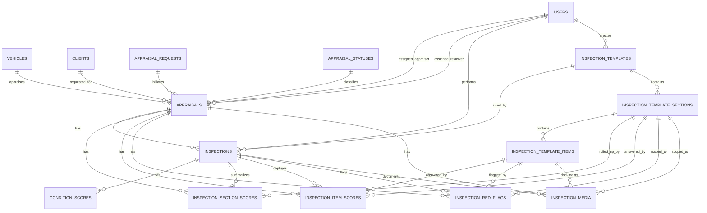

# ONE Classics Nexus
## 04_Data_Inspections

**Document Name:** Nexus_Inspection_Data_Model_v1.3.md  
**Version:** 1.3 (addendum: reverse-engineered code reconciliation)  
**Status:** Reconciled to Database Source of Truth; Domain/API code reconciliation gaps identified in Sections 8A and 12.1A  
**Prepared For:** DBA, Technical Architect, Tech Lead, QA, API Engineering  
**System:** ONE_Classics_Nexus  
**Target Repo Location:** `/docs/04_Data/04_Data_Inspections/`  
**Last Regenerated:** 2026-06-25  
**Supersedes:** `Nexus_04_Data_Inspections_v1.2.md`

---

# 1. Purpose

The `Inspection_Data_Model` package defines the inspection data model for ONE Classics Nexus. Version 1.3 reconciles `Nexus_04_Data_Inspections_v1.2.md` against the attached `appraisals` table schema and carries forward the prior inspection-table reconciliation completed in v1.2.

The attached database DDL files are the source of truth for this document. API contracts, repository SQL, WinForms models, Swagger examples, QA data, engine inputs, and reporting queries must align to these physical column names, data types, nullability rules, indexes, and foreign-key relationships.

Version 1.3 adds an appraisal-workflow reconciliation layer. Inspections are not isolated records. Each inspection belongs to an appraisal, and the appraisal record owns the broader workflow state through fields such as `status`, `inspection_status`, `valuation_status`, and `report_status`.

The inspection module is responsible for:

1. Creating appraisal-linked inspection records.
2. Binding each inspection to an active inspection template.
3. Capturing canonical 12-system condition scores.
4. Capturing section-level and item-level inspection responses.
5. Capturing inspection red flags and media metadata.
6. Persisting denormalized inspection summaries for fast review and valuation readiness.
7. Updating appraisal-level inspection workflow state consistently.
8. Providing deterministic, auditable input to the Nexus valuation pipeline.

---

# 2. Source-of-Truth Inputs

Version 1.3 was reconciled against the following database DDL files:

| Source File | Source-of-Truth Table | v1.3 Treatment |
|---|---|---|
| `CREATE_appraisals.sql` | `appraisals` | Newly reconciled in v1.3; establishes inspection workflow parent context. |
| `CREATE_inspections.sql` | `inspections` | Carried forward from v1.2 and reconciled against appraisal workflow. |
| `CREATE_inspection_template.sql` | `inspection_templates` | Carried forward from v1.2 and confirmed. |
| `CREATE_inspection_sections.sql` | `inspection_template_sections` | Carried forward from v1.2 and confirmed. |
| `CREATE_inspection_template_items.sql` | `inspection_template_items` | Carried forward from v1.2 and confirmed. |
| `CREATE_condition_scores.sql` | `condition_scores` | Carried forward from v1.2 and confirmed. |
| `CREATE_inspection_section_scores.sql` | `inspection_section_scores` | Carried forward from v1.2 and reconciled against `appraisals`. |
| `CREATE_inspection_item_scores.sql` | `inspection_item_scores` | Carried forward from v1.2 and reconciled against `appraisals`. |
| `CREATE_inspection_red_flags.sql` | `inspection_red_flags` | Carried forward from v1.2 and reconciled against `appraisals`. |
| `CREATE_inspection_media.sql` | `inspection_media` | Carried forward from v1.2 and reconciled against `appraisals`. |

---

# 3. v1.3 Reconciliation Summary

| Area | v1.2 Treatment | v1.3 Corrected Source-of-Truth Alignment |
|---|---|---|
| Appraisal parent table | Not included in inspection-source reconciliation. | Added `appraisals` as the workflow parent for inspection records. |
| Appraisal primary key | Implied through inspection FK only. | Confirmed `appraisals.appraisal_id CHAR(36) NOT NULL` primary key. |
| Inspection parent relationship | `inspections.appraisal_id` FK to `appraisals`. | Confirmed and expanded: section scores, item scores, red flags, and media also store `appraisal_id` and FK to `appraisals`. |
| Appraisal workflow state | Not documented as inspection aggregate state. | Confirmed `appraisals.inspection_status VARCHAR(30) NULL` is the appraisal-level inspection workflow rollup. |
| Appraisal overall status | Out of scope in v1.2. | Confirmed `appraisals.status VARCHAR(30) NOT NULL` and `appraisal_status_id CHAR(36) NULL` FK to `appraisal_statuses`. |
| Appraisal type model | Out of scope in v1.2. | Confirmed both `appraisal_type VARCHAR(50) NOT NULL` and `appraisal_type_id CHAR(36) NULL` exist. No FK constraint for `appraisal_type_id` is present in the supplied DDL. |
| Assigned users | Out of scope in v1.2. | Confirmed `assigned_appraiser_id` and `assigned_reviewer_id` nullable FKs to `users`. |
| Appraisal client/request links | Out of scope in v1.2. | Confirmed nullable FKs to `clients` and `appraisal_requests`. |
| Appraisal vehicle link | Out of scope in v1.2. | Confirmed required `vehicle_id CHAR(36) NOT NULL` FK to `vehicles`. |
| Appraisal optimistic concurrency | Not reconciled. | Confirmed `appraisals.row_version BIGINT(20) NOT NULL DEFAULT 1`. |
| Inspection optimistic concurrency | Reconciled in v1.2. | Confirmed `inspections.row_version BIGINT(20) NOT NULL` has no default; repository inserts must supply it. |
| Child-table appraisal consistency | Not explicitly enforced beyond FK existence. | Added application/repository rule: child-table `appraisal_id` must equal the parent `inspections.appraisal_id` for the same `inspection_id`. The DDL has separate FKs but no composite constraint enforcing this equality. |
| Completed inspection soft delete | Status-based because no delete columns exist on `inspections`. | Confirmed still status-based. If an inspection is soft-deleted, `appraisals.inspection_status` must be updated consistently by the application/service layer. |
| Inspection rollup to appraisal | Limited to inspection table summaries. | Added requirement that changes to inspection status, completion, red flags, and score readiness should roll up to `appraisals.inspection_status` and valuation readiness decisions. |

---

# 4. Locked Data Design Decisions for v1.3

| Decision Area | Locked Decision |
|---|---|
| Database source of truth | The attached DDL files listed in Section 2 are authoritative for v1.3. |
| Appraisal boundary | `appraisals` is the workflow parent for inspections. |
| Inspection ownership | Every `inspections` row must reference one `appraisals.appraisal_id`. |
| Child-table appraisal duplication | `inspection_section_scores`, `inspection_item_scores`, `inspection_red_flags`, and `inspection_media` physically store both `inspection_id` and `appraisal_id`; service code must keep them consistent. |
| Template usage | Template tables are required immediately and are part of the baseline data model. |
| Template binding | Every inspection must reference `inspection_template_id`. |
| Template status model | Use `inspection_templates.status`; do not use a non-existent `is_active` column. |
| Template family model | Use `inspection_templates.template_family`. |
| Inspection type | Use `inspections.inspection_type`; keep this aligned to template family at the application layer. |
| Appraisal type | Use `appraisals.appraisal_type` as the required physical value. `appraisal_type_id` is nullable in the supplied DDL and has no FK constraint in the attached schema. |
| Appraisal status | Use `appraisals.status` as the required physical workflow value. `appraisal_status_id` is nullable and FK-constrained to `appraisal_statuses`. |
| Appraisal inspection rollup | Use `appraisals.inspection_status` as the appraisal-level inspection workflow summary. |
| Canonical condition score precision | Store canonical 12-system scores in `condition_scores.score_0_to_5 DECIMAL(3,2)`. |
| Section score precision | Store section rollup scores in `inspection_section_scores.score_0_to_5 DECIMAL(4,2)`. |
| Item score precision | Store item-level scores in `inspection_item_scores.score_0_to_5 DECIMAL(4,2)`. |
| Inspection-level summary | Persist `inspections.completion_percentage`, `inspections.overall_condition_score`, and `inspections.has_red_flags` as denormalized rollups recalculated from child records. |
| Completed inspection deletion | Do not physically delete completed inspections through the application. Since the DDL has no explicit soft-delete columns, use `inspections.status = 'Deleted'` or an approved equivalent status value for application-level soft delete. |
| Appraisal delete implication | Do not physically delete appraisal records that have inspections, valuation runs, reports, or audit-relevant workflow history through normal application flows. |
| Condition score delete behavior | The database cascades `condition_scores` when an inspection row is hard-deleted. Application code should avoid hard-deleting completed inspections. |
| Media storage | Do not store binary files in the database. Store metadata and external storage pointer fields using `inspection_media.storage_provider` and `inspection_media.storage_path`. |
| Appraisal row version | `appraisals.row_version` defaults to `1`; update it when appraisal workflow fields are changed by application logic. |
| Inspection row version | Supply and maintain `inspections.row_version` in repository operations because the DDL does not define a default. |
| Required boolean defaults | `inspections.has_red_flags` has no default; `condition_scores.is_red_flag`, `inspection_item_scores.is_red_flag`, and `inspection_red_flags.requires_manual_review` do have defaults. |

---

# 5. Core Entity Relationship Model



---

# 6. Authoritative Table Inventory

## 6.1 `appraisals`

`appraisals` is the workflow parent for inspections and valuation readiness. It links the vehicle, client, request, assigned users, appraisal status, and inspection lifecycle state.

| Column | Type / Nullability | v1.3 Meaning |
|---|---|---|
| `appraisal_id` | `CHAR(36) NOT NULL` | Primary key. |
| `appraisal_number` | `VARCHAR(50) NULL` | Unique external/business appraisal number. |
| `appraisal_request_id` | `CHAR(36) NULL` | FK to `appraisal_requests`. |
| `vehicle_id` | `CHAR(36) NOT NULL` | Required FK to `vehicles`. |
| `appraisal_type_id` | `CHAR(36) NULL` | Nullable lookup-style field; no FK constraint is present in attached DDL. |
| `appraisal_status_id` | `CHAR(36) NULL` | Nullable FK to `appraisal_statuses`. |
| `client_id` | `CHAR(36) NULL` | Nullable FK to `clients`. |
| `assigned_appraiser_id` | `CHAR(36) NULL` | Nullable FK to `users`. |
| `assigned_reviewer_id` | `CHAR(36) NULL` | Nullable FK to `users`. |
| `appraisal_type` | `VARCHAR(50) NOT NULL` | Required physical appraisal type value. |
| `status` | `VARCHAR(30) NOT NULL` | Required appraisal workflow status. |
| `intake_status` | `VARCHAR(30) NULL` | Intake workflow rollup. |
| `inspection_status` | `VARCHAR(30) NULL` | Inspection workflow rollup. |
| `valuation_status` | `VARCHAR(30) NULL` | Valuation workflow rollup. |
| `report_status` | `VARCHAR(30) NULL` | Report workflow rollup. |
| `effective_date_utc` | `DATETIME(6) NULL` | Effective appraisal date. |
| `row_version` | `BIGINT(20) NOT NULL DEFAULT 1` | Appraisal optimistic-concurrency token. |
| `created_at_utc` | `DATETIME(6) NOT NULL DEFAULT CURRENT_TIMESTAMP(6)` | Creation timestamp. |
| `updated_at_utc` | `DATETIME(6) NOT NULL DEFAULT CURRENT_TIMESTAMP(6) ON UPDATE CURRENT_TIMESTAMP(6)` | Update timestamp. |

## 6.2 `inspections`

`inspections` is the inspection header record for a specific appraisal and template.

| Column | Type / Nullability | v1.3 Meaning |
|---|---|---|
| `inspection_id` | `CHAR(36) NOT NULL` | Primary key. |
| `appraisal_id` | `CHAR(36) NOT NULL` | Required FK to `appraisals`. |
| `inspection_template_id` | `CHAR(36) NOT NULL` | Required FK to `inspection_templates`. |
| `inspected_by_user_id` | `CHAR(36) NULL` | Nullable FK to `users`. |
| `inspection_type` | `VARCHAR(30) NOT NULL` | Inspection type; align with template family at application layer. |
| `status` | `VARCHAR(30) NOT NULL` | Inspection workflow status. |
| `inspection_location` | `VARCHAR(255) NULL` | Location text. |
| `inspected_on_utc` | `DATETIME(6) NULL` | Actual inspection datetime. |
| `summary_notes` | `TEXT NULL` | Inspection-level summary notes. |
| `created_at_utc` | `DATETIME(6) NOT NULL DEFAULT CURRENT_TIMESTAMP(6)` | Creation timestamp. |
| `updated_at_utc` | `DATETIME(6) NOT NULL DEFAULT CURRENT_TIMESTAMP(6) ON UPDATE CURRENT_TIMESTAMP(6)` | Update timestamp. |
| `completion_percentage` | `DECIMAL(5,2) NULL` | Denormalized completion rollup. |
| `overall_condition_score` | `DECIMAL(5,2) NULL` | Denormalized condition summary. |
| `has_red_flags` | `TINYINT(1) NOT NULL` | Denormalized red-flag rollup; repository insert must supply a value. |
| `row_version` | `BIGINT(20) NOT NULL` | Inspection optimistic-concurrency token; repository insert must supply a value. |

## 6.3 `inspection_templates`

`inspection_templates` defines active, draft, and retired template headers.

| Column | Type / Nullability | v1.3 Meaning |
|---|---|---|
| `inspection_template_id` | `CHAR(36) NOT NULL` | Primary key. |
| `template_code` | `VARCHAR(50) NOT NULL` | Template code. |
| `template_family` | `VARCHAR(30) NOT NULL` | Template family such as `Standard`, `Custom`, or `VintageClassic`. |
| `template_name` | `VARCHAR(150) NOT NULL` | Display name. |
| `version_label` | `VARCHAR(30) NOT NULL` | Template version label. |
| `description` | `TEXT NULL` | Template description. |
| `total_system_count` | `INT(11) NOT NULL DEFAULT 12` | Expected system count. |
| `status` | `VARCHAR(30) NOT NULL` | Template lifecycle status. |
| `effective_from_utc` | `DATETIME(6) NULL` | Effective start. |
| `effective_to_utc` | `DATETIME(6) NULL` | Effective end. |
| `created_by_user_id` | `CHAR(36) NULL` | Nullable FK to `users`. |
| `created_at_utc` | `DATETIME(6) NOT NULL DEFAULT CURRENT_TIMESTAMP(6)` | Creation timestamp. |
| `updated_at_utc` | `DATETIME(6) NOT NULL DEFAULT CURRENT_TIMESTAMP(6) ON UPDATE CURRENT_TIMESTAMP(6)` | Update timestamp. |

## 6.4 `inspection_template_sections`

`inspection_template_sections` defines the 12 canonical inspection systems for a template.

| Column | Type / Nullability | v1.3 Meaning |
|---|---|---|
| `inspection_template_section_id` | `CHAR(36) NOT NULL` | Primary key. |
| `inspection_template_id` | `CHAR(36) NOT NULL` | FK to `inspection_templates`. |
| `system_number` | `INT(11) NOT NULL` | Canonical system number 1-12. |
| `system_key` | `VARCHAR(50) NOT NULL` | Canonical system key. |
| `display_name` | `VARCHAR(150) NOT NULL` | UI display name. |
| `description` | `TEXT NULL` | Section description. |
| `weight` | `DECIMAL(9,6) NOT NULL` | Section weight. |
| `sort_order` | `INT(11) NOT NULL` | Display order. |
| `created_at_utc` | `DATETIME(6) NOT NULL DEFAULT CURRENT_TIMESTAMP(6)` | Creation timestamp. |

## 6.5 `inspection_template_items`

`inspection_template_items` defines item-level prompts under each inspection section.

| Column | Type / Nullability | v1.3 Meaning |
|---|---|---|
| `inspection_template_item_id` | `CHAR(36) NOT NULL` | Primary key. |
| `inspection_template_section_id` | `CHAR(36) NOT NULL` | FK to `inspection_template_sections`. |
| `item_key` | `VARCHAR(80) NOT NULL` | Unique item key within the section. |
| `display_name` | `VARCHAR(200) NOT NULL` | UI prompt label. |
| `help_text` | `TEXT NULL` | UI/help text. |
| `response_type` | `VARCHAR(30) NOT NULL` | Response type. |
| `default_weight` | `DECIMAL(9,6) NULL` | Optional item weight. |
| `allows_red_flag` | `TINYINT(1) NOT NULL DEFAULT 1` | Whether item can create red flags. |
| `is_required` | `TINYINT(1) NOT NULL DEFAULT 0` | Whether item response is required. |
| `sort_order` | `INT(11) NOT NULL` | Display order. |
| `created_at_utc` | `DATETIME(6) NOT NULL DEFAULT CURRENT_TIMESTAMP(6)` | Creation timestamp. |

## 6.6 `condition_scores`

`condition_scores` stores the canonical 12-system score input used by the Condition Engine.

| Column | Type / Nullability | v1.3 Meaning |
|---|---|---|
| `condition_score_id` | `CHAR(36) NOT NULL` | Primary key. |
| `inspection_id` | `CHAR(36) NOT NULL` | FK to `inspections`; cascades on hard delete. |
| `system_number` | `INT(11) NOT NULL` | Canonical system number. |
| `system_key` | `VARCHAR(50) NOT NULL` | Canonical system key. |
| `score_0_to_5` | `DECIMAL(3,2) NOT NULL` | Required canonical score. |
| `weight` | `DECIMAL(6,4) NOT NULL` | Canonical condition weight. |
| `is_red_flag` | `TINYINT(1) NOT NULL DEFAULT 0` | System-level red flag indicator. |
| `notes` | `TEXT NULL` | Score notes. |
| `created_at_utc` | `DATETIME(6) NOT NULL DEFAULT CURRENT_TIMESTAMP(6)` | Creation timestamp. |
| `updated_at_utc` | `DATETIME(6) NOT NULL DEFAULT CURRENT_TIMESTAMP(6) ON UPDATE CURRENT_TIMESTAMP(6)` | Update timestamp. |

## 6.7 `inspection_section_scores`

`inspection_section_scores` stores section-level rollups and duplicates `appraisal_id` for appraisal-scoped querying.

| Column | Type / Nullability | v1.3 Meaning |
|---|---|---|
| `inspection_section_score_id` | `CHAR(36) NOT NULL` | Primary key. |
| `inspection_id` | `CHAR(36) NOT NULL` | FK to `inspections`. |
| `appraisal_id` | `CHAR(36) NOT NULL` | FK to `appraisals`; must match parent inspection's appraisal. |
| `inspection_template_section_id` | `CHAR(36) NOT NULL` | FK to `inspection_template_sections`. |
| `system_number` | `INT(11) NOT NULL` | Canonical system number. |
| `system_key` | `VARCHAR(50) NOT NULL` | Canonical system key. |
| `score_0_to_5` | `DECIMAL(4,2) NOT NULL` | Required section score. |
| `normalized_score_0_to_100` | `DECIMAL(6,2) NULL` | Optional normalized score. |
| `weight` | `DECIMAL(9,6) NOT NULL` | Section weight. |
| `weighted_score` | `DECIMAL(12,6) NULL` | Optional weighted score. |
| `red_flag_count` | `INT(11) NOT NULL DEFAULT 0` | Section red flag count. |
| `notes` | `TEXT NULL` | Rollup notes. |
| `created_at_utc` | `DATETIME(6) NOT NULL DEFAULT CURRENT_TIMESTAMP(6)` | Creation timestamp. |
| `updated_at_utc` | `DATETIME(6) NOT NULL DEFAULT CURRENT_TIMESTAMP(6) ON UPDATE CURRENT_TIMESTAMP(6)` | Update timestamp. |

## 6.8 `inspection_item_scores`

`inspection_item_scores` stores item-level inspection answers and duplicates `appraisal_id` for appraisal-scoped querying.

| Column | Type / Nullability | v1.3 Meaning |
|---|---|---|
| `inspection_item_score_id` | `CHAR(36) NOT NULL` | Primary key. |
| `inspection_id` | `CHAR(36) NOT NULL` | FK to `inspections`. |
| `appraisal_id` | `CHAR(36) NOT NULL` | FK to `appraisals`; must match parent inspection's appraisal. |
| `inspection_template_section_id` | `CHAR(36) NOT NULL` | FK to `inspection_template_sections`. |
| `inspection_template_item_id` | `CHAR(36) NOT NULL` | FK to `inspection_template_items`. |
| `system_number` | `INT(11) NOT NULL` | Canonical system number. |
| `item_key` | `VARCHAR(80) NOT NULL` | Item key copied from template item. |
| `score_0_to_5` | `DECIMAL(4,2) NULL` | Optional item score. |
| `boolean_response` | `TINYINT(1) NULL` | Optional Boolean answer. |
| `numeric_response` | `DECIMAL(18,4) NULL` | Optional numeric answer. |
| `text_response` | `TEXT NULL` | Optional text answer. |
| `is_red_flag` | `TINYINT(1) NOT NULL DEFAULT 0` | Item red flag indicator. |
| `evidence_note` | `TEXT NULL` | Evidence note. |
| `created_at_utc` | `DATETIME(6) NOT NULL DEFAULT CURRENT_TIMESTAMP(6)` | Creation timestamp. |
| `updated_at_utc` | `DATETIME(6) NOT NULL DEFAULT CURRENT_TIMESTAMP(6) ON UPDATE CURRENT_TIMESTAMP(6)` | Update timestamp. |

## 6.9 `inspection_red_flags`

`inspection_red_flags` stores structured red flags scoped to an inspection, optional section, and optional item.

| Column | Type / Nullability | v1.3 Meaning |
|---|---|---|
| `inspection_red_flag_id` | `CHAR(36) NOT NULL` | Primary key. |
| `inspection_id` | `CHAR(36) NOT NULL` | FK to `inspections`. |
| `appraisal_id` | `CHAR(36) NOT NULL` | FK to `appraisals`; must match parent inspection's appraisal. |
| `inspection_template_section_id` | `CHAR(36) NULL` | Optional FK to `inspection_template_sections`. |
| `inspection_template_item_id` | `CHAR(36) NULL` | Optional FK to `inspection_template_items`. |
| `system_number` | `INT(11) NULL` | Optional canonical system number. |
| `red_flag_code` | `VARCHAR(50) NULL` | Optional red flag code. |
| `title` | `VARCHAR(150) NOT NULL` | Required red flag title. |
| `description` | `TEXT NULL` | Red flag description. |
| `severity` | `VARCHAR(20) NOT NULL` | Severity value; no DB check constraint in supplied DDL. |
| `penalty_factor` | `DECIMAL(8,4) NULL` | Optional valuation penalty factor. |
| `requires_manual_review` | `TINYINT(1) NOT NULL DEFAULT 0` | Manual review indicator. |
| `created_at_utc` | `DATETIME(6) NOT NULL DEFAULT CURRENT_TIMESTAMP(6)` | Creation timestamp. |

## 6.10 `inspection_media`

`inspection_media` stores metadata and external storage pointer fields. It does not store file binaries.

| Column | Type / Nullability | v1.3 Meaning |
|---|---|---|
| `inspection_media_id` | `CHAR(36) NOT NULL` | Primary key. |
| `inspection_id` | `CHAR(36) NOT NULL` | FK to `inspections`. |
| `appraisal_id` | `CHAR(36) NOT NULL` | FK to `appraisals`; must match parent inspection's appraisal. |
| `inspection_template_section_id` | `CHAR(36) NULL` | Optional FK to `inspection_template_sections`. |
| `inspection_template_item_id` | `CHAR(36) NULL` | Optional FK to `inspection_template_items`. |
| `media_type` | `VARCHAR(20) NOT NULL` | Media type. |
| `storage_provider` | `VARCHAR(50) NOT NULL` | External storage provider. |
| `storage_path` | `VARCHAR(500) NULL` | External storage path/key. |
| `file_name` | `VARCHAR(255) NOT NULL` | File name. |
| `file_extension` | `VARCHAR(20) NULL` | File extension. |
| `mime_type` | `VARCHAR(100) NULL` | MIME type. |
| `caption` | `VARCHAR(255) NULL` | Caption. |
| `content_hash` | `VARCHAR(128) NULL` | Hash/deduplication value. |
| `sort_order` | `INT(11) NOT NULL DEFAULT 0` | Display order. |
| `created_at_utc` | `DATETIME(6) NOT NULL DEFAULT CURRENT_TIMESTAMP(6)` | Creation timestamp. |

---

# 7. Canonical 12-System Inspection Model

The following mapping remains locked for ONE Classics Nexus and must not be renumbered.

| System # | System Name | `system_key` |
|---:|---|---|
| 1 | Body & Exterior | `body_exterior` |
| 2 | Frame & Structure | `frame_structure` |
| 3 | Engine / Powertrain | `powertrain` |
| 4 | Transmission & Driveline | `transmission_driveline` |
| 5 | Suspension & Steering | `suspension_steering` |
| 6 | Braking System | `braking_system` |
| 7 | Electrical System | `electrical_system` |
| 8 | Interior | `interior` |
| 9 | Wheels & Tires | `wheels_tires` |
| 10 | Trim, Glass & Details | `trim_glass_details` |
| 11 | Documentation & Provenance | `documentation_provenance` |
| 12 | Road Test & Functional | `road_test_functional` |

---

# 8. Vehicle-Type Weight Sets

These weight sets remain the project-level canonical weight assumptions. They must be loaded into `inspection_template_sections.weight` for the applicable `inspection_templates.template_family` rows.

## 8.1 Standard Vehicle Weights

| System # | `system_key` | Weight |
|---:|---|---:|
| 1 | `body_exterior` | 0.060000 |
| 2 | `frame_structure` | 0.100000 |
| 3 | `powertrain` | 0.180000 |
| 4 | `transmission_driveline` | 0.140000 |
| 5 | `suspension_steering` | 0.100000 |
| 6 | `braking_system` | 0.100000 |
| 7 | `electrical_system` | 0.100000 |
| 8 | `interior` | 0.040000 |
| 9 | `wheels_tires` | 0.060000 |
| 10 | `trim_glass_details` | 0.020000 |
| 11 | `documentation_provenance` | 0.040000 |
| 12 | `road_test_functional` | 0.060000 |

## 8.2 Custom Vehicle Weights

| System # | `system_key` | Weight |
|---:|---|---:|
| 1 | `body_exterior` | 0.150000 |
| 2 | `frame_structure` | 0.120000 |
| 3 | `powertrain` | 0.160000 |
| 4 | `transmission_driveline` | 0.100000 |
| 5 | `suspension_steering` | 0.080000 |
| 6 | `braking_system` | 0.060000 |
| 7 | `electrical_system` | 0.080000 |
| 8 | `interior` | 0.080000 |
| 9 | `wheels_tires` | 0.050000 |
| 10 | `trim_glass_details` | 0.050000 |
| 11 | `documentation_provenance` | 0.030000 |
| 12 | `road_test_functional` | 0.040000 |

## 8.3 Vintage/Classic Vehicle Weights

| System # | `system_key` | Weight |
|---:|---|---:|
| 1 | `body_exterior` | 0.120000 |
| 2 | `frame_structure` | 0.090000 |
| 3 | `powertrain` | 0.130000 |
| 4 | `transmission_driveline` | 0.080000 |
| 5 | `suspension_steering` | 0.060000 |
| 6 | `braking_system` | 0.050000 |
| 7 | `electrical_system` | 0.050000 |
| 8 | `interior` | 0.090000 |
| 9 | `wheels_tires` | 0.040000 |
| 10 | `trim_glass_details` | 0.080000 |
| 11 | `documentation_provenance` | 0.120000 |
| 12 | `road_test_functional` | 0.090000 |

---

# 8A. Reconciliation Gap: Domain Code vs. Database Source of Truth

Reverse-engineering the current solution surfaced a **material inconsistency** between the canonical 12-system model documented in Sections 7–8 (reconciled against the database DDL and seed data) and the canonical 12-system model actually implemented in `ONE_Classics_Nexus.Domain.Constants.InspectionSystems`. This section documents the gap as-found; it does not resolve it, since resolving it is an implementation decision outside the scope of this data model document.

## 8A.1 Database / Seed Source of Truth (Sections 7–8)

The `system_key` values and weights in Sections 7 and 8 are taken directly from the attached DDL semantics and from `inspection_template_sections_test_data_v1.3.sql`, e.g.:

```text
1  body_exterior              0.060000 (Standard)
2  frame_structure             0.100000
3  powertrain                  0.180000
4  transmission_driveline      0.140000
5  suspension_steering         0.100000
6  braking_system               0.100000
7  electrical_system            0.100000
8  interior                     0.040000
9  wheels_tires                 0.060000
10 trim_glass_details           0.020000
11 documentation_provenance     0.040000
12 road_test_functional         0.060000
```

## 8A.2 Domain Code Implementation (`InspectionSystems.cs`)

The Domain layer (`ONE_Classics_Nexus.Domain\Constants\InspectionSystems.cs`) instead defines:

```text
1  exterior_body_paint          1.00
2  glass_trim_lighting          0.70
3  interior_cabin                0.90
4  dashboard_controls             0.60
5  engine_compartment              1.00
6  fuel_exhaust_cooling             0.75
7  transmission_driveline           0.95
8  suspension_steering_brakes       0.95
9  chassis_undercarriage            0.90
10 wheels_tires                     0.55
11 electrical_accessories            0.65
12 documentation_authenticity        0.85
```

## 8A.3 Observed Differences

| Aspect | Database / Seed Data | Domain Code | Impact |
|---|---|---|---|
| `system_key` naming | `body_exterior`, `frame_structure`, `powertrain`, `braking_system`, `interior`, `trim_glass_details`, `documentation_provenance`, `road_test_functional`, `suspension_steering`, `electrical_system` | `exterior_body_paint`, (no separate frame/structure system), `engine_compartment`, `fuel_exhaust_cooling`, `chassis_undercarriage`, `dashboard_controls`, `documentation_authenticity`, `electrical_accessories`, `suspension_steering_brakes`, `glass_trim_lighting`, `interior_cabin` | Only 2 of 12 keys match exactly (`wheels_tires`, `transmission_driveline`). Repository queries filtering/joining on `system_key` between application-calculated scores and template-defined sections would not align. |
| Weight scale | Weights sum to `1.000000` per vehicle-type set (proper percentage weighting) | Weights are raw multipliers from `0.55` to `1.00`, not normalized to sum to 1.0 | The Domain `DefaultConditionEngine` divides by `Σ(weight)`, so the calculation is still mathematically valid in isolation, but it uses a **different weighting scheme** than the one seeded into `inspection_template_sections`. |
| Per-vehicle-type weighting | Three distinct weight sets exist in the DB seed data (Standard, Custom, Vintage/Classic) tied to `template_family` | The Domain layer has exactly one fixed weight set with no vehicle-type/template-family variation | `VehicleTypeSystemWeightRepository` in Infrastructure is an empty stub (no implementation), meaning the multi-weight-set design in Sections 8.1–8.3 is **not wired into the running Condition Engine**. The engine currently always uses the single hard-coded `InspectionSystems.All` weight set regardless of vehicle type or template family. |
| Condition index formula | Section 9.1 specifies `ROUND(SUM(score_0_to_5 * weight) * 20, 2)` | `DefaultConditionEngine` computes `(Σ(score×weight) / Σ(weight)) * 10`, then applies a red-flag penalty (not present in the DB-oriented formula in Section 9.1) | The two formulas produce different results at the same input weights, and the code additionally subtracts up to 25 points for red flags — a rule not documented in Section 9.1. |

## 8A.4 Recommended Follow-Up (Not Yet Actioned)

1. Confirm with Domain/Architecture ownership which system taxonomy (`InspectionSystems.cs` vs. the DB-seeded `inspection_template_sections` keys) is the intended long-term canonical source, and update the other side to match.
2. If the DB-seeded, vehicle-type-specific weighting model (Sections 8.1–8.3) is the intended design, implement `VehicleTypeSystemWeightRepository` and have `DefaultConditionEngine` resolve weights per `template_family`/vehicle type instead of using the fixed `InspectionSystems.All` set.
3. Reconcile the condition index formula in Section 9.1 with the actual `DefaultConditionEngine` implementation (including the red-flag penalty), or update the engine to match the documented formula.
4. Until reconciled, treat Sections 7–8 as the **database/API-contract design target** and `InspectionSystems.cs` as the **current runtime behavior** — they are not currently equivalent.

---

# 9. Scoring and Rollup Rules

## 9.1 Canonical Condition Scores

`condition_scores.score_0_to_5` is the canonical 12-system score used by the Condition Engine.

| Rule | Requirement |
|---|---|
| Physical storage | `DECIMAL(3,2)` |
| Minimum value | `0.00` |
| Maximum value | `5.00` |
| API type | `decimal` |
| C# type | `decimal` |
| Source table | `condition_scores` |
| Source column | `score_0_to_5` |
| Required unique row grain | One row per `inspection_id` + `system_number` |

Condition index formula:

```text
Condition Index = ROUND(SUM(condition_scores.score_0_to_5 * condition_scores.weight) * 20, 2)
```

Repository and engine rules:

1. Validate `score_0_to_5` is between `0.00` and `5.00` before persistence.
2. Validate exactly 12 condition score rows before marking an inspection complete.
3. Validate the total condition weight is `1.0000`, allowing a small decimal tolerance for storage and rounding.
4. Persist the calculated condition index to `inspections.overall_condition_score`.
5. Recalculate `inspections.has_red_flags` from `condition_scores.is_red_flag`, `inspection_item_scores.is_red_flag`, and `inspection_red_flags`.
6. Recalculate `appraisals.inspection_status` when inspection completeness or status changes.

## 9.2 Section Scores

`inspection_section_scores` stores section-level rollups tied to template sections.

| Rule | Requirement |
|---|---|
| Physical score storage | `score_0_to_5 DECIMAL(4,2) NOT NULL` |
| Normalized score | `normalized_score_0_to_100 DECIMAL(6,2) NULL` |
| Weight storage | `weight DECIMAL(9,6) NOT NULL` |
| Weighted output | `weighted_score DECIMAL(12,6) NULL` |
| Required unique row grain | One row per `inspection_id` + `system_number` |

Recommended section formulas:

```text
normalized_score_0_to_100 = ROUND(score_0_to_5 * 20, 2)
weighted_score = ROUND(normalized_score_0_to_100 * weight, 6)
```

## 9.3 Item Scores

`inspection_item_scores` stores flexible item-level responses. At least one response column should be populated for answered required items.

Allowed response columns:

1. `score_0_to_5 DECIMAL(4,2) NULL`
2. `boolean_response TINYINT(1) NULL`
3. `numeric_response DECIMAL(18,4) NULL`
4. `text_response TEXT NULL`

Application validation must align the populated response column to the template item's `response_type`.

## 9.4 Inspection Header Rollups

The inspection header stores denormalized rollup fields:

| Column | Recalculation Source |
|---|---|
| `completion_percentage` | Required template items answered + required section/system score completeness. |
| `overall_condition_score` | Canonical `condition_scores` weighted score formula. |
| `has_red_flags` | `condition_scores.is_red_flag`, `inspection_item_scores.is_red_flag`, and `inspection_red_flags`. |
| `row_version` | Incremented by repository/service layer on material updates. |

## 9.5 Appraisal Workflow Rollups

The appraisal header stores workflow rollup fields that must be maintained by application services.

| Column | Recalculation / Update Trigger |
|---|---|
| `appraisals.inspection_status` | Create inspection, update inspection status, complete inspection, delete/restore inspection, update required score completeness. |
| `appraisals.status` | Broader appraisal lifecycle changes. Inspection completion may contribute but should not be the only driver. |
| `appraisals.valuation_status` | Valuation readiness/run status, dependent on completed inspection and comparable readiness. |
| `appraisals.report_status` | Report workflow status. |
| `appraisals.row_version` | Increment when appraisal workflow rollup fields are changed. |

No supplied DDL trigger automatically keeps appraisal workflow columns synchronized. The API/application layer must update them transactionally with inspection changes.

---

# 10. Status Values and Lifecycle Rules

The supplied DDL uses `VARCHAR` status columns and does not define check constraints. The following values are recommended application-level controlled values for consistency.

## 10.1 `inspections.status`

| Status | Meaning |
|---|---|
| `Draft` | Inspection created but not actively underway. |
| `InProgress` | Inspection entry has started. |
| `ReadyForReview` | Inspection is complete enough for reviewer validation. |
| `Completed` | Inspection is locked for valuation/reporting use. |
| `Deleted` | Application-level soft delete. Physical hard delete should not be used for completed inspections. |

## 10.2 `appraisals.inspection_status`

| Status | Meaning |
|---|---|
| `NotStarted` | No active inspection exists for the appraisal. |
| `Draft` | Inspection exists but is still draft. |
| `InProgress` | At least one inspection is in progress. |
| `ReadyForReview` | Inspection is ready for QA/reviewer workflow. |
| `Completed` | Inspection is completed and valuation-ready. |
| `Deleted` | Active inspection was soft-deleted or no longer valid for the appraisal. |

## 10.3 `appraisals.status`

`appraisals.status` is the overall appraisal workflow state. It must not be inferred solely from inspection status. It should coordinate intake, inspection, valuation, report, and delivery progress.

Recommended values:

| Status | Meaning |
|---|---|
| `Draft` | Appraisal shell exists. |
| `Active` | Appraisal workflow is underway. |
| `InReview` | Appraisal is under reviewer validation. |
| `Completed` | Appraisal is finalized. |
| `Cancelled` | Appraisal workflow was cancelled. |
| `Deleted` | Application-level soft delete where supported by business rules. |

---

# 11. Repository and Transaction Rules

## 11.1 Create Inspection

Create inspection operations must:

1. Verify `appraisals.appraisal_id` exists.
2. Verify the selected `inspection_template_id` exists and is eligible for use based on `inspection_templates.status` and effective date fields.
3. Ensure `inspections.inspection_type` aligns to `inspection_templates.template_family`.
4. Insert `inspections.has_red_flags = 0` because the column is `NOT NULL` and has no default.
5. Insert `inspections.row_version = 1` because the column is `NOT NULL` and has no default.
6. Update `appraisals.inspection_status` to `Draft` or `InProgress` according to workflow policy.
7. Increment or otherwise maintain `appraisals.row_version` when appraisal workflow state is updated.
8. Execute the inspection insert and appraisal update in a single transaction.

## 11.2 Save Condition Scores

Save condition score operations must:

1. Upsert one row per `inspection_id` + `system_number`.
2. Validate each `system_number` and `system_key` against the selected template's sections.
3. Validate `score_0_to_5` range `0.00` to `5.00`.
4. Validate `weight` matches the applicable template section or approved canonical weight set.
5. Recalculate `inspections.overall_condition_score`.
6. Recalculate `inspections.has_red_flags`.
7. Recalculate `inspections.completion_percentage` where applicable.
8. Increment `inspections.row_version`.
9. Update `appraisals.inspection_status` if the inspection crosses a workflow threshold.
10. Perform changes in a single transaction.

## 11.3 Save Section Scores

Save section score operations must:

1. Validate the `inspection_id` and load its `appraisal_id`.
2. Insert `inspection_section_scores.appraisal_id` using the parent inspection's `appraisal_id`.
3. Validate `inspection_template_section_id` belongs to the inspection's selected template.
4. Enforce one row per `inspection_id` + `system_number`.
5. Recalculate section normalized and weighted values before persistence or in a deterministic service method.
6. Recalculate inspection summary fields.
7. Update appraisal inspection workflow state if applicable.

## 11.4 Save Item Scores

Save item score operations must:

1. Validate `inspection_id` and load its `appraisal_id`.
2. Insert `inspection_item_scores.appraisal_id` using the parent inspection's `appraisal_id`.
3. Validate `inspection_template_item_id` belongs to `inspection_template_section_id`.
4. Validate `inspection_template_section_id` belongs to the selected inspection template.
5. Validate response columns according to `inspection_template_items.response_type`.
6. Recalculate completion, section summaries, and red flag state.
7. Update appraisal inspection workflow state if applicable.

## 11.5 Save Red Flags

Save red flag operations must:

1. Validate `inspection_id` and load its `appraisal_id`.
2. Insert `inspection_red_flags.appraisal_id` using the parent inspection's `appraisal_id`.
3. Validate optional section and item references are compatible with the inspection template.
4. Validate severity against application-defined values.
5. Recalculate `inspections.has_red_flags = 1` when any active red flag exists.
6. Update `appraisals.inspection_status` or review-related workflow indicators if severity requires review.

## 11.6 Save Media

Save media operations must:

1. Store file binaries outside the database.
2. Persist only metadata and pointer fields to `inspection_media`.
3. Validate `inspection_id` and load its `appraisal_id`.
4. Insert `inspection_media.appraisal_id` using the parent inspection's `appraisal_id`.
5. Validate optional section and item references are compatible with the inspection template.
6. Use `storage_provider` and `storage_path`; do not use a non-existent `external_storage_uri` column.

## 11.7 Delete Inspection

Deletion rules:

1. Draft inspections may be eligible for physical deletion only if business rules allow and no audit-relevant child data exists.
2. Completed inspections must not be physically deleted through the application.
3. Because the DDL has no explicit soft-delete columns, completed inspection deletion is represented by setting `inspections.status = 'Deleted'` or an approved equivalent status value.
4. When an inspection is status-deleted, update `appraisals.inspection_status` in the same transaction.
5. Do not rely on `condition_scores` cascade delete for normal completed-inspection workflows.

---

# 12. API Contract Alignment

> **Reconciliation Note:** The endpoints below are the recommended/target contract for this data model. Reverse-engineering the current `ONE_Classics_Nexus.API` controllers found the **actual implemented routes differ** from this recommendation. See Section 12.1A for the as-built routes.

## 12.1 Inspection Endpoints

Recommended inspection API endpoints:

```text
POST   /api/appraisals/{appraisalId}/inspections
GET    /api/appraisals/{appraisalId}/inspections
GET    /api/inspections/{inspectionId}
PUT    /api/inspections/{inspectionId}
PUT    /api/inspections/{inspectionId}/condition-scores
PUT    /api/inspections/{inspectionId}/section-scores
PUT    /api/inspections/{inspectionId}/item-scores
POST   /api/inspections/{inspectionId}/red-flags
POST   /api/inspections/{inspectionId}/media
DELETE /api/inspections/{inspectionId}
```

The delete endpoint must implement the lifecycle rules in Section 11.7.

## 12.1A As-Built Endpoints (`InspectionsController`, `ConditionScoresController`)

The following routes are what the solution actually implements today:

```text
POST   /api/inspections                                  (appraisalId supplied in request body, not the route)
GET    /api/inspections/{inspectionId}
GET    /api/appraisals/{appraisalId}/inspections
PUT    /api/inspections/{inspectionId}
DELETE /api/inspections/{inspectionId}
PUT    /api/inspections/{inspectionId}/scores             (bulk condition-score save; not "condition-scores")
GET    /api/inspections                                   (list all — not present in the recommended contract)
GET    /api/inspections/{inspectionId}/scores
GET    /api/inspections/{inspectionId}/scores/{scoreId}
POST   /api/inspections/{inspectionId}/scores
PUT    /api/inspections/{inspectionId}/scores/{scoreId}
DELETE /api/inspections/{inspectionId}/scores/{scoreId}
```

Differences from Section 12.1:

1. Inspection creation is `POST /api/inspections` with `appraisalId` in the request body, not `POST /api/appraisals/{appraisalId}/inspections`.
2. The bulk condition-score save route is `PUT /api/inspections/{inspectionId}/scores`, not `/condition-scores`.
3. There is no dedicated `/section-scores` or `/item-scores` bulk endpoint. Individual condition-score CRUD is instead exposed under `/api/inspections/{inspectionId}/scores/{scoreId}` via `ConditionScoresController`, operating only on the canonical `condition_scores` table — **not** on `inspection_section_scores` or `inspection_item_scores`.
4. There are no `/red-flags` or `/media` endpoints implemented. `inspection_red_flags` and `inspection_media` have repository classes (`InspectionRedFlagRepository`, `InspectionMediaRepository`) but no corresponding controller routes were found.
5. An additional `GET /api/inspections` (list-all) endpoint exists that is not part of the recommended contract.

**Conclusion:** Section-score and item-score persistence (Sections 9.2–9.3, 11.3–11.4) and red-flag/media persistence (Sections 9.4–9.5 references, 11.5–11.6) are represented in the Infrastructure repository layer but are **not currently reachable through the API**. Only the canonical `condition_scores` table is exposed end-to-end (API → Application → Infrastructure).

## 12.2 Create Inspection Request

```json
{
  "appraisalId": "aaaaaaaa-aaaa-aaaa-aaaa-aaaaaaaaaaaa",
  "inspectionTemplateId": "bbbbbbbb-bbbb-bbbb-bbbb-bbbbbbbbbbbb",
  "inspectedByUserId": "cccccccc-cccc-cccc-cccc-cccccccccccc",
  "inspectionType": "VintageClassic",
  "status": "Draft",
  "inspectionLocation": "Meridian, Idaho",
  "inspectedOnUtc": null,
  "summaryNotes": null
}
```

Repository insert defaults to include:

```json
{
  "completionPercentage": null,
  "overallConditionScore": null,
  "hasRedFlags": false,
  "rowVersion": 1
}
```

## 12.3 Inspection Response

```json
{
  "inspectionId": "dddddddd-dddd-dddd-dddd-dddddddddddd",
  "appraisalId": "aaaaaaaa-aaaa-aaaa-aaaa-aaaaaaaaaaaa",
  "inspectionTemplateId": "bbbbbbbb-bbbb-bbbb-bbbb-bbbbbbbbbbbb",
  "inspectedByUserId": "cccccccc-cccc-cccc-cccc-cccccccccccc",
  "inspectionType": "VintageClassic",
  "status": "InProgress",
  "inspectionLocation": "Meridian, Idaho",
  "inspectedOnUtc": null,
  "summaryNotes": null,
  "completionPercentage": 41.67,
  "overallConditionScore": 82.40,
  "hasRedFlags": true,
  "rowVersion": 3,
  "appraisalInspectionStatus": "InProgress",
  "createdAtUtc": "2026-06-25T00:00:00.000000Z",
  "updatedAtUtc": "2026-06-25T00:00:00.000000Z"
}
```

---

# 13. Swagger Test Data Alignment

## 13.1 Create Inspection Test Payload

```json
{
  "appraisalId": "11111111-1111-1111-1111-111111111111",
  "inspectionTemplateId": "b95932c7-42c0-4c4b-a8c6-4a4c2fe5a594",
  "inspectedByUserId": null,
  "inspectionType": "VintageClassic",
  "status": "Draft",
  "inspectionLocation": "Meridian, Idaho",
  "inspectedOnUtc": null,
  "summaryNotes": "Initial vintage/classic inspection shell for test appraisal."
}
```

## 13.2 Save Condition Scores Test Payload

```json
{
  "scores": [
    { "systemNumber": 1, "systemKey": "body_exterior", "score0To5": 4.20, "weight": 0.1200, "isRedFlag": false, "notes": "Paint and panel fit are above average." },
    { "systemNumber": 2, "systemKey": "frame_structure", "score0To5": 4.50, "weight": 0.0900, "isRedFlag": false, "notes": "Frame appears solid." },
    { "systemNumber": 3, "systemKey": "powertrain", "score0To5": 3.80, "weight": 0.1300, "isRedFlag": false, "notes": "Starts and runs with minor seepage." },
    { "systemNumber": 4, "systemKey": "transmission_driveline", "score0To5": 4.00, "weight": 0.0800, "isRedFlag": false, "notes": "Shifts normally." },
    { "systemNumber": 5, "systemKey": "suspension_steering", "score0To5": 3.90, "weight": 0.0600, "isRedFlag": false, "notes": "Normal age-related wear." },
    { "systemNumber": 6, "systemKey": "braking_system", "score0To5": 3.70, "weight": 0.0500, "isRedFlag": false, "notes": "Pedal feel acceptable." },
    { "systemNumber": 7, "systemKey": "electrical_system", "score0To5": 3.60, "weight": 0.0500, "isRedFlag": false, "notes": "Most systems functional." },
    { "systemNumber": 8, "systemKey": "interior", "score0To5": 4.10, "weight": 0.0900, "isRedFlag": false, "notes": "Interior presents well." },
    { "systemNumber": 9, "systemKey": "wheels_tires", "score0To5": 3.80, "weight": 0.0400, "isRedFlag": false, "notes": "Tires serviceable." },
    { "systemNumber": 10, "systemKey": "trim_glass_details", "score0To5": 4.00, "weight": 0.0800, "isRedFlag": false, "notes": "Trim mostly complete." },
    { "systemNumber": 11, "systemKey": "documentation_provenance", "score0To5": 3.50, "weight": 0.1200, "isRedFlag": false, "notes": "Partial documentation." },
    { "systemNumber": 12, "systemKey": "road_test_functional", "score0To5": 3.90, "weight": 0.0900, "isRedFlag": false, "notes": "Road test acceptable." }
  ]
}
```

Expected weighted condition index for this payload:

```text
ROUND(SUM(score0To5 * weight) * 20, 2) = 78.72
```

---

# 14. Data Quality and QA Matrix

| Test ID | Area | Validation |
|---|---|---|
| INS-APP-001 | Parent Appraisal | Cannot create inspection for missing `appraisal_id`. |
| INS-APP-002 | Workflow Rollup | Creating an inspection updates `appraisals.inspection_status`. |
| INS-APP-003 | Child Consistency | Section score `appraisal_id` must match the parent inspection's `appraisal_id`. |
| INS-APP-004 | Child Consistency | Item score `appraisal_id` must match the parent inspection's `appraisal_id`. |
| INS-APP-005 | Child Consistency | Red flag `appraisal_id` must match the parent inspection's `appraisal_id`. |
| INS-APP-006 | Child Consistency | Media `appraisal_id` must match the parent inspection's `appraisal_id`. |
| INS-APP-007 | Appraisal Type | `appraisals.appraisal_type` is required; API must reject blank values when creating appraisal test parents. |
| INS-APP-008 | Appraisal Status | `appraisals.status` is required; API must reject blank values when creating appraisal test parents. |
| INS-CREATE-001 | Inspection Create | Insert supplies `has_red_flags = 0`. |
| INS-CREATE-002 | Inspection Create | Insert supplies `row_version = 1`. |
| INS-CREATE-003 | Template Binding | Inspection must reference existing template. |
| INS-SCORE-001 | Condition Score | Reject score below `0.00`. |
| INS-SCORE-002 | Condition Score | Reject score above `5.00`. |
| INS-SCORE-003 | Condition Score | Enforce unique `inspection_id + system_number`. |
| INS-SCORE-004 | Condition Rollup | Recalculate `overall_condition_score` after score save. |
| INS-SCORE-005 | Red Flag Rollup | Recalculate `has_red_flags` after score/item/red flag save. |
| INS-SEC-001 | Section Score | Enforce unique `inspection_id + system_number`. |
| INS-ITEM-001 | Item Response | Validate response column by `response_type`. |
| INS-FLAG-001 | Red Flag | Save severity, penalty, and manual-review flag. |
| INS-MEDIA-001 | Media | Reject binary body storage in DB. |
| INS-MEDIA-002 | Media | Persist `storage_provider` and `storage_path`. |
| INS-DELETE-001 | Delete | Completed inspection delete is status-based, not hard delete. |
| INS-DELETE-002 | Delete Rollup | Status delete updates `appraisals.inspection_status`. |

---

# 15. Implementation Corrections to Apply Across Source Documents

The following corrections should be applied to related design, API, repository, and test-data documents for consistency with the v1.3 source-of-truth reconciliation.

1. Add `CREATE_appraisals.sql` to the inspection data package dependency list because inspections and child inspection artifacts are appraisal-scoped.
2. Treat `appraisals.inspection_status` as the appraisal-level inspection workflow rollup.
3. Treat `appraisals.status` as the overall appraisal status, not the same thing as `inspections.status`.
4. Do not remove `appraisals.appraisal_type`; it is required in the supplied DDL even though `appraisal_type_id` also exists.
5. Do not document `appraisal_type_id` as enforced by FK unless a future migration adds a constraint; the attached DDL has no FK for it.
6. Ensure every inspection child table that stores `appraisal_id` uses the parent inspection's `appraisal_id`.
7. Do not document database triggers for rollup fields unless implemented later; current synchronization is application/service responsibility.
8. Preserve the v1.2 correction that inspection media uses `storage_provider` and `storage_path`, not `external_storage_uri`.
9. Preserve the v1.2 correction that completed inspection soft delete is status-based unless future DDL adds explicit soft-delete columns.
10. Ensure appraisal and inspection repositories both handle `row_version` consistently.

---

# 16. Acceptance Criteria

Version 1.3 is accepted when all of the following are true:

1. The document lists `CREATE_appraisals.sql` as a source-of-truth input.
2. `appraisals` is documented as the workflow parent for inspections.
3. `appraisals.inspection_status` is documented as the appraisal-level inspection rollup.
4. The `inspections.appraisal_id` FK relationship is retained and clearly linked to `appraisals.appraisal_id`.
5. All inspection child tables with `appraisal_id` include a consistency rule against parent `inspections.appraisal_id`.
6. The document states that `appraisal_type_id` has no FK constraint in the supplied DDL.
7. The document does not invent unsupported columns on `appraisals`, `inspections`, `inspection_media`, or inspection child tables.
8. The document preserves score precision exactly as supplied by the DDL.
9. Delete behavior remains status-based because explicit soft-delete columns are not present in supplied DDL.
10. API, repository, QA, and Swagger guidance align to the attached schema set.
11. Known discrepancies between the documented canonical model/API contract and the actual `ONE_Classics_Nexus.Domain`/`ONE_Classics_Nexus.API` implementation are explicitly recorded (Sections 8A, 12.1A) rather than silently reconciled, since resolving them requires an implementation decision outside this document's scope.

---

# 17. Recommended Repo Placement

```text
/docs/04_Data/04_Data_Inspections/
    Nexus_04_Data_Inspections_v1.3.md
    /schema/
        CREATE_appraisals.sql
        CREATE_inspections.sql
        CREATE_inspection_template.sql
        CREATE_inspection_sections.sql
        CREATE_inspection_template_items.sql
        CREATE_condition_scores.sql
        CREATE_inspection_section_scores.sql
        CREATE_inspection_item_scores.sql
        CREATE_inspection_red_flags.sql
        CREATE_inspection_media.sql
    /seed/
        Nexus_inspection_templates_test_data_v1.0.sql
    /qa/
        Inspection_Data_QA_Checklist_v1.3.md
```

---

# 18. Appendix A — Source DDL Reference

The following DDL excerpts are included to make the v1.3 document directly auditable against the supplied database source-of-truth files.


## 18.1 `appraisals` from `CREATE_appraisals.sql`

```sql
-- one_classics_nexus_test.appraisals definition

create table `appraisals` (
  `appraisal_id` char(36) not null,
`appraisal_number` varchar(50) default null,
`appraisal_request_id` char(36) default null,
`vehicle_id` char(36) not null,
`appraisal_type_id` char(36) default null,
`appraisal_status_id` char(36) default null,
`client_id` char(36) default null,
`assigned_appraiser_id` char(36) default null,
`assigned_reviewer_id` char(36) default null,
`appraisal_type` varchar(50) not null,
`status` varchar(30) not null,
`intake_status` varchar(30) default null,
`inspection_status` varchar(30) default null,
`valuation_status` varchar(30) default null,
`report_status` varchar(30) default null,
`effective_date_utc` datetime(6) default null,
`row_version` bigint(20) not null default 1,
`created_at_utc` datetime(6) not null default current_timestamp(6),
`updated_at_utc` datetime(6) not null default current_timestamp(6) on
update
    current_timestamp(6),
    primary key (`appraisal_id`),
    unique key `uq_appraisals_number` (`appraisal_number`),
    key `idx_appraisals_vehicle` (`vehicle_id`),
    key `idx_appraisals_client` (`client_id`),
    key `idx_appraisals_status` (`status`),
    key `fk_appraisals_request` (`appraisal_request_id`),
    key `fk_appraisals_assigned_appraiser` (`assigned_appraiser_id`),
    key `fk_appraisals_assigned_reviewer` (`assigned_reviewer_id`),
    key `ix_appraisals_appraisal_status_id` (`appraisal_status_id`),
    constraint `fk_appraisals_appraisal_status` foreign key (`appraisal_status_id`) references `appraisal_statuses` (`appraisal_status_id`),
    constraint `fk_appraisals_assigned_appraiser` foreign key (`assigned_appraiser_id`) references `users` (`user_id`),
    constraint `fk_appraisals_assigned_reviewer` foreign key (`assigned_reviewer_id`) references `users` (`user_id`),
    constraint `fk_appraisals_client` foreign key (`client_id`) references `clients` (`client_id`),
    constraint `fk_appraisals_request` foreign key (`appraisal_request_id`) references `appraisal_requests` (`appraisal_request_id`),
    constraint `fk_appraisals_vehicle` foreign key (`vehicle_id`) references `vehicles` (`vehicle_id`)
) engine = InnoDB default CHARSET = utf8mb4 collate = utf8mb4_unicode_ci;
```

## 18.2 `inspections` from `CREATE_inspections.sql`

```sql
-- one_classics_nexus_test.inspections definition

create table `inspections` (
  `inspection_id` char(36) not null,
`appraisal_id` char(36) not null,
`inspection_template_id` char(36) not null,
`inspected_by_user_id` char(36) default null,
`inspection_type` varchar(30) not null,
`status` varchar(30) not null,
`inspection_location` varchar(255) default null,
`inspected_on_utc` datetime(6) default null,
`summary_notes` text default null,
`created_at_utc` datetime(6) not null default current_timestamp(6),
`updated_at_utc` datetime(6) not null default current_timestamp(6) on
update
    current_timestamp(6),
    `completion_percentage` decimal(5, 2) default null,
    `overall_condition_score` decimal(5, 2) default null,
    `has_red_flags` tinyint(1) not null,
    `row_version` bigint(20) not null,
    primary key (`inspection_id`),
    key `idx_inspections_appraisal` (`appraisal_id`),
    key `idx_inspections_template` (`inspection_template_id`),
    key `idx_inspections_user` (`inspected_by_user_id`),
    key `idx_inspections_status` (`status`),
    constraint `fk_inspections_appraisal` foreign key (`appraisal_id`) references `appraisals` (`appraisal_id`),
    constraint `fk_inspections_template` foreign key (`inspection_template_id`) references `inspection_templates` (`inspection_template_id`),
    constraint `fk_inspections_user` foreign key (`inspected_by_user_id`) references `users` (`user_id`)
) engine = InnoDB default CHARSET = utf8mb4 collate = utf8mb4_unicode_ci;
```

## 18.3 `inspection_templates` from `CREATE_inspection_template.sql`

```sql
-- one_classics_nexus_test.inspection_templates definition

create table `inspection_templates` (
  `inspection_template_id` char(36) not null,
`template_code` varchar(50) not null,
`template_family` varchar(30) not null,
`template_name` varchar(150) not null,
`version_label` varchar(30) not null,
`description` text default null,
`total_system_count` int(11) not null default 12,
`status` varchar(30) not null,
`effective_from_utc` datetime(6) default null,
`effective_to_utc` datetime(6) default null,
`created_by_user_id` char(36) default null,
`created_at_utc` datetime(6) not null default current_timestamp(6),
`updated_at_utc` datetime(6) not null default current_timestamp(6) on
update
    current_timestamp(6),
    primary key (`inspection_template_id`),
    key `idx_inspection_templates_code` (`template_code`),
    key `idx_inspection_templates_family` (`template_family`),
    key `idx_inspection_templates_created_by` (`created_by_user_id`),
    constraint `fk_inspection_templates_created_by` foreign key (`created_by_user_id`) references `users` (`user_id`)
) engine = InnoDB default CHARSET = utf8mb4 collate = utf8mb4_unicode_ci;
```

## 18.4 `inspection_template_sections` from `CREATE_inspection_sections.sql`

```sql
-- one_classics_nexus_test.inspection_template_sections definition

create table `inspection_template_sections` (
  `inspection_template_section_id` char(36) not null,
`inspection_template_id` char(36) not null,
`system_number` int(11) not null,
`system_key` varchar(50) not null,
`display_name` varchar(150) not null,
`description` text default null,
`weight` decimal(9, 6) not null,
`sort_order` int(11) not null,
`created_at_utc` datetime(6) not null default current_timestamp(6),
primary key (`inspection_template_section_id`),
unique key `uq_template_sections_template_system` (`inspection_template_id`,
`system_number`),
key `idx_template_sections_template` (`inspection_template_id`),
key `idx_template_sections_system_key` (`system_key`),
constraint `fk_template_sections_template` foreign key (`inspection_template_id`) references `inspection_templates` (`inspection_template_id`)
) engine = InnoDB default CHARSET = utf8mb4 collate = utf8mb4_unicode_ci;
```

## 18.5 `inspection_template_items` from `CREATE_inspection_template_items.sql`

```sql
-- one_classics_nexus_test.inspection_template_items definition

create table `inspection_template_items` (
  `inspection_template_item_id` char(36) not null,
`inspection_template_section_id` char(36) not null,
`item_key` varchar(80) not null,
`display_name` varchar(200) not null,
`help_text` text default null,
`response_type` varchar(30) not null,
`default_weight` decimal(9, 6) default null,
`allows_red_flag` tinyint(1) not null default 1,
`is_required` tinyint(1) not null default 0,
`sort_order` int(11) not null,
`created_at_utc` datetime(6) not null default current_timestamp(6),
primary key (`inspection_template_item_id`),
unique key `uq_template_items_section_key` (`inspection_template_section_id`,
`item_key`),
key `idx_template_items_section` (`inspection_template_section_id`),
constraint `fk_template_items_section` foreign key (`inspection_template_section_id`) references `inspection_template_sections` (`inspection_template_section_id`)
) engine = InnoDB default CHARSET = utf8mb4 collate = utf8mb4_unicode_ci;
```

## 18.6 `condition_scores` from `CREATE_condition_scores.sql`

```sql
-- one_classics_nexus_test.condition_scores definition

create table `condition_scores` (
  `condition_score_id` char(36) not null,
`inspection_id` char(36) not null,
`system_number` int(11) not null,
`system_key` varchar(50) not null,
`score_0_to_5` decimal(3, 2) not null,
`weight` decimal(6, 4) not null,
`is_red_flag` tinyint(1) not null default 0,
`notes` text default null,
`created_at_utc` datetime(6) not null default current_timestamp(6),
`updated_at_utc` datetime(6) not null default current_timestamp(6) on
update
    current_timestamp(6),
    primary key (`condition_score_id`),
    unique key `uk_inspection_system` (`inspection_id`,
    `system_number`),
    key `idx_inspection` (`inspection_id`),
    constraint `fk_condition_scores_inspection` foreign key (`inspection_id`) references `inspections` (`inspection_id`) on
    delete
        cascade
) engine = InnoDB default CHARSET = utf8mb4 collate = utf8mb4_unicode_ci;
```

## 18.7 `inspection_section_scores` from `CREATE_inspection_section_scores.sql`

```sql
-- one_classics_nexus_test.inspection_section_scores definition

create table `inspection_section_scores` (
  `inspection_section_score_id` char(36) not null,
`inspection_id` char(36) not null,
`appraisal_id` char(36) not null,
`inspection_template_section_id` char(36) not null,
`system_number` int(11) not null,
`system_key` varchar(50) not null,
`score_0_to_5` decimal(4, 2) not null,
`normalized_score_0_to_100` decimal(6, 2) default null,
`weight` decimal(9, 6) not null,
`weighted_score` decimal(12, 6) default null,
`red_flag_count` int(11) not null default 0,
`notes` text default null,
`created_at_utc` datetime(6) not null default current_timestamp(6),
`updated_at_utc` datetime(6) not null default current_timestamp(6) on
update
    current_timestamp(6),
    primary key (`inspection_section_score_id`),
    unique key `uq_section_scores_inspection_system` (`inspection_id`,
    `system_number`),
    key `idx_section_scores_appraisal` (`appraisal_id`),
    key `idx_section_scores_inspection` (`inspection_id`),
    key `idx_section_scores_section` (`inspection_template_section_id`),
    constraint `fk_section_scores_appraisal` foreign key (`appraisal_id`) references `appraisals` (`appraisal_id`),
    constraint `fk_section_scores_inspection` foreign key (`inspection_id`) references `inspections` (`inspection_id`),
    constraint `fk_section_scores_section` foreign key (`inspection_template_section_id`) references `inspection_template_sections` (`inspection_template_section_id`)
) engine = InnoDB default CHARSET = utf8mb4 collate = utf8mb4_unicode_ci;
```

## 18.8 `inspection_item_scores` from `CREATE_inspection_item_scores.sql`

```sql
-- one_classics_nexus_test.inspection_item_scores definition

create table `inspection_item_scores` (
  `inspection_item_score_id` char(36) not null,
`inspection_id` char(36) not null,
`appraisal_id` char(36) not null,
`inspection_template_section_id` char(36) not null,
`inspection_template_item_id` char(36) not null,
`system_number` int(11) not null,
`item_key` varchar(80) not null,
`score_0_to_5` decimal(4, 2) default null,
`boolean_response` tinyint(1) default null,
`numeric_response` decimal(18, 4) default null,
`text_response` text default null,
`is_red_flag` tinyint(1) not null default 0,
`evidence_note` text default null,
`created_at_utc` datetime(6) not null default current_timestamp(6),
`updated_at_utc` datetime(6) not null default current_timestamp(6) on
update
    current_timestamp(6),
    primary key (`inspection_item_score_id`),
    key `idx_item_scores_appraisal` (`appraisal_id`),
    key `idx_item_scores_inspection` (`inspection_id`),
    key `idx_item_scores_section` (`inspection_template_section_id`),
    key `idx_item_scores_item` (`inspection_template_item_id`),
    constraint `fk_item_scores_appraisal` foreign key (`appraisal_id`) references `appraisals` (`appraisal_id`),
    constraint `fk_item_scores_inspection` foreign key (`inspection_id`) references `inspections` (`inspection_id`),
    constraint `fk_item_scores_item` foreign key (`inspection_template_item_id`) references `inspection_template_items` (`inspection_template_item_id`),
    constraint `fk_item_scores_section` foreign key (`inspection_template_section_id`) references `inspection_template_sections` (`inspection_template_section_id`)
) engine = InnoDB default CHARSET = utf8mb4 collate = utf8mb4_unicode_ci;
```

## 18.9 `inspection_red_flags` from `CREATE_inspection_red_flags.sql`

```sql
-- one_classics_nexus_test.inspection_red_flags definition

create table `inspection_red_flags` (
  `inspection_red_flag_id` char(36) not null,
`inspection_id` char(36) not null,
`appraisal_id` char(36) not null,
`inspection_template_section_id` char(36) default null,
`inspection_template_item_id` char(36) default null,
`system_number` int(11) default null,
`red_flag_code` varchar(50) default null,
`title` varchar(150) not null,
`description` text default null,
`severity` varchar(20) not null,
`penalty_factor` decimal(8, 4) default null,
`requires_manual_review` tinyint(1) not null default 0,
`created_at_utc` datetime(6) not null default current_timestamp(6),
primary key (`inspection_red_flag_id`),
key `idx_red_flags_appraisal` (`appraisal_id`),
key `idx_red_flags_inspection` (`inspection_id`),
key `idx_red_flags_section` (`inspection_template_section_id`),
key `idx_red_flags_item` (`inspection_template_item_id`),
key `idx_red_flags_severity` (`severity`),
constraint `fk_red_flags_appraisal` foreign key (`appraisal_id`) references `appraisals` (`appraisal_id`),
constraint `fk_red_flags_inspection` foreign key (`inspection_id`) references `inspections` (`inspection_id`),
constraint `fk_red_flags_item` foreign key (`inspection_template_item_id`) references `inspection_template_items` (`inspection_template_item_id`),
constraint `fk_red_flags_section` foreign key (`inspection_template_section_id`) references `inspection_template_sections` (`inspection_template_section_id`)
) engine = InnoDB default CHARSET = utf8mb4 collate = utf8mb4_unicode_ci;
```

## 18.10 `inspection_media` from `CREATE_inspection_media.sql`

```sql
-- one_classics_nexus_test.inspection_media definition

create table `inspection_media` (
  `inspection_media_id` char(36) not null,
`inspection_id` char(36) not null,
`appraisal_id` char(36) not null,
`inspection_template_section_id` char(36) default null,
`inspection_template_item_id` char(36) default null,
`media_type` varchar(20) not null,
`storage_provider` varchar(50) not null,
`storage_path` varchar(500) default null,
`file_name` varchar(255) not null,
`file_extension` varchar(20) default null,
`mime_type` varchar(100) default null,
`caption` varchar(255) default null,
`content_hash` varchar(128) default null,
`sort_order` int(11) not null default 0,
`created_at_utc` datetime(6) not null default current_timestamp(6),
primary key (`inspection_media_id`),
key `idx_inspection_media_appraisal` (`appraisal_id`),
key `idx_inspection_media_inspection` (`inspection_id`),
key `idx_inspection_media_section` (`inspection_template_section_id`),
key `idx_inspection_media_item` (`inspection_template_item_id`),
constraint `fk_inspection_media_appraisal` foreign key (`appraisal_id`) references `appraisals` (`appraisal_id`),
constraint `fk_inspection_media_inspection` foreign key (`inspection_id`) references `inspections` (`inspection_id`),
constraint `fk_inspection_media_item` foreign key (`inspection_template_item_id`) references `inspection_template_items` (`inspection_template_item_id`),
constraint `fk_inspection_media_section` foreign key (`inspection_template_section_id`) references `inspection_template_sections` (`inspection_template_section_id`)
) engine = InnoDB default CHARSET = utf8mb4 collate = utf8mb4_unicode_ci;
```

---

# 19. Final v1.3 Design Position

`Nexus_04_Data_Inspections_v1.3.md` establishes the inspection data model as appraisal-scoped, template-driven, score-normalized, and workflow-aware.

The most important v1.3 change is the addition of the `appraisals` schema to the inspection data boundary. From this version forward, inspection design must account for both:

1. Inspection-level facts stored on `inspections` and inspection child tables.
2. Appraisal-level workflow rollups stored on `appraisals`.

This ensures inspection capture, valuation readiness, reporting, and QA operate against the same physical database contract.
