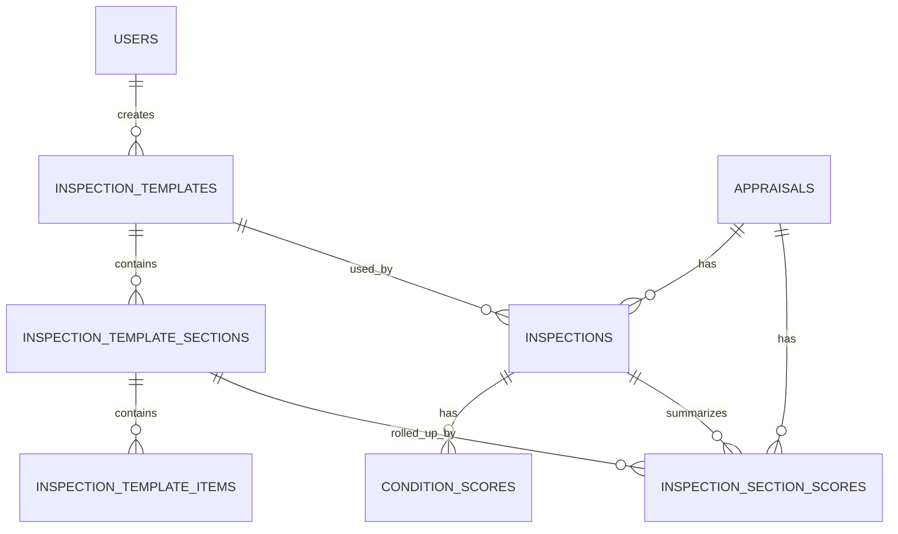

# ONE Classics Nexus
## 04_Data_Inspections

**Document Name:** Nexus_04_Data_Inspections_v1.1.md  
**Version:** 1.1  
**Status:** Reconciled to Database Source of Truth  
**Prepared For:** DBA, Technical Architect, Tech Lead, QA, API Engineering  
**System:** ONE_Classics_Nexus  
**Target Repo Location:** `/docs/04_Data/04_Data_Inspections/`  
**Last Regenerated:** 2026-06-25  
**Supersedes:** `Nexus_04_Data_Inspections_v1.0.md`

---

# 1. Purpose

The `04_Data_Inspections` package defines the inspection data model for ONE Classics Nexus. Version 1.1 reconciles the prior v1.0 design package against the attached ONE_Classics_Nexus database DDL files and treats those table schemas as the source of truth for the reconciled tables.

The inspection module is responsible for:

1. Creating and managing appraisal-linked inspection records.
2. Capturing template-driven inspection detail.
3. Capturing canonical 12-system vehicle condition scores.
4. Persisting score rollups for section-level review and valuation preparation.
5. Supporting red-flag-aware inspection scoring.
6. Supporting auditability, repeatability, and deterministic valuation input data.

---

# 2. Source-of-Truth Inputs

Version 1.1 was reconciled against the following database DDL files:

| Source File | Source-of-Truth Table |
|---|---|
| `CREATE_inspection_template.sql` | `inspection_templates` |
| `CREATE_inspection_sections.sql` | `inspection_template_sections` |
| `CREATE_inspection_template_items.sql` | `inspection_template_items` |
| `CREATE_condition_scores.sql` | `condition_scores` |
| `CREATE_inspection_section_scores.sql` | `inspection_section_scores` |

The following v1.0 tables were not included in the uploaded DDL set and therefore remain design-level references until their database schemas are provided and reconciled:

| Table | v1.1 Treatment |
|---|---|
| `inspections` | Retained as parent inspection table concept; column-level details should be verified against the actual database DDL. |
| `inspection_item_scores` | Retained as design-level future/detail table until database DDL is provided. |
| `inspection_red_flags` | Retained as design-level future/detail table until database DDL is provided. |
| `inspection_media` | Retained as design-level future/detail table until database DDL is provided. |

---

# 3. v1.1 Reconciliation Summary

| Area | v1.0 Design | v1.1 Corrected Source-of-Truth Alignment |
|---|---|---|
| Template table name | `inspection_templates` | Confirmed. |
| Template code uniqueness | Documented as `UNIQUE` | Corrected: DDL has non-unique index `idx_inspection_templates_code`; no unique constraint is present. |
| Template family | Not represented or represented as `inspection_type` | Corrected: use `template_family VARCHAR(30) NOT NULL`. |
| Template version | `version` | Corrected: use `version_label VARCHAR(30) NOT NULL`. |
| Template active flag | `is_active BOOLEAN` | Corrected: use `status VARCHAR(30) NOT NULL`. |
| Template date range | Not represented | Corrected: use `effective_from_utc` and `effective_to_utc`. |
| Template creator | Not represented | Corrected: use `created_by_user_id` FK to `users(user_id)`. |
| Template timestamps | Manually required | Corrected: `created_at_utc` and `updated_at_utc` default to `CURRENT_TIMESTAMP(6)`; `updated_at_utc` uses `ON UPDATE`. |
| Template section display column | `section_name` | Corrected: use `display_name VARCHAR(150) NOT NULL`. |
| Template section required flag | `is_required` | Removed from section source model; not present in DDL. |
| Template section updated timestamp | `updated_at_utc` | Removed from section source model; not present in DDL. |
| Template section weight | `DECIMAL(6,4)` | Corrected: `weight DECIMAL(9,6) NOT NULL`. |
| Template item key | `item_code` | Corrected: use `item_key VARCHAR(80) NOT NULL`. |
| Template item label | `item_label` | Corrected: use `display_name VARCHAR(200) NOT NULL`. |
| Template item help text | `item_help_text` | Corrected: use `help_text TEXT`. |
| Template item default weight | Not represented | Corrected: `default_weight DECIMAL(9,6) NULL`. |
| Template item red-flag support | Not represented | Corrected: `allows_red_flag TINYINT(1) NOT NULL DEFAULT 1`. |
| Template item updated timestamp | `updated_at_utc` | Removed from item source model; not present in DDL. |
| Condition score precision | `DECIMAL(3,2)` | Confirmed source-of-truth. |
| Condition score weight | `DECIMAL(6,4)` | Confirmed source-of-truth. |
| Condition score FK behavior | No cascade documented | Corrected: FK uses `ON DELETE CASCADE`. |
| Condition score unique key name | `ux_condition_scores_inspection_system` | Corrected: DDL key name is `uk_inspection_system`. |
| Section score precision | `DECIMAL(3,2)` or `section_score_0_to_5` | Corrected: source column is `score_0_to_5 DECIMAL(4,2) NOT NULL`. |
| Section normalized score | Not present | Corrected: `normalized_score_0_to_100 DECIMAL(6,2) NULL`. |
| Section score appraisal link | Not present | Corrected: `appraisal_id CHAR(36) NOT NULL` with FK to `appraisals`. |
| Section template section link | Not present | Corrected: `inspection_template_section_id CHAR(36) NOT NULL` with FK to `inspection_template_sections`. |
| Section red flag summary | `has_red_flags BOOLEAN` | Corrected: source column is `red_flag_count INT NOT NULL DEFAULT 0`. |
| Section score weight precision | `DECIMAL(6,4)` | Corrected: `weight DECIMAL(9,6) NOT NULL`. |
| Section weighted score precision | `DECIMAL(8,4)` | Corrected: `weighted_score DECIMAL(12,6) NULL`. |

---

# 4. Locked Inspection Data Design Decisions for v1.1

The following decisions are locked for `04_Data_Inspections_v1.1`.

| Decision Area | Locked Decision |
|---|---|
| Database source of truth | Attached database DDL is authoritative for reconciled tables. |
| Template usage | Template tables are required immediately and are part of the baseline data model. |
| Template status model | Use `inspection_templates.status`; do not use the v1.0 `is_active` column. |
| Template family model | Use `inspection_templates.template_family`; do not use `inspection_type` on template rows unless added by future migration. |
| Condition score precision | Store canonical condition scores as `condition_scores.score_0_to_5 DECIMAL(3,2)`. |
| Section score precision | Store section rollup scores as `inspection_section_scores.score_0_to_5 DECIMAL(4,2)`. |
| Section normalized score | Persist `inspection_section_scores.normalized_score_0_to_100 DECIMAL(6,2)` when available. |
| Section weighted score | Persist `inspection_section_scores.weighted_score DECIMAL(12,6)` when available. |
| Red flag rollup on section scores | Use `inspection_section_scores.red_flag_count`; do not use `has_red_flags` on section scores. |
| Condition score uniqueness | Enforce one canonical condition score per inspection and system number using `uk_inspection_system`. |
| Condition score delete behavior | Child `condition_scores` rows cascade when the parent `inspections` row is hard-deleted by the database. Application delete behavior should still follow project soft-delete rules where the parent table supports them. |
| Media storage | Media remains metadata plus external storage URI only, but the `inspection_media` DDL was not included in this reconciliation set. |

---

# 5. Core Entity Relationship Model



Notes:

1. The `inspections` parent table is referenced by the uploaded `condition_scores` and `inspection_section_scores` DDL, but the `CREATE_inspections.sql` file was not included in the reconciliation package.
2. `inspection_template_items` are implemented in the source DDL, but the corresponding response table `inspection_item_scores` was not included in the uploaded DDL set.

---

# 6. Canonical 12-System Inspection Model

The following mapping remains locked for ONE Classics Nexus and must not be renumbered.

| System # | System Name | `system_key` |
|---:|---|---|
| 1 | Body & Exterior | `body_exterior` |
| 2 | Frame & Structure | `frame_structure` |
| 3 | Engine / Powertrain | `powertrain` |
| 4 | Transmission & Driveline | `transmission_driveline` |
| 5 | Suspension & Steering | `suspension_steering` |
| 6 | Braking System | `braking_system` |
| 7 | Electrical System | `electrical_system` |
| 8 | Interior | `interior` |
| 9 | Wheels & Tires | `wheels_tires` |
| 10 | Trim, Glass & Details | `trim_glass_details` |
| 11 | Documentation & Provenance | `documentation_provenance` |
| 12 | Road Test & Functional | `road_test_functional` |

---

# 7. Vehicle-Type Weight Sets

These weight sets remain the project-level canonical weight assumptions. They must be loaded into `inspection_template_sections.weight` for the applicable `inspection_templates.template_family` rows.

## 7.1 Standard Vehicle Weights

| System # | `system_key` | Weight |
|---:|---|---:|
| 1 | `body_exterior` | 0.060000 |
| 2 | `frame_structure` | 0.100000 |
| 3 | `powertrain` | 0.180000 |
| 4 | `transmission_driveline` | 0.140000 |
| 5 | `suspension_steering` | 0.100000 |
| 6 | `braking_system` | 0.100000 |
| 7 | `electrical_system` | 0.100000 |
| 8 | `interior` | 0.040000 |
| 9 | `wheels_tires` | 0.060000 |
| 10 | `trim_glass_details` | 0.020000 |
| 11 | `documentation_provenance` | 0.040000 |
| 12 | `road_test_functional` | 0.060000 |

## 7.2 Custom Vehicle Weights

| System # | `system_key` | Weight |
|---:|---|---:|
| 1 | `body_exterior` | 0.150000 |
| 2 | `frame_structure` | 0.120000 |
| 3 | `powertrain` | 0.160000 |
| 4 | `transmission_driveline` | 0.100000 |
| 5 | `suspension_steering` | 0.080000 |
| 6 | `braking_system` | 0.060000 |
| 7 | `electrical_system` | 0.080000 |
| 8 | `interior` | 0.080000 |
| 9 | `wheels_tires` | 0.050000 |
| 10 | `trim_glass_details` | 0.050000 |
| 11 | `documentation_provenance` | 0.030000 |
| 12 | `road_test_functional` | 0.040000 |

## 7.3 Vintage/Classic Vehicle Weights

| System # | `system_key` | Weight |
|---:|---|---:|
| 1 | `body_exterior` | 0.120000 |
| 2 | `frame_structure` | 0.090000 |
| 3 | `powertrain` | 0.130000 |
| 4 | `transmission_driveline` | 0.080000 |
| 5 | `suspension_steering` | 0.060000 |
| 6 | `braking_system` | 0.050000 |
| 7 | `electrical_system` | 0.050000 |
| 8 | `interior` | 0.090000 |
| 9 | `wheels_tires` | 0.040000 |
| 10 | `trim_glass_details` | 0.080000 |
| 11 | `documentation_provenance` | 0.120000 |
| 12 | `road_test_functional` | 0.090000 |

---

# 8. Scoring Rules

## 8.1 Canonical Condition Scores

`condition_scores.score_0_to_5` is the canonical 12-system score used by the Condition Engine.

| Rule | Requirement |
|---|---|
| Physical storage | `DECIMAL(3,2)` |
| Minimum value | `0.00` |
| Maximum value | `5.00` |
| API type | `decimal` |
| C# type | `decimal` |
| Source table | `condition_scores` |
| Source column | `score_0_to_5` |
| Required unique row grain | One row per `inspection_id` + `system_number` |

Condition score formula:

```text
Condition Index = ROUND(SUM(condition_scores.score_0_to_5 * condition_scores.weight) * 20, 2)
```

## 8.2 Section Score Rollups

`inspection_section_scores` stores section-level scoring and rollup values tied to the parent inspection, appraisal, and template section.

| Rule | Requirement |
|---|---|
| Section score column | `score_0_to_5` |
| Physical storage | `DECIMAL(4,2)` |
| Normalized score column | `normalized_score_0_to_100 DECIMAL(6,2)` |
| Section weight | `weight DECIMAL(9,6)` |
| Weighted score | `weighted_score DECIMAL(12,6)` |
| Red flag rollup | `red_flag_count INT` |
| Required unique row grain | One row per `inspection_id` + `system_number` |

Recommended section calculations:

```text
normalized_score_0_to_100 = ROUND(score_0_to_5 * 20, 2)
weighted_score = ROUND(score_0_to_5 * weight, 6)
red_flag_count = count of unresolved or active red flags for the section
```

The database DDL does not define generated columns or check constraints for these calculations. The application layer or repository transaction should compute and persist these values consistently.

---

# 9. Source-of-Truth Table Specifications

## 9.1 `inspection_templates`

Defines reusable templates for inspection workflows.

| Column | Type | Required | Description |
|---|---|---:|---|
| `inspection_template_id` | `CHAR(36)` | Yes | Primary GUID. |
| `template_code` | `VARCHAR(50)` | Yes | Template business code. Indexed, but not unique in the current DDL. |
| `template_family` | `VARCHAR(30)` | Yes | Template family such as `Standard`, `Custom`, or `VintageClassic`. |
| `template_name` | `VARCHAR(150)` | Yes | Human-readable template name. |
| `version_label` | `VARCHAR(30)` | Yes | Version label, such as `v1.0` or `vNext`. |
| `description` | `TEXT` | No | Template description. |
| `total_system_count` | `INT(11)` | Yes | Expected total systems; defaults to `12`. |
| `status` | `VARCHAR(30)` | Yes | Template lifecycle status. |
| `effective_from_utc` | `DATETIME(6)` | No | Template effective start date/time. |
| `effective_to_utc` | `DATETIME(6)` | No | Template effective end date/time. |
| `created_by_user_id` | `CHAR(36)` | No | FK to `users(user_id)`. |
| `created_at_utc` | `DATETIME(6)` | Yes | Defaults to `CURRENT_TIMESTAMP(6)`. |
| `updated_at_utc` | `DATETIME(6)` | Yes | Defaults to `CURRENT_TIMESTAMP(6)` and auto-updates. |

Indexes and constraints:

```sql
PRIMARY KEY (`inspection_template_id`)
KEY `idx_inspection_templates_code` (`template_code`)
KEY `idx_inspection_templates_family` (`template_family`)
KEY `idx_inspection_templates_created_by` (`created_by_user_id`)
CONSTRAINT `fk_inspection_templates_created_by`
    FOREIGN KEY (`created_by_user_id`) REFERENCES `users` (`user_id`)
```

## 9.2 `inspection_template_sections`

Defines template sections mapped to the canonical 12-system model.

| Column | Type | Required | Description |
|---|---|---:|---|
| `inspection_template_section_id` | `CHAR(36)` | Yes | Primary GUID. |
| `inspection_template_id` | `CHAR(36)` | Yes | FK to `inspection_templates`. |
| `system_number` | `INT(11)` | Yes | Canonical system number. |
| `system_key` | `VARCHAR(50)` | Yes | Canonical system key. |
| `display_name` | `VARCHAR(150)` | Yes | Human-readable section name. |
| `description` | `TEXT` | No | Section description. |
| `weight` | `DECIMAL(9,6)` | Yes | Section weight. |
| `sort_order` | `INT(11)` | Yes | UI/display order. |
| `created_at_utc` | `DATETIME(6)` | Yes | Defaults to `CURRENT_TIMESTAMP(6)`. |

Indexes and constraints:

```sql
PRIMARY KEY (`inspection_template_section_id`)
UNIQUE KEY `uq_template_sections_template_system` (`inspection_template_id`, `system_number`)
KEY `idx_template_sections_template` (`inspection_template_id`)
KEY `idx_template_sections_system_key` (`system_key`)
CONSTRAINT `fk_template_sections_template`
    FOREIGN KEY (`inspection_template_id`) REFERENCES `inspection_templates` (`inspection_template_id`)
```

## 9.3 `inspection_template_items`

Defines checklist items for each inspection template section.

| Column | Type | Required | Description |
|---|---|---:|---|
| `inspection_template_item_id` | `CHAR(36)` | Yes | Primary GUID. |
| `inspection_template_section_id` | `CHAR(36)` | Yes | FK to `inspection_template_sections`. |
| `item_key` | `VARCHAR(80)` | Yes | Item business key unique within the section. |
| `display_name` | `VARCHAR(200)` | Yes | Human-readable item name. |
| `help_text` | `TEXT` | No | UI/help guidance. |
| `response_type` | `VARCHAR(30)` | Yes | Expected response type. |
| `default_weight` | `DECIMAL(9,6)` | No | Optional item-level default weight. |
| `allows_red_flag` | `TINYINT(1)` | Yes | Whether this item can trigger a red flag; defaults to `1`. |
| `is_required` | `TINYINT(1)` | Yes | Whether item is required; defaults to `0`. |
| `sort_order` | `INT(11)` | Yes | UI/display order. |
| `created_at_utc` | `DATETIME(6)` | Yes | Defaults to `CURRENT_TIMESTAMP(6)`. |

Indexes and constraints:

```sql
PRIMARY KEY (`inspection_template_item_id`)
UNIQUE KEY `uq_template_items_section_key` (`inspection_template_section_id`, `item_key`)
KEY `idx_template_items_section` (`inspection_template_section_id`)
CONSTRAINT `fk_template_items_section`
    FOREIGN KEY (`inspection_template_section_id`) REFERENCES `inspection_template_sections` (`inspection_template_section_id`)
```

## 9.4 `condition_scores`

Stores the canonical 12-system condition scores used by the condition engine.

| Column | Type | Required | Description |
|---|---|---:|---|
| `condition_score_id` | `CHAR(36)` | Yes | Primary GUID. |
| `inspection_id` | `CHAR(36)` | Yes | FK to `inspections`. |
| `system_number` | `INT(11)` | Yes | Canonical system number. |
| `system_key` | `VARCHAR(50)` | Yes | Canonical system key. |
| `score_0_to_5` | `DECIMAL(3,2)` | Yes | System score from `0.00` through `5.00`. |
| `weight` | `DECIMAL(6,4)` | Yes | Vehicle/template-specific system weight. |
| `is_red_flag` | `TINYINT(1)` | Yes | Inline red-flag indicator; defaults to `0`. |
| `notes` | `TEXT` | No | Inspector notes. |
| `created_at_utc` | `DATETIME(6)` | Yes | Defaults to `CURRENT_TIMESTAMP(6)`. |
| `updated_at_utc` | `DATETIME(6)` | Yes | Defaults to `CURRENT_TIMESTAMP(6)` and auto-updates. |

Indexes and constraints:

```sql
PRIMARY KEY (`condition_score_id`)
UNIQUE KEY `uk_inspection_system` (`inspection_id`, `system_number`)
KEY `idx_inspection` (`inspection_id`)
CONSTRAINT `fk_condition_scores_inspection`
    FOREIGN KEY (`inspection_id`) REFERENCES `inspections` (`inspection_id`) ON DELETE CASCADE
```

## 9.5 `inspection_section_scores`

Stores section-level rollups for an inspection. This table is tied to both the parent appraisal and the template section.

| Column | Type | Required | Description |
|---|---|---:|---|
| `inspection_section_score_id` | `CHAR(36)` | Yes | Primary GUID. |
| `inspection_id` | `CHAR(36)` | Yes | FK to `inspections`. |
| `appraisal_id` | `CHAR(36)` | Yes | FK to `appraisals`. |
| `inspection_template_section_id` | `CHAR(36)` | Yes | FK to `inspection_template_sections`. |
| `system_number` | `INT(11)` | Yes | Canonical system number. |
| `system_key` | `VARCHAR(50)` | Yes | Canonical system key. |
| `score_0_to_5` | `DECIMAL(4,2)` | Yes | Section score. |
| `normalized_score_0_to_100` | `DECIMAL(6,2)` | No | Normalized 0-100 section score. |
| `weight` | `DECIMAL(9,6)` | Yes | Section weight. |
| `weighted_score` | `DECIMAL(12,6)` | No | Weighted score. |
| `red_flag_count` | `INT(11)` | Yes | Red flag count for the section; defaults to `0`. |
| `notes` | `TEXT` | No | Section rollup notes. |
| `created_at_utc` | `DATETIME(6)` | Yes | Defaults to `CURRENT_TIMESTAMP(6)`. |
| `updated_at_utc` | `DATETIME(6)` | Yes | Defaults to `CURRENT_TIMESTAMP(6)` and auto-updates. |

Indexes and constraints:

```sql
PRIMARY KEY (`inspection_section_score_id`)
UNIQUE KEY `uq_section_scores_inspection_system` (`inspection_id`, `system_number`)
KEY `idx_section_scores_appraisal` (`appraisal_id`)
KEY `idx_section_scores_inspection` (`inspection_id`)
KEY `idx_section_scores_section` (`inspection_template_section_id`)
CONSTRAINT `fk_section_scores_appraisal`
    FOREIGN KEY (`appraisal_id`) REFERENCES `appraisals` (`appraisal_id`)
CONSTRAINT `fk_section_scores_inspection`
    FOREIGN KEY (`inspection_id`) REFERENCES `inspections` (`inspection_id`)
CONSTRAINT `fk_section_scores_section`
    FOREIGN KEY (`inspection_template_section_id`) REFERENCES `inspection_template_sections` (`inspection_template_section_id`)
```

---

# 10. Corrected SQL DDL Baseline

The following DDL is copied from the attached source-of-truth database schema files and replaces the conflicting v1.0 DDL snippets for these tables.

## 10.1 `inspection_templates`

```sql
-- one_classics_nexus_test.inspection_templates definition

create table `inspection_templates` (
  `inspection_template_id` char(36) not null,
`template_code` varchar(50) not null,
`template_family` varchar(30) not null,
`template_name` varchar(150) not null,
`version_label` varchar(30) not null,
`description` text default null,
`total_system_count` int(11) not null default 12,
`status` varchar(30) not null,
`effective_from_utc` datetime(6) default null,
`effective_to_utc` datetime(6) default null,
`created_by_user_id` char(36) default null,
`created_at_utc` datetime(6) not null default current_timestamp(6),
`updated_at_utc` datetime(6) not null default current_timestamp(6) on
update
    current_timestamp(6),
    primary key (`inspection_template_id`),
    key `idx_inspection_templates_code` (`template_code`),
    key `idx_inspection_templates_family` (`template_family`),
    key `idx_inspection_templates_created_by` (`created_by_user_id`),
    constraint `fk_inspection_templates_created_by` foreign key (`created_by_user_id`) references `users` (`user_id`)
) engine = InnoDB default CHARSET = utf8mb4 collate = utf8mb4_unicode_ci;
```

## 10.2 `inspection_template_sections`

```sql
-- one_classics_nexus_test.inspection_template_sections definition

create table `inspection_template_sections` (
  `inspection_template_section_id` char(36) not null,
`inspection_template_id` char(36) not null,
`system_number` int(11) not null,
`system_key` varchar(50) not null,
`display_name` varchar(150) not null,
`description` text default null,
`weight` decimal(9, 6) not null,
`sort_order` int(11) not null,
`created_at_utc` datetime(6) not null default current_timestamp(6),
primary key (`inspection_template_section_id`),
unique key `uq_template_sections_template_system` (`inspection_template_id`,
`system_number`),
key `idx_template_sections_template` (`inspection_template_id`),
key `idx_template_sections_system_key` (`system_key`),
constraint `fk_template_sections_template` foreign key (`inspection_template_id`) references `inspection_templates` (`inspection_template_id`)
) engine = InnoDB default CHARSET = utf8mb4 collate = utf8mb4_unicode_ci;
```

## 10.3 `inspection_template_items`

```sql
-- one_classics_nexus_test.inspection_template_items definition

create table `inspection_template_items` (
  `inspection_template_item_id` char(36) not null,
`inspection_template_section_id` char(36) not null,
`item_key` varchar(80) not null,
`display_name` varchar(200) not null,
`help_text` text default null,
`response_type` varchar(30) not null,
`default_weight` decimal(9, 6) default null,
`allows_red_flag` tinyint(1) not null default 1,
`is_required` tinyint(1) not null default 0,
`sort_order` int(11) not null,
`created_at_utc` datetime(6) not null default current_timestamp(6),
primary key (`inspection_template_item_id`),
unique key `uq_template_items_section_key` (`inspection_template_section_id`,
`item_key`),
key `idx_template_items_section` (`inspection_template_section_id`),
constraint `fk_template_items_section` foreign key (`inspection_template_section_id`) references `inspection_template_sections` (`inspection_template_section_id`)
) engine = InnoDB default CHARSET = utf8mb4 collate = utf8mb4_unicode_ci;
```

## 10.4 `condition_scores`

```sql
-- one_classics_nexus_test.condition_scores definition

create table `condition_scores` (
  `condition_score_id` char(36) not null,
`inspection_id` char(36) not null,
`system_number` int(11) not null,
`system_key` varchar(50) not null,
`score_0_to_5` decimal(3, 2) not null,
`weight` decimal(6, 4) not null,
`is_red_flag` tinyint(1) not null default 0,
`notes` text default null,
`created_at_utc` datetime(6) not null default current_timestamp(6),
`updated_at_utc` datetime(6) not null default current_timestamp(6) on
update
    current_timestamp(6),
    primary key (`condition_score_id`),
    unique key `uk_inspection_system` (`inspection_id`,
    `system_number`),
    key `idx_inspection` (`inspection_id`),
    constraint `fk_condition_scores_inspection` foreign key (`inspection_id`) references `inspections` (`inspection_id`) on
    delete
        cascade
) engine = InnoDB default CHARSET = utf8mb4 collate = utf8mb4_unicode_ci;
```

## 10.5 `inspection_section_scores`

```sql
-- one_classics_nexus_test.inspection_section_scores definition

create table `inspection_section_scores` (
  `inspection_section_score_id` char(36) not null,
`inspection_id` char(36) not null,
`appraisal_id` char(36) not null,
`inspection_template_section_id` char(36) not null,
`system_number` int(11) not null,
`system_key` varchar(50) not null,
`score_0_to_5` decimal(4, 2) not null,
`normalized_score_0_to_100` decimal(6, 2) default null,
`weight` decimal(9, 6) not null,
`weighted_score` decimal(12, 6) default null,
`red_flag_count` int(11) not null default 0,
`notes` text default null,
`created_at_utc` datetime(6) not null default current_timestamp(6),
`updated_at_utc` datetime(6) not null default current_timestamp(6) on
update
    current_timestamp(6),
    primary key (`inspection_section_score_id`),
    unique key `uq_section_scores_inspection_system` (`inspection_id`,
    `system_number`),
    key `idx_section_scores_appraisal` (`appraisal_id`),
    key `idx_section_scores_inspection` (`inspection_id`),
    key `idx_section_scores_section` (`inspection_template_section_id`),
    constraint `fk_section_scores_appraisal` foreign key (`appraisal_id`) references `appraisals` (`appraisal_id`),
    constraint `fk_section_scores_inspection` foreign key (`inspection_id`) references `inspections` (`inspection_id`),
    constraint `fk_section_scores_section` foreign key (`inspection_template_section_id`) references `inspection_template_sections` (`inspection_template_section_id`)
) engine = InnoDB default CHARSET = utf8mb4 collate = utf8mb4_unicode_ci;
```

---

# 11. Removed or Corrected v1.0 DDL Assumptions

The following v1.0 assumptions must not be used in implementation unless a later migration explicitly adds them.

## 11.1 Do Not Use These `inspection_templates` Columns

```text
inspection_type
vehicle_type_code
version
is_active
```

Use instead:

```text
template_family
version_label
status
effective_from_utc
effective_to_utc
created_by_user_id
```

## 11.2 Do Not Use These `inspection_template_sections` Columns

```text
section_name
is_required
updated_at_utc
```

Use instead:

```text
display_name
description
weight DECIMAL(9,6)
created_at_utc
```

## 11.3 Do Not Use These `inspection_template_items` Columns

```text
item_code
item_label
item_help_text
updated_at_utc
```

Use instead:

```text
item_key
display_name
help_text
default_weight
allows_red_flag
created_at_utc
```

## 11.4 Do Not Use These `inspection_section_scores` Columns

```text
section_score_0_to_5
has_red_flags
```

Use instead:

```text
score_0_to_5
normalized_score_0_to_100
red_flag_count
inspection_template_section_id
appraisal_id
```

---

# 12. API Contract Alignment

API DTOs must align to the source-of-truth column names while preserving C# naming conventions.

## 12.1 Template Response DTO Alignment

```json
{
  "inspectionTemplateId": "9cb93bbd-fd5e-4f7e-b28c-1125703d21fc",
  "templateCode": "VINTAGE_CLASSIC_12SYS_V1",
  "templateFamily": "VintageClassic",
  "templateName": "Vintage/Classic 12-System Inspection",
  "versionLabel": "v1.0",
  "description": "12-system inspection template for vintage and classic vehicles.",
  "totalSystemCount": 12,
  "status": "Active",
  "effectiveFromUtc": "2026-01-01T00:00:00.000000Z",
  "effectiveToUtc": null,
  "createdByUserId": null,
  "createdAtUtc": "2026-06-25T00:00:00.000000Z",
  "updatedAtUtc": "2026-06-25T00:00:00.000000Z"
}
```

## 12.2 Template Section Response DTO Alignment

```json
{
  "inspectionTemplateSectionId": "aaaaaaaa-aaaa-aaaa-aaaa-aaaaaaaaaaaa",
  "inspectionTemplateId": "9cb93bbd-fd5e-4f7e-b28c-1125703d21fc",
  "systemNumber": 1,
  "systemKey": "body_exterior",
  "displayName": "Body & Exterior",
  "description": "Exterior panels, paint, body alignment, corrosion, and visible body condition.",
  "weight": 0.120000,
  "sortOrder": 1,
  "createdAtUtc": "2026-06-25T00:00:00.000000Z"
}
```

## 12.3 Template Item Response DTO Alignment

```json
{
  "inspectionTemplateItemId": "bbbbbbbb-bbbb-bbbb-bbbb-bbbbbbbbbbbb",
  "inspectionTemplateSectionId": "aaaaaaaa-aaaa-aaaa-aaaa-aaaaaaaaaaaa",
  "itemKey": "paint_finish",
  "displayName": "Paint Finish",
  "helpText": "Assess paint consistency, orange peel, checking, cracking, chips, and repaint evidence.",
  "responseType": "Score0To5",
  "defaultWeight": 0.250000,
  "allowsRedFlag": true,
  "isRequired": true,
  "sortOrder": 1,
  "createdAtUtc": "2026-06-25T00:00:00.000000Z"
}
```

## 12.4 Condition Score Request DTO Alignment

```json
{
  "scores": [
    {
      "systemNumber": 1,
      "systemKey": "body_exterior",
      "score0To5": 4.25,
      "weight": 0.1200,
      "isRedFlag": false,
      "notes": "Paint and panel alignment are strong with minor age-appropriate blemishes."
    }
  ]
}
```

## 12.5 Section Score Response DTO Alignment

```json
{
  "inspectionSectionScoreId": "cccccccc-cccc-cccc-cccc-cccccccccccc",
  "inspectionId": "dddddddd-dddd-dddd-dddd-dddddddddddd",
  "appraisalId": "eeeeeeee-eeee-eeee-eeee-eeeeeeeeeeee",
  "inspectionTemplateSectionId": "aaaaaaaa-aaaa-aaaa-aaaa-aaaaaaaaaaaa",
  "systemNumber": 1,
  "systemKey": "body_exterior",
  "score0To5": 4.25,
  "normalizedScore0To100": 85.00,
  "weight": 0.120000,
  "weightedScore": 0.510000,
  "redFlagCount": 0,
  "notes": "Body section rollup calculated from item and/or condition score data.",
  "createdAtUtc": "2026-06-25T00:00:00.000000Z",
  "updatedAtUtc": "2026-06-25T00:00:00.000000Z"
}
```

---

# 13. Repository Alignment Rules

## 13.1 `InspectionTemplateRepository`

Required methods:

```csharp
Task<InspectionTemplate?> GetByIdAsync(Guid inspectionTemplateId, CancellationToken cancellationToken);
Task<InspectionTemplate?> GetActiveByIdAsync(Guid inspectionTemplateId, CancellationToken cancellationToken);
Task<IReadOnlyList<InspectionTemplate>> GetByFamilyAsync(string templateFamily, CancellationToken cancellationToken);
Task<IReadOnlyList<InspectionTemplateSection>> GetSectionsAsync(Guid inspectionTemplateId, CancellationToken cancellationToken);
Task<IReadOnlyList<InspectionTemplateItem>> GetItemsBySectionIdAsync(Guid inspectionTemplateSectionId, CancellationToken cancellationToken);
```

Rules:

1. Active template filtering must use `status = 'Active'` and effective date rules, not `is_active`.
2. Template family filtering must use `template_family`, not `inspection_type`.
3. Template version must map to `version_label`, not `version`.
4. Template code is indexed but not database-unique in the current DDL. Application-level rules may still enforce uniqueness for seed data and API writes.
5. Repository SQL must include `created_by_user_id` when mapping template records.

## 13.2 `ConditionScoreRepository`

Required methods:

```csharp
Task<IReadOnlyList<ConditionScore>> GetByInspectionIdAsync(Guid inspectionId, CancellationToken cancellationToken);
Task ReplaceScoresAsync(Guid inspectionId, IReadOnlyList<ConditionScore> scores, CancellationToken cancellationToken);
```

Rules:

1. Insert `condition_score_id` as a GUID string.
2. Use `score_0_to_5 DECIMAL(3,2)`.
3. Use `weight DECIMAL(6,4)`.
4. Enforce one row per inspection and system number using `uk_inspection_system`.
5. Persist `is_red_flag` as `TINYINT(1)` / C# `bool`.
6. Account for `ON DELETE CASCADE` at the database layer, but do not rely on hard delete for normal application deletion.

## 13.3 `InspectionSectionScoreRepository`

Required methods:

```csharp
Task<IReadOnlyList<InspectionSectionScore>> GetByInspectionIdAsync(Guid inspectionId, CancellationToken cancellationToken);
Task ReplaceSectionScoresAsync(Guid inspectionId, IReadOnlyList<InspectionSectionScore> scores, CancellationToken cancellationToken);
```

Rules:

1. Insert `inspection_section_score_id` as a GUID string.
2. Insert and map `appraisal_id`.
3. Insert and map `inspection_template_section_id`.
4. Use `score_0_to_5 DECIMAL(4,2)`.
5. Use `normalized_score_0_to_100 DECIMAL(6,2)` when computed.
6. Use `weight DECIMAL(9,6)`.
7. Use `weighted_score DECIMAL(12,6)` when computed.
8. Use `red_flag_count`, not `has_red_flags`.
9. Enforce one row per inspection and system number using `uq_section_scores_inspection_system`.

---

# 14. Transaction Rules

## 14.1 Condition Score Replacement Transaction

`PUT /api/inspections/{id}/scores` must replace all canonical condition score rows for the inspection inside a transaction.

Transaction steps:

1. Validate inspection exists.
2. Validate inspection is not soft-deleted if the parent `inspections` table includes soft-delete columns.
3. Validate score payload.
4. Validate that each `system_number` is unique in the payload.
5. Validate each `system_key` matches the canonical 12-system mapping.
6. Validate each `score_0_to_5` is between `0.00` and `5.00`.
7. Validate each `weight` matches the active template section or configured weight set.
8. Delete existing `condition_scores` rows for the inspection.
9. Insert new `condition_scores` rows.
10. Recalculate inspection-level summary fields where present on the `inspections` table.
11. Recalculate section scores if the endpoint is responsible for rollups.
12. Commit.

Rollback on any failure.

## 14.2 Section Score Replacement Transaction

Section score rollups must be persisted consistently with the source DDL.

Transaction steps:

1. Resolve the parent inspection and appraisal.
2. Resolve each `inspection_template_section_id` from the inspection template sections.
3. Compute or accept `score_0_to_5` as `DECIMAL(4,2)`.
4. Compute `normalized_score_0_to_100 = ROUND(score_0_to_5 * 20, 2)` where available.
5. Compute `weighted_score = ROUND(score_0_to_5 * weight, 6)` where available.
6. Compute `red_flag_count` for the section.
7. Replace existing section rows by `inspection_id`.
8. Insert rows into `inspection_section_scores`.
9. Commit.

---

# 15. QA Coverage Matrix Updates

| Test ID | Area | Scenario | Expected Result |
|---|---|---|---|
| `TMPL-R-001` | Template | Read active template by `inspection_template_id` | Uses `status = 'Active'`; does not query `is_active`. |
| `TMPL-R-002` | Template | Read templates by family | Uses `template_family`. |
| `TMPL-R-003` | Template | Verify template code handling | `template_code` is indexed; uniqueness is application/seed-data controlled unless database constraint is added. |
| `SECT-R-001` | Sections | Read template sections | Maps `display_name`, `description`, `weight DECIMAL(9,6)`, and `sort_order`. |
| `ITEM-R-001` | Items | Read template items | Maps `item_key`, `display_name`, `help_text`, `default_weight`, `allows_red_flag`, and `is_required`. |
| `COND-U-001` | Condition Scores | Persist score `4.25` | Stored exactly as `DECIMAL(3,2)`. |
| `COND-U-002` | Condition Scores | Duplicate system score for same inspection | Rejected by `uk_inspection_system`. |
| `COND-D-001` | Condition Scores | DBA hard-deletes parent inspection | Child `condition_scores` cascade by FK. |
| `SECS-U-001` | Section Scores | Persist section score `4.25` | Stored as `DECIMAL(4,2)`. |
| `SECS-U-002` | Section Scores | Persist normalized section score | `normalized_score_0_to_100 = 85.00`. |
| `SECS-U-003` | Section Scores | Persist weighted score | Stored as `DECIMAL(12,6)`. |
| `SECS-U-004` | Section Scores | Persist red flag rollup | Uses `red_flag_count`, not `has_red_flags`. |
| `SECS-U-005` | Section Scores | Missing appraisal ID | Insert fails due to `appraisal_id NOT NULL` / FK. |
| `SECS-U-006` | Section Scores | Missing template section ID | Insert fails due to `inspection_template_section_id NOT NULL` / FK. |

---

# 16. Swagger Test Data Updates

## 16.1 Template Record Example

```json
{
  "inspectionTemplateId": "9cb93bbd-fd5e-4f7e-b28c-1125703d21fc",
  "templateCode": "VINTAGE_CLASSIC_12SYS_V1",
  "templateFamily": "VintageClassic",
  "templateName": "Vintage/Classic 12-System Inspection",
  "versionLabel": "v1.0",
  "description": "12-system inspection template for vintage and classic vehicles.",
  "totalSystemCount": 12,
  "status": "Active",
  "effectiveFromUtc": "2026-01-01T00:00:00.000000Z",
  "effectiveToUtc": null,
  "createdByUserId": null
}
```

## 16.2 Template Section Record Example

```json
{
  "inspectionTemplateSectionId": "aaaaaaaa-aaaa-aaaa-aaaa-aaaaaaaaaaaa",
  "inspectionTemplateId": "9cb93bbd-fd5e-4f7e-b28c-1125703d21fc",
  "systemNumber": 1,
  "systemKey": "body_exterior",
  "displayName": "Body & Exterior",
  "description": "Exterior body panels, paint, corrosion, alignment, and visible presentation.",
  "weight": 0.120000,
  "sortOrder": 1
}
```

## 16.3 Template Item Record Example

```json
{
  "inspectionTemplateItemId": "bbbbbbbb-bbbb-bbbb-bbbb-bbbbbbbbbbbb",
  "inspectionTemplateSectionId": "aaaaaaaa-aaaa-aaaa-aaaa-aaaaaaaaaaaa",
  "itemKey": "paint_finish",
  "displayName": "Paint Finish",
  "helpText": "Inspect paint quality, consistency, blemishes, checking, cracking, overspray, and repaint evidence.",
  "responseType": "Score0To5",
  "defaultWeight": 0.250000,
  "allowsRedFlag": true,
  "isRequired": true,
  "sortOrder": 1
}
```

## 16.4 Section Score Record Example

```json
{
  "inspectionSectionScoreId": "cccccccc-cccc-cccc-cccc-cccccccccccc",
  "inspectionId": "dddddddd-dddd-dddd-dddd-dddddddddddd",
  "appraisalId": "eeeeeeee-eeee-eeee-eeee-eeeeeeeeeeee",
  "inspectionTemplateSectionId": "aaaaaaaa-aaaa-aaaa-aaaa-aaaaaaaaaaaa",
  "systemNumber": 1,
  "systemKey": "body_exterior",
  "score0To5": 4.25,
  "normalizedScore0To100": 85.00,
  "weight": 0.120000,
  "weightedScore": 0.510000,
  "redFlagCount": 0,
  "notes": "Body section score rollup."
}
```

---

# 17. DBA Implementation Checklist

- Verify `inspection_templates` uses `template_family`, `version_label`, `status`, effective date columns, and `created_by_user_id`.
- Verify `inspection_templates.template_code` is currently indexed but not unique.
- Verify `inspection_template_sections` uses `display_name`, `description`, and `weight DECIMAL(9,6)`.
- Verify `inspection_template_sections` does not include `updated_at_utc` in the current DDL.
- Verify `inspection_template_items` uses `item_key`, `display_name`, `help_text`, `default_weight`, and `allows_red_flag`.
- Verify `inspection_template_items` does not include `updated_at_utc` in the current DDL.
- Verify `condition_scores.score_0_to_5` is `DECIMAL(3,2)`.
- Verify `condition_scores.weight` is `DECIMAL(6,4)`.
- Verify `condition_scores` uses `uk_inspection_system` and `idx_inspection`.
- Verify `condition_scores` FK to `inspections` uses `ON DELETE CASCADE`.
- Verify `inspection_section_scores.score_0_to_5` is `DECIMAL(4,2)`.
- Verify `inspection_section_scores.normalized_score_0_to_100` is `DECIMAL(6,2)`.
- Verify `inspection_section_scores.weight` is `DECIMAL(9,6)`.
- Verify `inspection_section_scores.weighted_score` is `DECIMAL(12,6)`.
- Verify `inspection_section_scores.red_flag_count` exists and replaces the v1.0 `has_red_flags` assumption for section rollups.
- Provide source DDL for `inspections`, `inspection_item_scores`, `inspection_red_flags`, and `inspection_media` for full v1.2 reconciliation if those tables are implemented.

---

# 18. API Engineering Checklist

- Replace any DTO references to `inspectionTemplate.version` with `versionLabel`.
- Replace any DTO references to `inspectionTemplate.inspectionType` with `templateFamily`.
- Replace any active-template filter using `isActive` with `status` plus effective date filtering.
- Replace section `sectionName` fields with `displayName`.
- Replace section score `sectionScore0To5` fields with `score0To5`.
- Replace section score `hasRedFlags` fields with `redFlagCount`.
- Add `appraisalId` and `inspectionTemplateSectionId` to section score contracts where persisted or returned.
- Keep C# DTO names PascalCase while mapping exactly to snake_case database columns in repositories.
- Keep Swagger examples aligned to the v1.1 DTOs.

---

# 19. Infrastructure / Dapper Mapping Checklist

## 19.1 Template Mapping

```csharp
public sealed class InspectionTemplate
{
    public Guid InspectionTemplateId { get; init; }
    public string TemplateCode { get; init; } = string.Empty;
    public string TemplateFamily { get; init; } = string.Empty;
    public string TemplateName { get; init; } = string.Empty;
    public string VersionLabel { get; init; } = string.Empty;
    public string? Description { get; init; }
    public int TotalSystemCount { get; init; }
    public string Status { get; init; } = string.Empty;
    public DateTime? EffectiveFromUtc { get; init; }
    public DateTime? EffectiveToUtc { get; init; }
    public Guid? CreatedByUserId { get; init; }
    public DateTime CreatedAtUtc { get; init; }
    public DateTime UpdatedAtUtc { get; init; }
}
```

## 19.2 Template Section Mapping

```csharp
public sealed class InspectionTemplateSection
{
    public Guid InspectionTemplateSectionId { get; init; }
    public Guid InspectionTemplateId { get; init; }
    public int SystemNumber { get; init; }
    public string SystemKey { get; init; } = string.Empty;
    public string DisplayName { get; init; } = string.Empty;
    public string? Description { get; init; }
    public decimal Weight { get; init; }
    public int SortOrder { get; init; }
    public DateTime CreatedAtUtc { get; init; }
}
```

## 19.3 Template Item Mapping

```csharp
public sealed class InspectionTemplateItem
{
    public Guid InspectionTemplateItemId { get; init; }
    public Guid InspectionTemplateSectionId { get; init; }
    public string ItemKey { get; init; } = string.Empty;
    public string DisplayName { get; init; } = string.Empty;
    public string? HelpText { get; init; }
    public string ResponseType { get; init; } = string.Empty;
    public decimal? DefaultWeight { get; init; }
    public bool AllowsRedFlag { get; init; }
    public bool IsRequired { get; init; }
    public int SortOrder { get; init; }
    public DateTime CreatedAtUtc { get; init; }
}
```

## 19.4 Section Score Mapping

```csharp
public sealed class InspectionSectionScore
{
    public Guid InspectionSectionScoreId { get; init; }
    public Guid InspectionId { get; init; }
    public Guid AppraisalId { get; init; }
    public Guid InspectionTemplateSectionId { get; init; }
    public int SystemNumber { get; init; }
    public string SystemKey { get; init; } = string.Empty;
    public decimal Score0To5 { get; init; }
    public decimal? NormalizedScore0To100 { get; init; }
    public decimal Weight { get; init; }
    public decimal? WeightedScore { get; init; }
    public int RedFlagCount { get; init; }
    public string? Notes { get; init; }
    public DateTime CreatedAtUtc { get; init; }
    public DateTime UpdatedAtUtc { get; init; }
}
```

---

# 20. Recommended Folder Layout

```text
/docs/04_Data/04_Data_Inspections/
│
├── Nexus_04_Data_Inspections_v1.1.md
├── SQL/
│   ├── CREATE_inspection_template.sql
│   ├── CREATE_inspection_sections.sql
│   ├── CREATE_inspection_template_items.sql
│   ├── CREATE_condition_scores.sql
│   ├── CREATE_inspection_section_scores.sql
│   └── pending_reconciliation/
│       ├── CREATE_inspections.sql
│       ├── CREATE_inspection_item_scores.sql
│       ├── CREATE_inspection_red_flags.sql
│       └── CREATE_inspection_media.sql
│
├── Test_Data/
│   ├── inspection_templates_test_data.sql
│   ├── inspection_template_sections_test_data.sql
│   ├── inspection_template_items_test_data.sql
│   ├── condition_scores_test_data.sql
│   └── inspection_section_scores_test_data.sql
│
└── Diagrams/
    └── inspection_data_model.mmd
```

---

# 21. Acceptance Criteria

The v1.1 inspection data package is accepted when:

1. Repository SQL exactly matches the reconciled DDL for `inspection_templates`.
2. Repository SQL exactly matches the reconciled DDL for `inspection_template_sections`.
3. Repository SQL exactly matches the reconciled DDL for `inspection_template_items`.
4. Repository SQL exactly matches the reconciled DDL for `condition_scores`.
5. Repository SQL exactly matches the reconciled DDL for `inspection_section_scores`.
6. API and DTO names no longer expose removed v1.0 assumptions such as `isActive`, `version`, `sectionName`, `itemCode`, `itemLabel`, `sectionScore0To5`, or section-level `hasRedFlags`.
7. Template active filtering uses `status` and effective date fields.
8. Template family filtering uses `template_family`.
9. Condition scores persist `score_0_to_5` as `DECIMAL(3,2)`.
10. Section scores persist `score_0_to_5` as `DECIMAL(4,2)`.
11. Section scores include `appraisal_id` and `inspection_template_section_id`.
12. Section score red flag summaries use `red_flag_count`.
13. Integration tests pass against `one_classics_nexus_test`.
14. Source DDL files are stored with this package under `/docs/04_Data/04_Data_Inspections/SQL/`.

---

# 22. Change Log

| Version | Date | Changes |
|---|---|---|
| 1.0 | 2026-06-25 | Initial regenerated inspection data package with template, scoring, media, and soft-delete recommendations. |
| 1.1 | 2026-06-25 | Reconciled template, section, item, condition score, and section score specifications against attached database DDL. Corrected column names, data types, indexes, constraints, FK relationships, precision rules, DTO alignment, repository rules, QA tests, and folder layout. |

---

# 23. Final Recommendation

Use `Nexus_04_Data_Inspections_v1.1.md` as the implementation reference for the reconciled inspection data tables.

The database schema is the source of truth for the reconciled tables. Application, API, repository, Swagger, test data, and QA materials must align to these exact column names and data types. The remaining inspection-adjacent tables should be reconciled in a future v1.2 after the source DDL files for `inspections`, `inspection_item_scores`, `inspection_red_flags`, and `inspection_media` are provided.
